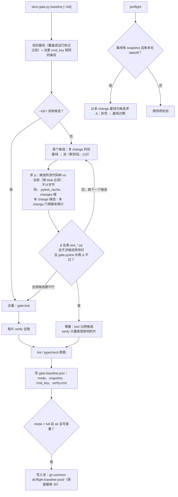

## Context

- **现状**（main `f7df55f`）：
  - `cmd_baseline`（`template/.claude/hooks/slice-gate.py:1156`）每次都跑：全量 `gate.test` → lint / typecheck → 每片 verify。开跑时先把 `gate-baseline.json` 覆盖成运行标记。
  - `plan_sha`（`:231`）只认 gate 三条命令与每片 verify 命令的**字符串**。
  - `cmd_preflight`（`:1236`）四项校验：计划合法、基线 ok、plan_sha 一致、基线 commit 是 HEAD 的祖先。
  - final 按基线 `test.failed` 逐条差分（DRAFT-test-gate-baseline-diff）。
- **调用方**：
  - propose 第 5 步后台跑 baseline；
  - 插件「批准修订并续飞」经 `resume.ts` 调 baseline；
  - 插件起飞（含续飞）先提交工件，再 lint、preflight（`orchestrator.tsx:745`）。
- **实测**（afa `b737-post-hooks-merge-split-params`，2026-10-14）：
  - 一遍基线约 10 分钟，其中全量 447 秒、其余约 154 秒；
  - 改计划后模型自行决定重跑，而当时 preflight 是通过的；
  - afa 历次基线的 commit 两两之间，executor/ 内都有 6–56 个非测试改动；c98cf33 → 5455ace（`git pull`）在 executor/ 与 packages/ 内改动为 0。
- **用户决策（2026-10-14）**：
  - 档 2（分层指纹 + 增量）与档 3（跨 change 复用）都做；
  - 增量只认 `test_*.py`，仓内其余改动一律回全量；
  - 仓外（不归本仓 git 管的数据仓、解释器环境）不纳入；
  - 命令指纹 = 命令文本 + 命令里直接引用的文件内容。
- **约束**：
  - 铁律 3：测试由可信方运行，复用要有指纹为证；
  - 铁律 5：门禁红不收口；
  - 铁律 9：零 token 判定；
  - DRAFT-test-gate-baseline-diff：预存红差分口径不变。

## Goals / Non-Goals

**Goals:**
- 改计划后重跑 baseline：代码树没变、或只改了测试文件时，不跑全量。
- 同一仓库从同一个 main commit 切出的多个 change，全量只跑一次。
- 要不要重跑、重跑多少，由脚本判定：模型只负责调用，preflight 能看出内容变化。

**Non-Goals:**
- 仓外漂移（raw-dlib 软链目标、pixi 环境、系统包）：不检测，用 `--full` 兜底。
- 被 source 或 import 的门禁脚本（如 afa 的 `_env.sh`）：不计入 `cmd_key`。
- final 的全量：不复用，收口照旧跑全量并按基线差分。
- 插件 TS、插件版本：不改。

## Decisions

### D1 Δ 按 git blob 内容比较，不按 commit 相等
- **代码树**：候选所测的代码树 = 候选 commit 加上候选 `snapshot`（未提交改动的 blob id，删除为 null）；当前代码树 = HEAD 加上当前工作区。
- **候选路径**：`git diff --name-only <候选 commit> HEAD` ∪ 候选 snapshot 的键 ∪ 当前 snapshot 的键。
- **取值**：
  - 旧值 → 在候选 snapshot 里就取 snapshot 值，否则取候选 commit 里的 blob（`git ls-tree`）；
  - 新值 → 在当前 snapshot 里就取当前值，否则取 HEAD 里的 blob。
  - 两边不同即进 Δ。
- **前提**：候选 commit 必须是 HEAD 的祖先，否则候选作废。
- **为什么不用 commit 相等**：起飞会提交工件（内容不变而 commit 变），pull main 会带来范围外的提交。按内容比较，这两种情况都不会白跑全量。
- **否决**：
  - commit 相等 → 起飞提交工件、预合并之后全部失效；
  - mtime → 不可信，worktree 之间也不可比。

### D2 不计入 Δ 的路径
- **不计**：
  - 字节码（`__pycache__`、`.pyc`）与 `.pytest_cache`：测试副产物，不影响结果；
  - `<changes 根>/**`（change 目录的上一级）：放的是各 change 的计划与门禁脚本，不是被测代码。门禁脚本由 `cmd_key` 负责。
- **例外**：候选来自本 change 时，本 change 目录里计划工件以外的文件（门禁脚本，如 afa 的 `verify/*.sh`）照计。同一 change 内按严格口径，被 source 的脚本改了也能看出来。
- **计划工件**（任何时候都不计）：proposal.md、design.md、tasks.md、slices.json、spec.html、gate-baseline.json、.openspec.yaml、BOOKKEEPING、`specs/`、`slices/`。
- **其余全计**：包括 `openspec/adr/` 下的 DRAFT ADR。用户定的口径是「仓内非测试改动 → 全量」，本仓的 `tests/test_install.py` 也确实会读 ADR 目录。

### D3 增量条件：只认 `test_*.py` + 补跑 Δ
- **只认 `test_*.py`**：Δ 里的路径必须都是文件名匹配 `test_*.py` 的文件（用户决策）。conftest、helper、源码、配置、脚本，一律回全量。
- **Δ 文件旧的预存红**：候选 `test.failed` 里，classname 按点分段后含某个 Δ 文件名主干的条目 → 回全量。全量预存红用的是 junit 的 `classname::name`，与按路径的 nodeid 对不齐，按主干匹配是保守近似：同名文件只会多跑全量，不会漏。
- **补跑**：Δ 里现存的测试文件用 `_pytest_outcomes(root, files, gate)` 补跑一次，复用 G7 的运行方式（`gate.pytest` 前缀、超时、outcomes 插件）。以下三种都回全量：
  - 有 FAILED 或 ERROR；
  - 超时；
  - 退出码不是 0 或 5（5 = 没有收集到用例）。

  所以复用后的预存红集等于候选的：Δ 文件既不贡献新红，也没有旧红。
- **否决**：
  - 补跑后把结果合并进预存红集 → 需要把 nodeid 映射到 classname，脆弱；
  - 改测试文件也一律全量 → 本例就是改测试文件，等于没提速。

### D4 `cmd_key`：命令文本归一 + 直接引用的仓库内文件内容
- **计算**：`sha1(json([归一命令, [[词, 文件 blob id], …]]))`。
  - 归一 → 把本 change 目录相对路径（如 `openspec/changes/b737-…`）换成 `<change>`；
  - 引用文件 → 命令按 shell 规则切词，取指向仓库内已存在文件的词（相对仓库根，或在仓库内的绝对路径），按归一后的词记录其 blob id。
- **不追踪 source**（用户决策）：afa 各 change 的 `full_suite.sh` 可以内容相同（b737 与 dlib-post-hooks 同为 `7e8f988222`），`_env.sh` 却因 OWNED_PY 清单各不相同。计入 `_env.sh` 的话，跨 change 永远不会命中。
- **同一 change 内**：被 source 的脚本由 D2 的例外兜住。
- **切词失败**：shlex 抛错时 `cmd_key` 为 null，视为没有候选，跑全量。

### D5 基线池放 git common dir
- **位置**：`$(git rev-parse --git-common-dir)/flight-baseline-pool/`，同一仓库的全部 worktree 共享，不进提交，也不进 refs（账本 refs 只记飞行事件）。
- **写入**：只在 `mode = full`、ok、结果可度量（exit 0，或有 `test.failed`）时写。每条一个 JSON 文件，含 `change`、`commit`、`at`、`cmd_key`、`snapshot`、`test`。先写临时文件再 rename，保证原子。写完按 at 保留最新 30 条，删掉更旧的。
- **读取**：取 `cmd_key` 相同的条目，按 at 由新到旧，最多看 10 条（控制 git 调用次数）。本 change 自己的旧基线排在池前面。
- **为什么只收全量结果**：来源清楚。增量结果的正确性是从候选推出来的，再入池会形成推导链，审计时要一层层回溯。
- **否决**：
  - 存进 refs → refs 是账本的可信面，不放缓存；
  - 存进 change 目录 → 不跨 worktree。

### D6 运行期间的改动：开始、结束各取一次 snapshot
- **记录**：`snapshot` 记的是结束时的那一份，这样测试副产物不会让 preflight 永远判过期。
- **对比**：开始与结束不同的路径：
  - 开始时就存在（已跟踪，或在开始的 snapshot 里），或是测试文件 → 判红，原因写「基线运行期间 <路径> 被修改，重跑 baseline」。这堵住了后台基线运行时人改测试、却被当成已测的漏洞；
  - 运行中新出现的非测试文件 → 只警告（副产物）。
- **否决**：
  - 只记开始时的 → 有副产物的仓库会永远判过期；
  - 只记结束时的、不比对 → 运行中的人工改动会被当成已测。

### D7 verify 按需重跑
- **增量时重跑以下几类片**：
  - 上一次没有记录，或 `cmd` 变了；
  - 命令里的路径覆盖到 Δ 文件；
  - 命令里认不出任何路径。
- **其余沿用**本 change 上一次的 `exit`，并标 `reused: true`。
- **跨 change 复用**时，本 change 没有上一次的 verify 记录，全部重跑。
- **全量时**照旧全跑。
- **路径怎么认**：切词，去掉 `::` 之后的部分；它指向仓库内已存在的路径、或等于某个 Δ 路径时，算路径。
- 门禁脚本改动已由 D2、D4 推到全量，所以这里只需关心测试文件。

### D8 preflight 只在首次起飞前按内容判
- **按内容判**：基线有 `snapshot`、本 change 的账本里没有 takeoff 时，以本 change 的基线为候选求 Δ（D1、D2），非空 → `die("基线过期：自基线以来有改动：<≤8 个路径>；重跑 baseline（只改了测试文件时走增量）")`。
- **不判的情况**：
  - 账本有 takeoff → 续飞时切片代码本来就改了工作区，按内容判会误拦；「批准修订并续飞」本来就先跑 baseline；
  - 账本读不出 → 按没有 takeoff 处理（更严）；
  - 旧格式基线（没有 snapshot）→ 保持原四项校验，兼容。
- **起飞路径**：插件先提交工件、再跑 preflight。提交前后内容不变，所以 Δ 为空，照常放行。

### D9 记录与文档
- **耗时字段**：增量不改已有的 `gate.full_suite_sec`（看门狗、进度估算、G7 超时都用它）；本 change 还没有时，写候选的 `test.sec`。
- **stdout**：JSON 加 `mode`；增量时加 `incremental`。
- **timeline baseline 行**：增量时写成 `增量（复用 <change> 的全量 exit e, s 秒；补跑 n 个测试文件 t 秒） ok`。
- **propose 命令与 skill 第 5 步**：
  - 改完计划后重跑 baseline，全量还是增量由脚本判定；
  - `--full` 强制全量；
  - 跨 change 复用；
  - 一行报告：「基线绿（增量：复用 <change> 的全量，补跑 n 个测试文件 t 秒；预存红 k 条）」。

## Risks / Trade-offs

- **[测试读取非测试路径]** 测试若读取 `<changes 根>` 下的文件，D2 把它排除了，就可能漏判。→ 范围有限：本仓 `test_install` 归档时也略去了 changes。final 收口照跑全量，最坏是收口时多出一条红，不会把红判成绿。
- **[按主干匹配预存红]** 同名测试文件分在不同目录 → 只会多跑全量（保守）。
- **[跨文件副作用]** 新测试文件靠模块级副作用影响别的文件（全局状态、xdist 分组）→ 只有它补跑没红、且其他文件结果确实受影响时才会漏。final 全量照跑兜底。
- **[被 source 的脚本]** 跨 change 时看不出 `_env.sh` 的差异（用户已接受）。→ 改了 `_env.sh` 里的解释器、PYTHONPATH 逻辑时，用 `--full`。
- **[仓外漂移]** raw-dlib 数据仓、环境变了看不出来。→ `--full`；文档写明。
- **[池并发]** 多个 worktree 同时写池 → 每条一个文件、rename 保证原子；修剪时文件可能已被别人删掉，忽略 ENOENT。
- **[命中率]** afa 历史上跨 change 很少命中（commit 之间都有源码改动）。档 3 的收益在「同一 main commit 上连续开 change」「pull 只带进测试文件」这两种情况；档 2 的收益不受影响。

## Migration Plan

- **兼容**：旧格式 `gate-baseline.json` 没有 `snapshot` / `cmd_key`，不作候选，下一次 baseline 跑全量并写成新格式；preflight 对它保持原四项校验。verify 记录新增 `cmd`（复用时还有 `reused`），旧测试里对 verify 的完全相等断言（`tests/test_slice_gate.py::test_baseline_writes_gate_baseline`）放宽为只比 `exit`，由 S1 负责。
- **升级**：判定器随 `install.sh --upgrade` 下发，插件不需要更新。池目录按需创建，删掉它只会让下一次跑全量。
- **回退**：`--full` 恒等于旧行为；回滚代码不影响已有 change（新字段会被旧代码忽略）。

## Open Questions

- 无。DRAFT-test-gate-baseline-diff 继续有效。本变更是它的延伸（复用记录下来的预存红集），不推翻它，所以另起一个 ADR，不 supersede。
