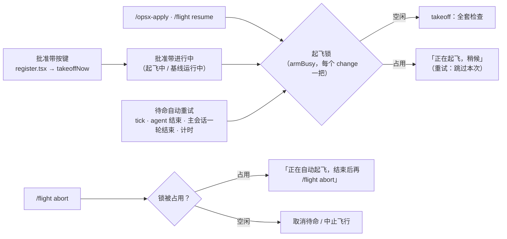
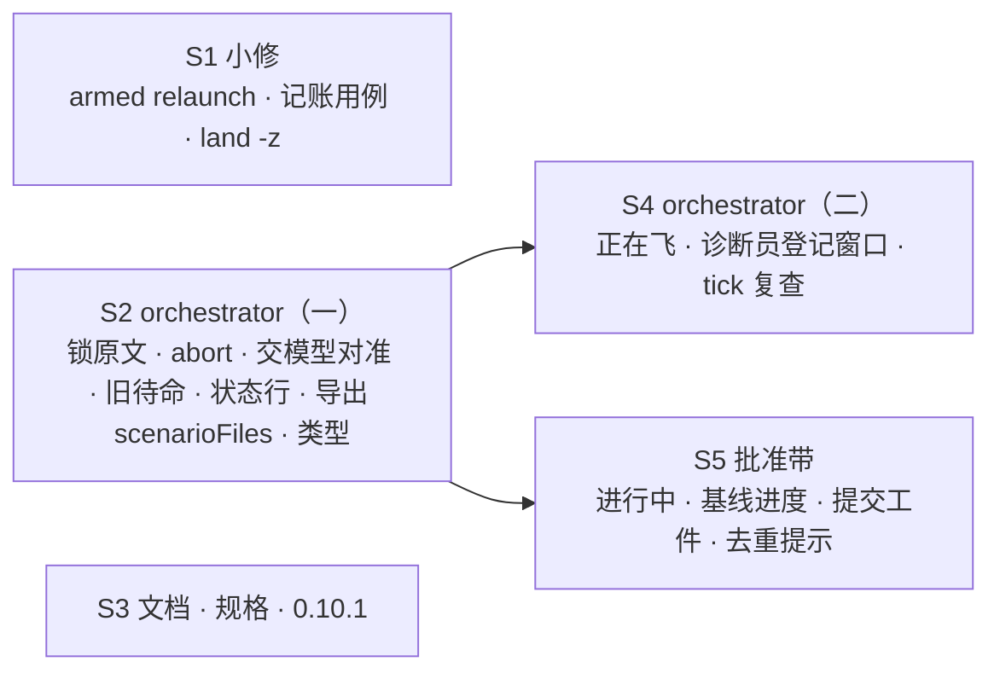

## Context

- **起因**：#54 合入时的 ship 评论有 25 条未修的 MEDIUM / LOW，另有用户在会话里遇到的「基线进度不可见」。决策页 `docs/flight-armed-followups.html`，Q1–Q6 全按推荐（2026-10-13）。
- **现状**（main `a495374`，`orchestrator.tsx`）：
  - `takeoffArmed`（约第 808 行）与自动重试 `advanceArm`（约第 881 行）已经共用 `armBusy` 互斥（#54 S4 评审 HIGH 的修复）。连按两次批准带不会重复起飞，但第二次的拒绝原文是「正在自动重试起飞」，容易误读。
  - `runStep` 重试回来后，只要待命的 `since` 变了就直接 return（约第 869 行），起飞成功的结果也一起被丢掉。
  - `/flight abort` 取消待命（约第 1097 行）不看 `armBusy`。
  - `runStep` 的 submit 分支先置 `awaitingModel`，再在 `clock.after(0)` 里提交。
  - 「正在飞」拒飞（约第 665 行）只看 `active.has(name)`。
  - 批准带的续飞按钮（`register.tsx` 的 `startResume`）先跑 2–3 分钟基线再调 `takeoffNow`。**这段时间批准带不加锁**，再按一次会并发启动第二个基线进程。
- **实测**（CLI 2.1.296，临时 mod，不进仓库）：
  1. 插件提交的那一轮，开始时刻（`turn.complete` 时的 `clock.now` 减 `durationMs`）比 `prompt.submit` 完成的时刻**早** 7–20 ms。所以「开始晚于提交完成」这条判据会挡掉正确的轮次；要在**调用 submit 之前**记下 T0。
  2. `Button` 没有禁用属性。「不可按」的做法是不渲染按钮，只显示文字。
- **约束**：铁律 7、10 不变；插件里 `$` 不出文件；测试与插件是隔离实例。

## Goals / Non-Goals

**Goals**
- 三个起飞入口之间不再有「回复与事实不符」或「白耗预算」的窗口；卡住的飞行可以直接续飞。
- 批准带从按下到起飞返回，全程可见、不可重复按。
- 文档与规格跟上 0.10.0 的行为。

**Non-Goals**
- 不改「被拒即待命」的分类与预算（#54 已定）。
- 批准带每次刷新读三遍账本的性能问题，留 backlog。
- 起飞（`takeoff`）与批准带工件计数里不带 `-z` 的 porcelain 解析，留 backlog；本 change 只修 `land.ts` 的已暂存删除识别。

## 架构（轻量 C4 · Mermaid）

- **两层互斥**：
  - 批准带层（`register.tsx`）只管自己按下的那一项，覆盖续飞的基线阶段，并据此显示进度；
  - 起飞层（`orchestrator.tsx` 的锁）管三个入口。
- **假设**：锁都在进程内，进程重启即释放；账本仍是唯一事实来源。

## Decisions

### D1 · 锁沿用 armBusy，改拒绝原文与 abort（Q2）
- `armBusy` 已经覆盖人工起飞与自动重试，不另起一把锁；只把拒绝原文改为「flight：<change> 正在起飞，稍候」。
- abort 遇锁时回复「flight：<change> 正在自动起飞，结束后再 /flight abort」，不删待命。
- 重试回来时，即使待命已不是这一次（`since` 变了），只要起飞成功，照样通知「已起飞」。
- **否决**：取消标记、起飞后自动中止（Q2 B）。账本会多一个立即停飞的 attempt，之后续飞还要处理它。

### D2 · 交模型对准（实测 1）
- 在 `clock.after(0)` 的回调里先取 T0 = `clock.now()`，再调 `prompt.submit`：
  - 成功后把 `awaitingModel` 置真，并记 `submittedAt = T0`；
  - 失败则放弃待命并通知。
- 主会话 `turn.complete` 时，开始时刻 = `clock.now() - durationMs`，只有不早于 `submittedAt` 才以 `main-turn` 推进。
- `submittedAt` 存在待命里（`FlightArmedItem` 新增字段）。缺失（旧状态）时按旧行为推进。
- **否决**：只看 submit 完成后的下一轮。实测提交完成晚于这一轮的开始，会漏掉正确的轮次；而 submit 前就在跑的无关轮次，又会在提交完成后结束，被误认。

### D3 · 旧待命与状态行
- 人再次起飞被拒为 human / human-key 时，先清同一 change 的旧待命。spec 原本就要求新的覆盖旧的。
- 清空状态行之前先看：还有别的待命，就显示其中一个的 `armedLine`；有在飞的 change，就交给它的 `refreshFromLedger`；都没有才清空。

### D4 · 「正在飞」判据（Q4）
- 拒飞条件为：本会话的 attempt、未落地未停飞、`active.has(name)`，并且以下两条至少满足一条：
  - drive 正在跑这个 change（`drive()` 维护进程内 `driving` 集合）；
  - 本 attempt 有活 agent（`liveAgents` 非空）。
- 两条都不满足就视为卡住，不拒，照常续飞。
- 拒绝原文补上下一步：「需要中止用 /flight abort <name>；中止后可用 /flight resume <name> 续飞」。
- **否决**：判据不变、只改原文（Q4 B）。卡住时人要多走一步 abort。

### D5 · 看门狗两处
- **诊断员登记窗口**：`inFlight` 对登记中（`pending`）的 owner，在 `diagnosing.has(change)` 时也计时。停飞后只派诊断员，登记中的必是它。
- **tick 复查**：`watchTick` 在 `await ownership` 之后，再确认 `steps` 里该 agent 的请求起点没变且仍超时，才处理。

### D6 · 批准带进行中与基线进度（Q3、Q5）
- `register.tsx` 维护进程内的进行中表：change → `{ phase: 'takeoff' | 'baseline', since }`。从按下到起飞返回（续飞时包括基线阶段）都有记录。
- `FlightItem` 新增 `busy?: string`；渲染时有 `busy` 就只显示文字，不渲染 Button（实测 2）。
- 基线阶段每 60 秒用 `$.clock.after` 自己续表，状态行显示「flight · 续飞准备中 <change> · 基线已跑 N 分钟（上次全量约 M 分钟）」。M 取 `slices.json` 的 `gate.full_suite_sec`。基线结束就停表。
- 去重分支的 toast 改为「flight：<change> 已批准（指纹相同），直接起飞」。

### D7 · 小修
- `land.ts` 识别已暂存删除时，改用 `git status --porcelain -z`：按 NUL 切条目，改名条目多一个路径要跳过。
- `armed.ts` 的 `relaunch`：resume 分支也带上 args 里 change 之外的参数（例如 `--takeover`）。
- `scenarioFiles` 由 `orchestrator.tsx` 导出（纯函数，收 `Io`），`register.tsx` 改为 import，删掉自己那份。

### D8 · 切片编排

- 5 片、2 层：
  - W1 = S1 ∥ S2 ∥ S3；
  - W2 = S4（依赖 S2，同改 orchestrator）∥ S5（依赖 S2 的类型与 `scenarioFiles`）。
- 吸取 #54 的两条教训：
  - S3 升版本号，`tests/test_armed_docs.py`（写死 `0.10.0`）收进它的 owns；
  - 护栏用例只写 pytest 包装，不碰 TS 文件，「授权提交」能认出它们是工件。

## Risks / Trade-offs

- **[批准带进行中表只在进程内]** → 进程重启后表就空了；但重启也会打断后台基线，与现状一致。账本与 `gate-baseline.json` 的运行标记仍是事实来源。
- **[`durationMs` 是墙钟时长]** → 主会话轮次被人中断（aborted）也会有 `turn.complete`，按同一规则判断；被中断的那一轮若是提交的那轮，会触发一次重试。这是可以接受的。
- **[「正在飞」放宽]** → drive 两轮之间可能出现短暂的「无活 agent、drive 不在跑」。此时人发续飞会被放行，再次起飞走 `takeoff` 的全套检查（指纹、跨会话等），最坏是续飞同一 attempt，不会重复派发已合回的切片。

## Migration Plan

- 合入后：主检出快进；`claude plugin update flight@intent-driven`；`/reload-plugins` 升到 0.10.1。

## Open Questions

- 无。
