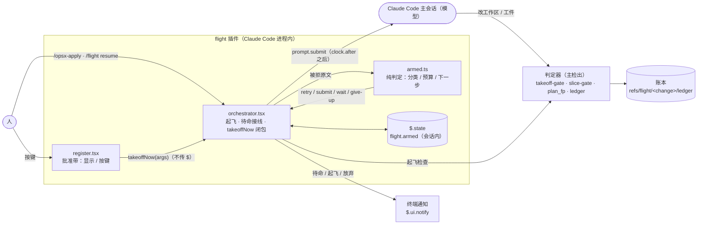
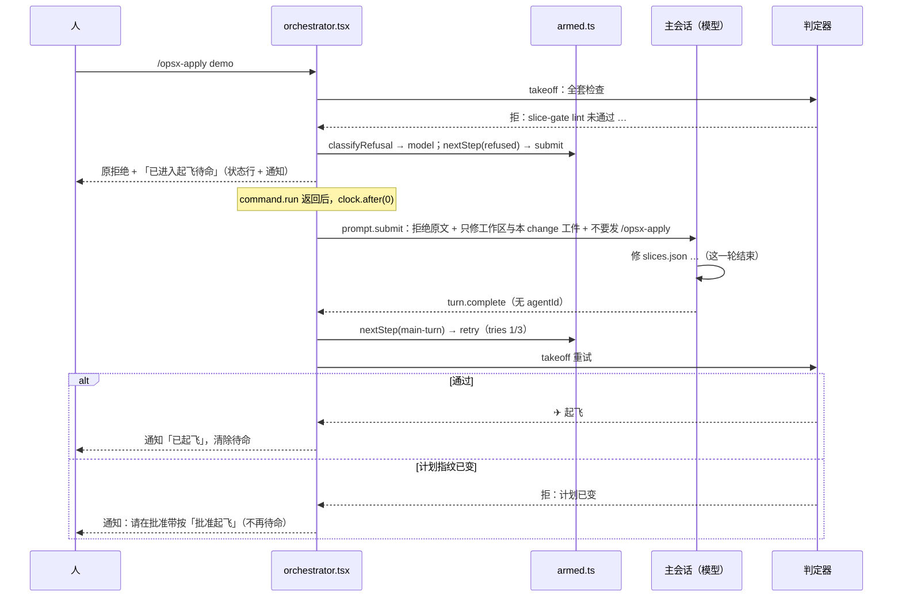
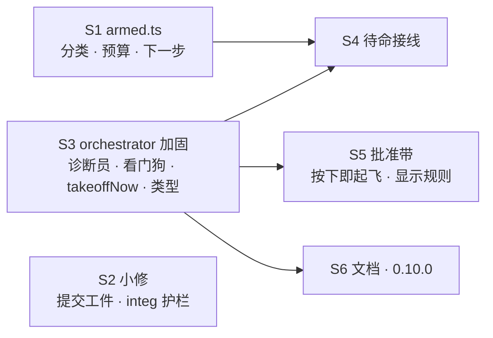

## Context

- **起因**：
  - 起飞被拒后，人必须再发一句；
  - #53 把续飞降级成预填；
  - 0.9.0 批准带给已落地的旧 change 挂「续飞」：`io.ts:48` 的 `stoppedNow` 在同一 attempt 里让 halt 优先于 land，而 `flight-envelope-followups`、`flight-hardening` 落地后又被补记过 halt。
- **决策**：`docs/flight-armed-takeoff.html` 的 Q1–Q8，用户 2026-10-13 全按推荐。
- **现状**：
  - `orchestrator.tsx` 的 `takeoff()`（main 第 598 行起）有 20 个拒绝出口，全部返回文本；`/opsx-apply` 的 `command.run` 原样回复；
  - 批准带（`register.tsx`）按「批准起飞」后预填 `/opsx-apply`，按续飞按钮则经 `resumeFlight` 预填 `/opsx-apply <c> 授权提交`。
- **实测**（CLI 2.1.296；临时 mod `scratchpad/mods/armed-spike`，不进仓库）：
  1. A 文件的 `session.start` hook 里造闭包（捕获本文件的 `$`）存进模块变量，B 文件的 hook 调用它：`claude plugin validate` 通过，测试世界与真实无头运行都可用。
  2. 在 `command.run` hook 里调用 `$.prompt.submit` 会被引擎拒绝，不 await 也一样。原文：「called from a command.run hook, it would wait on the turn this hook is holding; submit from a later event (turn.complete) (host check)」。
  3. 在 `command.run` 里用 `$.clock.after(0, …)` 延后再提交：本地命令返回后起了一轮模型对话（origin 为 plugin），插件看到了这一轮主会话的 `turn.complete`（agentId 为空）。
  4. 本地命令本身不产生 `turn.complete`。
  5. 同一插件在 `turn.complete` 上可以有三个 hook：一个不带 matcher、一个 `{ agentId: /./ }`、一个 `{ turnId: /./ }`。第三个能看到主会话的轮次。
  6. 测试世界：用 `on('prompt.submit')` 应答 `{ text }` 就能看到提交的正文；`mock.clock` 的 `advance` 会触发 `clock.after`。
  7. 测试与插件是隔离实例：测试 import 插件模块拿到的是另一份模块状态。所以闭包的效果只能经插件 hook（例如按键）观察。
  8. 真实 git：删除已用 `git rm` 暂存时，`git add -- <该路径>` 报「pathspec did not match」；跳过它、只 add 其余路径，再 `git commit -- <全部路径>`，删除被正确提交，工作区干净。
- **约束**：
  - 铁律 7：approve 只由按键写；
  - 铁律 10：起飞后的控制面异常照旧停飞；
  - 插件里 `$` 不出文件；
  - 每插件一个 hooks 模块（`register.tsx`）。

## Goals / Non-Goals

**Goals**
- 人表达一次起飞意图（命令或按键）后，凡不需要人判断的拒绝，都由插件等待、重试或交给模型，不必人再发一句。
- 批准带三个按钮按下即起飞；已批准未起飞的 change 有「起飞」按钮。
- 关掉 #53 留下的文档、规格与可靠性缺口（Q1 A 的范围）。

**Non-Goals**
- 不让模型能起飞：模型仍没有起飞入口，计划改了照旧要人按键。
- 不改判定器、不加账本事件类型：待命状态只在会话里。
- 不查 `python3 aborted` 的根因：本 change 只把它当偶发重试一次并留 diag（Q8）。
- 不处理 #53 其余 LOW（G9 误报、摘要口径、integ 缺 base 时 fail-closed 等）。

## 架构（C4 容器图 · Mermaid · 轻量 C4，与 flight-unattended 同口径）

- **边界**：
  - 待命全在插件内（`orchestrator.tsx` + `armed.ts` + 会话状态）；
  - 判定器与账本不改，只多一种 `diag.where = 'takeoff'` 的取值（`diag` 是既有事件，`where` 是自由文本）。
- **职责**：
  - `armed.ts` 只做纯判定，不碰 `$`；
  - `orchestrator.tsx` 负责执行（重试、提交、计时、通知、状态行）；
  - `register.tsx` 只管按键与显示，起飞经 `takeoffNow`。
- **模型**：只会收到插件提交的一轮「修工作区」，没有起飞入口；它改了计划，指纹就会变，下一次重试被起飞守卫拦下，变成「人按一次键」。
- **假设**：
  - 待命只对发出它的会话有效；会话结束即消失；
  - 跨会话起飞本来就会被拒。

## Decisions

### D1 · 拒绝按回复文本分类，不改 `takeoff` 的出口
- `armed.ts` 的 `classifyRefusal(text)` 按固定字样分类（见 spec `flight-armed-takeoff` 的表），认不出的一律归「只能人」。
- **理由**：20 个出口逐个改成结构化结果，要大改 `orchestrator.tsx`，#53 的 S5 正是因为改动面太大，连撞两次 40 轮上限。文本分类是 fail-safe 的：字样漂移只会让自动重试退化成「通知人」，不会误起飞。漂移由 S4 的集成用例兜底（它用真实拒绝文本走完整条路径）。
- **否决**：结构化 `{ok, kind, text}`。更稳，但改动大，等以后有需要再做。

### D2 · 待命状态放会话 `$.state`（Q4）
- `flight.armed.items[change]`，字段见 `slices/_interfaces.md`。插件热重载后仍在，会话结束即无。
- **否决**：账本新事件 `arm`。可审计，但要改 `ledger.py` 事件表、`features` 与版本核对，而待命本来就绑在本会话。

### D3 · 推进事件（Q7）
- **60 秒兜底 tick**：复用看门狗计时器。等待类在这里重试。
- **agent 结束**：已有的 `turn.complete { agentId: /./ }`，`wait-agents` 在这里重试。
- **主会话一轮结束**：新增 `turn.complete { turnId: /./ }` hook，只处理 agentId 为空的轮次（实测 5）。`model` 类在这里重试。
- **计时到**：`clock.after(ms)`，`transient` 类 10 秒后重试。
- **否决**：只靠轮询，平均多等 30 秒，而且主会话一轮结束这种确定事件没理由不用。

### D4 · 交模型：延后提交，正文写边界（Q5）
- `command.run` 返回后，经 `$.clock.after(0, …)` 调用 `$.prompt.submit`（实测 2、3）。
- 正文含：拒绝原文；「只修工作区与本 change 工件」；「改了计划需要人在批准带重新批准」；「不要发 /opsx-apply，插件会在这一轮结束后自动重试」。
- **铁律 7**：模型改计划 → 指纹变 → 重试被起飞守卫拒为「计划已变」→ 人按键类，通知人，不再待命。
- **否决**：只通知人。人不在时停在原地，违背本 change 的目标。

### D5 · 预算与过期（Q6）
- transient、model 两类的自动重试计入预算，最多 3 次；
- 等待类的重试不计入预算，只受 30 分钟有效期约束；
- transient 连续两次即放弃（只重试一次，Q8）。
- 人手动再发起飞，旧待命作废，预算重新计算。

### D6 · 起飞闭包 `takeoffNow`（实测 1）
- `orchestrator.tsx` 在自己带 matcher 的 `session.start` hook 里设 `entry = (args, opts) => takeoff($, args, opts)`；
- 导出 `takeoffNow(args, opts)`：`entry` 未设时回复「插件尚未就绪」。
- S4 把 `entry` 换成「起飞 + 被拒即待命」的包装，`register.tsx` 不用任何改动就能拿到待命行为。
- **否决**：
  - `register.tsx` 传 `$` 给 `takeoff`：validate 拒绝；
  - 插件自发 `$.command.run('/flight resume')`：origin 为 plugin，会被 `/flight` 的 `HOST_ORIGINS` 拒；放开它等于给任意插件开起飞入口。

### D7 · 批准带：按下即起飞（Q2、Q3）

| 账本与指纹 | 显示 | 按下 |
|---|---|---|
| 最新 attempt 以 halt 结束（同 attempt 无 land，halt kind 不是 abort），当前指纹 ≠ 最近批准 | 「批准修订并续飞」 | 核对指纹 → 写 approve → 后台 `resumeFlight(replan)`，起飞依赖为 `takeoffNow(args, { resume: true })` |
| 同上，指纹 = 最近批准 | 「续飞」 | 后台 `resumeFlight(resume)` |
| 最近一次 approve 晚于最近一次 takeoff，且指纹 = 该 approve | 「起飞」（新） | 后台 `takeoffNow([change, 授权提交])`，不写 approve |
| 其余，指纹未批准 | 「批准起飞」 | 写 approve → 后台 `takeoffNow([change, 授权提交])` |
| 其余，指纹已批准 | 不显示 | — |

- 「批准起飞」「起飞」的说明行：有未提交工件时写「按下会提交本 change 的 N 个工件并直接起飞」，否则写「按下直接起飞」。N 按 `land.ts` 的 `classifyDirty` 口径计。
- 起飞结果首行经 toast 与通知告诉人；输入框一律不预填。
- **手打命令仍要「授权提交」**（Q3 A）。没带而被拒为「工件未提交」时，属于人按键类：批准带上会出现「起飞」按钮。
- **否决**：首次起飞保持预填（Q2 B）。多一道回车，与续飞按钮的行为不一致。

### D8 · 停飞判定与 abort
- `stoppedNow` 在同一 attempt 里 land 优先于 halt（0.2.x 落地后补记 halt 的旧账本因此算已落地）。
- 批准带对 halt kind 为 abort 的停飞不显示「续飞」。人主动中止的飞行不该常驻提示。
- 其它调用方只判 `!== undefined`，不受影响。

### D9 · #53 遗留的处理方式
- **诊断员包络**：与评审员同规则，Read / Grep / Glob 与只读 git 升 allow；另外把 `triagePrompt` 里那两条查看命令（`python3 <hooksDir>/ledger.py show …`、`python3 <hooksDir>/timeline.py report …`）列入可升级命令。写入照旧不升。
- **诊断员计时**：`inFlight` 也认在诊断中（`diagnosing`）的 change，看门狗超时直接 TaskStop，不记 heal。
- **看门狗停飞补停**：停飞后像 `abortCommand` 一样，先停在跑的 agent，再等手上这轮 drive 做完，补停中途派出的。
- **计时器去重**：每次起表给一个代号，只有最新代号的 tick 才处理；同一 agent 在一次 tick 内先认领再处理。
- **提交工件**：按实测 8，跳过「暂存区已删、工作区也没有」的路径，不交给 `git add`，但保留在 `git commit --` 的路径里。
- **规格与用例**：
  - `freshWorktree` 的五个候选名在本 change 以 ADDED 重述，映射到 #53 修复轮改好的现有用例，作为护栏；
  - integ 提示词按 spec 原样的多行 Given，规划时补写子用例，作为护栏。

### D10 · 切片编排（吸取 #53 的教训）
- **6 片 2 层**：
  - W1：S1 `armed.ts` 纯模块、S2 小修（提交工件、integ 护栏）、S3 orchestrator 加固 + `takeoffNow` + 类型；
  - W2：S4 待命接线（orchestrator）、S5 批准带、S6 文档。
- **`orchestrator.tsx` 拆成两片串行**（S3 → S4），判定逻辑下沉到 `armed.ts`，避免一片撞 40 轮上限。
- **S4 ∥ S5**：
  - S5 调 `takeoffNow`，只断言调用了起飞与不预填，不依赖待命；
  - S4 不改 `register.tsx`；
  - 两片合回后，按键被拒也会自动进入待命，由 final 门禁全量验证。
- **S6 依赖 S3**：S6 只写文档，行为按 spec 写，与 S4、S5 并行。
- 每个切片包都写明测试世界事实、包络禁忌和「`$` 不出文件」。

## Risks / Trade-offs

- **[拒绝文本改了，分类失效]** → 认不出的一律归「只能人」：只是退化成通知，不会误重试。S4 的集成用例用真实拒绝文本走通 wait-baseline、transient、model 三条路，字样漂移会让它们变红。
- **[交模型烧 token]** → 只在模型能修的三种拒绝上提交，计入 3 次预算；人随时可以 `/flight abort <change>` 取消。
- **[模型借「修工作区」改计划]** → 指纹一变，起飞守卫就拒，必须人按键（铁律 7 不变）。正文也明示「改了计划需要人重新批准」。
- **[误按即起飞]** → 按键前照旧核对指纹与绘制时一致；起飞后可以 `/flight abort`。说明行写明会提交几个工件。
- **[待命只在会话内]** → 会话结束待命就没了，人回来重新发一次即可。这与跨会话拒飞的现有规则一致。
- **[S4 与 S5 并行]** → 两片之间只经 `takeoffNow` 的签名耦合（S3 已定）。合回后的交互由 final 全量验证；0.9.0 的整合修复体可以处理跨片失配。

## Migration Plan

- 合入后：主检出快进；`claude plugin update flight@intent-driven`；`/reload-plugins` 升到 0.10.0。
- 回滚：退回 0.9.0 即恢复「被拒即停、按键预填」，账本格式没有变化。

## Open Questions

- `python3 aborted` 的根因：本 change 只把它按偶发重试，留 diag 证据。以后用 `claude --debug` 复现。
- 待命是否要写进飞行记录（铁律 8）：起飞前的事不属于 apply 收口的度量，暂不记。
