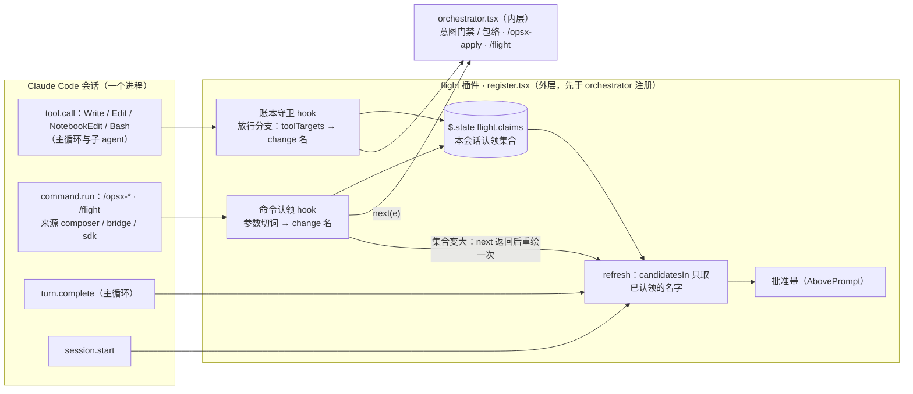
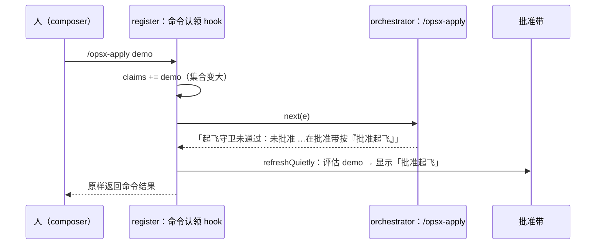

## Context

- **现状**：`register.tsx` 的 `refresh`（约第 229 行）对 `git worktree list` 列出的每个 worktree 调 `candidatesIn`（约第 96 行），收集全部「有 `spec.html`、`tasks.md` 仍有 `- [ ]`」的 change；`dedupe` 后逐个 `evaluate`：跑 `plan_fp.py`、`ledger.py approved`，再读账本判停飞。批准带显示可批准项里 `spec.html` 最新的一项。整个过程与会话无关。
- **会话状态**：`band` 已是 `$.state` 值（`{ plugin: 'flight', key: 'band' }`）。`$.state` 是宿主为本会话持有的值，热重载后保留；跨会话持久要另写 `$.store`（引擎类型文档 `state` 一节）。
- **hook 嵌套顺序**：同一插件的注册「按顺序嵌套、先注册的在外层」（引擎类型文档 `on` 的说明）。`register` 先注册自己的 hook，最后一行才 `registerOrchestrator(on)`，所以 `register.tsx` 里的 hook 都在编排器外层。编排器对 `/opsx-apply`、`/flight` 自己作答、不调 `next`，内层的 hook 看不到这两条命令。
- **写入口径**：`intent.ts` 的 `toolTargets(tool, e, cwd)` 已给出意图门禁用的写入目标（Write / Edit 取 `file_path`、NotebookEdit 取 `notebook_path`、Bash 经 `bashWriteTargets` 解析重定向、tee、`sed -i`、cp / mv、touch / rm / mkdir 等）。它是纯函数，可以直接 import。
- **来源**：编排器的 `HOST_ORIGINS = ['composer', 'bridge', 'sdk']` 与 `originOf(e)` 判断命令是否由人或宿主程序发出（约第 55、70 行），目前未导出。
- **决策页**：`docs/flight-band-session-scope.html`：Q1 写入 + 命令；Q2 多会话都显示；Q3 不相关的完全不显示；Q4 认领不跨进程（C）；Q5 0.11.0 BREAKING。

## Goals / Non-Goals

**Goals:**
- 批准带只评估、只显示本会话认领的 change。
- 认领判据全部来自插件看得到的工具调用与命令，零 token、不经模型自述。
- 提案会话不用额外操作就能看到自己的计划；别的会话写的 change，发一次 `/opsx-apply <name>` 就能认领。

**Non-Goals:**
- 认领跨进程保留（Q4 选 C）。
- 多会话之间的归属互斥（Q2 选 A）。
- 改按键、账本、判定器、起飞待命、跨会话起飞守卫。
- 面板（Pane `flight`）与状态行：它们本来就只反映本进程的飞行。

## Decisions

### D1 · 认领集合放在会话状态（Q4 C）
- 新 `$.state` 值 `{ plugin: 'flight', key: 'claims' }`，类型 `string[]`，初值 `[]`；写入一律经 `update($, claims, fn)`，只在集合真的变大时写。
- `session.start` 只重置 `band`，不动 `claims`：热重载后认领还在；新进程里宿主给的初值为空。
- **否决的方案**：
  - 模块变量：热重载即丢，开发插件时批准带会突然变空。
  - 写 `<git-common-dir>/flight/sessions/<id>.json`（Q4 A）或 `$.store`（Q4 B）：用户选了不跨进程。

### D2 · 写入即认领：放在现有账本守卫 hook 里
- 守卫 hook（`on('tool.call', { tool: GUARDED_TOOLS }, …)`，约第 595 行）在「不碰账本」的放行分支里，先 `await` 记录认领，再 `next(e)`：
  - 写入目标 = `toolTargets(tool, e, await $.session.cwd())`；
  - 每个目标按 `/openspec/changes/([^/]+)(\/|$)/` 取名，跳过 `archive`。
- 守卫 hook 已在编排器外层，编排器的意图门禁或包络拒绝这次调用，也不影响认领；`.catch` 照旧：认领出错时 `next.called` 为假，不碰账本就 `next(e)`。
- 不立即重绘：写入发生在一轮之内，主会话一轮结束时 `turn.complete` 照常刷新。子 agent 的写入同样要等主会话那一轮结束才刷新。
- **否决的方案**：对命令文本做正则，看到 `openspec/changes/<name>` 就认领。这会把只读的 `cat`、`grep` 也算进去，排查类会话会把一堆旧 change 拉上来。

### D3 · 命令即认领：新 hook，注册在编排器之前
- `on('command.run', { command: /^(opsx-.+|flight)$/ }, …)`，写在 `register` 里、`registerOrchestrator(on)` 之前。
- `originOf(e)` 不在 `HOST_ORIGINS` 里 → 直接 `next(e)`，不认领。这两个名字从 `orchestrator.tsx` 导出，不另立同值常量，免得漂移。
- 参数按空白切词，不以 `-` 开头的词都记入集合。`status`、`授权提交` 这类词也会被记下，但只有与真实 change 同名才会显示，代价可以接受。
- 集合变大且批准带启用时，`await next(e)` 返回后 `await refreshQuietly($)`：本地命令不一定引出主会话的一轮，不能只靠 `turn.complete`。
- **时序**：`/opsx-apply demo` 被拒（未批准）后，回复叫人「在批准带按『批准起飞』」，这时批准带已经刷新出 `demo`。

### D4 · refresh 只评估已认领的名字
- `refresh` 开头读 `claims`，交给 `candidatesIn`；`candidatesIn` 在 `fs.list` 之后，对不在集合里的目录名直接跳过，不读它的 `tasks.md`、不 `stat` `spec.html`。
- `dedupe`、`evaluate`、进行中项的叠加都不变。进行中项本来就来自本进程的按键，一定已认领。
- 按键路径不变：只在 `band.items` 里找，指向未认领 change 的旧按钮照旧得到「已不在可批准列表」。
- 顺带的好处：不相关的 change 不再每轮跑 `plan_fp.py` 与 `ledger.py`。

### D5 · 测试世界与现有用例
- 现有批准带用例都假设「会话启动即显示」。在 Given 里，于 `$.session.start(START)` 之前，用 Write 工具调用认领该用例出现的 change 名：这时批准带尚未启用，认领不触发重绘，启动时的那次刷新与改前完全一样，`plan_fp` 的调用序号不变。断言不改。
- 测试世界要补两处：Write / Bash 的底层应答；`git -C <tree> rev-parse --path-format=absolute --git-common-dir`（意图门禁找判定器）以失败作答且不记入 `log.git`，免得 `writes(log)` 多出一项。
- `orchestrator.test.tsx` 也加载整个插件：人发 `/opsx-apply` 时，命令认领会在返回后多刷新一次批准带。若有用例因此变红，只调整其 Given（例如先认领、或不启动会话），不改断言。

## Risks / Trade-offs

- [Bash 经解释器脚本写 change 目录（如 `python3 x.py`）认不出] → 与意图门禁同一上限；提案工件经 Write 写，`mkdir -p` 建目录也认得出，实际不受影响。
- [认领不跨进程：进程重启或 `--resume` 进新进程后批准带为空] → 文档写明：发一次 `/opsx-apply <name>` 即可再认领。
- [命令参数里的普通词也被记为认领名] → 只有与真实 change 同名才显示；集合只增不减，但只在本进程内，规模可忽略。
- [两个会话都认领同一 change，两边都显示按钮] → 第二个会话起飞时，现有的「由另一个会话起飞，尚未落地或停飞」守卫照旧拦截。
- [改动现有批准带用例的 Given 较多] → 机械改动：同一个 helper，放在 `session.start` 之前一行；断言一律不动，由全量 `claude plugin test` 兜底。

## Migration Plan

- 插件 0.11.0（BREAKING）。升级后，想在某个会话里批准别的会话写的 change，先在该会话发 `/opsx-apply <name>`。
- 回滚：退回 0.10.3 即恢复全仓库显示。没有持久数据要清理。

## Open Questions

- 无。未发现需要 supersede 的 in-force ADR：`DRAFT-approval-bound-to-plan-fingerprint` 只规定批准证据是人按键写账本，不规定批准带的显示范围。
