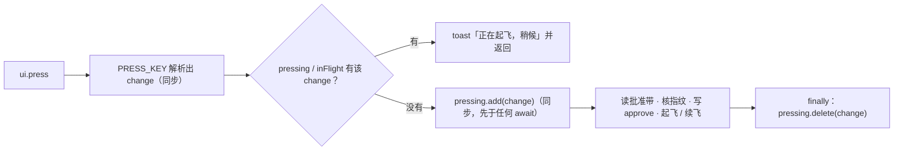
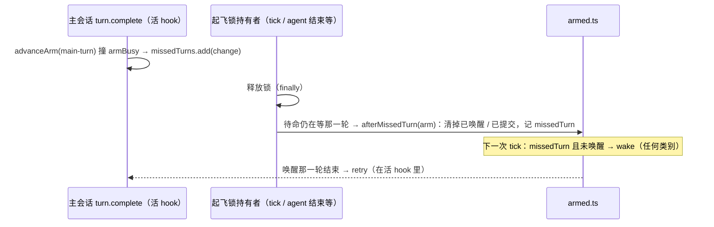

## Context

- **约束**：派发只在处理外部事件、尚未返回的 hook 里发生（`DRAFT-flight-dispatch-live-frame`）。定时器回调与已返回的回调里派发会被凭证拒绝（0.10.2）。
- **按键是并发处理的**（#57 交互实测）。`register.tsx` 的 `ui.press` 在 `await read($, band)` 之后才查 `inFlight`，登记又要再等 `fingerprint`、写 approve、`clock.now` 之后。
- **drive 走模块内单一 Promise 队列串行**。`driving` 只在排到队首时登记（`orchestrator.tsx` 约第 560 行），「正在飞」判据（约第 675 行）看 `driving` 与活 agent。
- **`advanceArm` 遇 `armBusy` 直接返回**（约第 983 行）。主会话 `turn.complete` 推进 `awaitingWake` / `awaitingModel` 的待命时，如果撞锁，这一轮就丢了；之后的 tick 对已唤醒的待命只给 `wait`。
- **`armBusy` 同时被人工起飞（`takeoffArmed`）与自动推进（`advanceArm`）持有**，abort 撞锁却一律回复「正在自动起飞」（约第 1228 行）。
- **`deferTriage` 的唤醒正文第二行与 `armed.ts` 的 `wakePrompt` 重复**（约第 1191 行），失败时只通知不记日志。
- **`Arm` 没有 `submittedAt`**，orchestrator 用 `as Arm` 与 `Arm & { submittedAt?: number }` 绕过类型检查。

## Goals / Non-Goals

**Goals:**
- 连按批准带、drive 排队时，都不会重复起飞。
- 撞锁错过的那一轮不再让待命卡到过期。
- 收掉便宜的 LOW 与测试残留。
- 借本次飞行完成 0.10.2 的真引擎冒烟。

**Non-Goals:**
- D 组：`land.ts` 的 Y 位改名、tick 同毫秒、非首项的进行中显示。记入 backlog。
- 不改判定器与账本事件，不建 ADR。

## Decisions

### D1 · 按键在入口同步登记（S2）

- 新增模块级 `pressing: Set<string>`。登记与检查都在第一个 await 之前完成，并发的两次按键里只有一次能通过。
- `inFlight` 仍负责批准带上「起飞中 / 基线运行中」的显示，不变。
- **否决的方案**：每个 change 一把 promise 锁、让后到的按键排队。排到时计划可能已变，还得再核一次指纹，复杂度不值。

### D2 · 排队中的 drive 计入「正在飞」（S1）

- 模块级 `queued: Map<string, number>`。`drive()` 入队时加一，这次 drive 的 Promise 结束时减一（含异常）。
- 「正在飞」判据改为：`driving.has(name) || (queued.get(name) ?? 0) > 0 || 活 agent 非空`。
- **否决的方案**：每个 change 一条队列。不同 change 的合回会并发，需要重新论证合回互斥。

### D3 · 错过的那一轮在下一次 tick 补发唤醒（S1）

- 决策页 Q4 选「锁释放时补推一次」。按「派发只在活 hook 里」的约束，补推不能在释放锁的地方直接重试：持有者可能是 tick，手上没有活凭证。所以补推改为下一次 tick 补发唤醒，重试仍在唤醒那一轮结束时、在活的 hook 里做。最多晚一个 tick（60 秒），不会卡到过期。
- **`armed.ts`**：
  - `Arm` 加 `missedTurn: boolean`，`armOf` 置 false，`beforeRetry` 置回 false；
  - 新增纯函数 `afterMissedTurn(arm)`：正在等那一轮（`awaitingWake || awaitingModel`）时，返回清掉这两项、`missedTurn: true` 的待命；否则原样返回；
  - `nextStep` 在 `main-turn` 那条之后加一条：`tick` / `timer` 且 `missedTurn` 时，未唤醒给 `wake`，已唤醒给 `wait`，对任何类别都适用，包括 model。
- **orchestrator**：
  - `advanceArm` 撞锁且事件是 `main-turn` 时，`missedTurns.add(change)`；
  - `advanceArm` 与 `takeoffArmed` 释放锁之后，若 `missedTurns` 有该 change，先删除，再读当前待命；仍在等那一轮就 `putArm(afterMissedTurn(arm))`；
  - 待命已被持有者替换或清掉时，什么都不做。

### D4 · abort 撞锁时区分人工与自动（S1）

- `armBusy` 由 `Set` 改为 `Map<string, 'auto' | 'manual'>`：`advanceArm` 记 `auto`，`takeoffArmed` 记 `manual`。
- abort 撞锁时：
  - `auto` 照旧回复「正在自动起飞，结束后再 /flight abort」；
  - `manual` 回复「flight：<change> 正在起飞，结束后再 /flight abort」。

### D5 · 便宜的 LOW（S1、S2）

| 项 | 做法 | 片 |
|---|---|---|
| 看门狗唤醒失败不记日志 | `deferTriage` 失败时除了通知，再 `ctx.log` 一行，含「唤醒失败」 | S1 |
| 唤醒尾句重复 | `armed.ts` 导出 `WAKE_FOOTER`，`wakePrompt` 与 `deferTriage` 共用 | S1 |
| `Arm` 缺 `submittedAt` | `Arm` 加 `submittedAt?: number`，删掉强转与交叉类型 | S1 |
| 批准修订已批准时 toast 与行为不符 | replan 模式命中去重：toast「flight：<change> 已批准（指纹相同），直接续飞」，并按已批准的修订续飞（`startResume(..., true, lease)`） | S2 |
| 恢复状态行冲掉别的基线进度 | 续飞结束、`restoreStatusNow()` 之后，若 `inFlight` 里还有别的 change 处于基线相位，立即重写它的基线进度行（复用 `baselineTick` 的文案） | S2 |

### D6 · 切片编排

- **S1**：orchestrator 与 armed，含类型、补测、清理 pytest 残留。
- **S2**：批准带。
- **S3**：版本与文档测试残留。

三片 owns 互不相交，同一 wave 并行。

## Risks / Trade-offs

- **[错过的那一轮要等下一次 tick]**：最多晚 60 秒 → 可以接受；之前会卡到 30 分钟过期。
- **[`pressing` 让连按一律被拒]**：第二次按键得到「正在起飞，稍候」→ 与 #57 的语义一致，不排队。
- **[测试世界模拟不出撞锁的微小窗口]**：`afterMissedTurn` 是纯函数，用 `armed.test.ts` 直接测；orchestrator 的接线只是几行。
- **[冒烟要求人在基线跑完前按键]**：错过窗口就只验证冒烟 1，冒烟 2 留到以后碰上再看。

## Migration Plan

- 插件 0.10.3，合入后：主检出快进 → `claude plugin update flight@intent-driven` → `/reload-plugins`。
- 本次起飞就是 0.10.2 的冒烟，结果写进 PR：
  - 首轮执行体的 measure 是否正常；
  - takeoff 之前是否先有一轮「收到」。

## Open Questions

- 无。现行 ADR 不受影响：`DRAFT-flight-dispatch-live-frame` 的约束由 D3 遵守。
