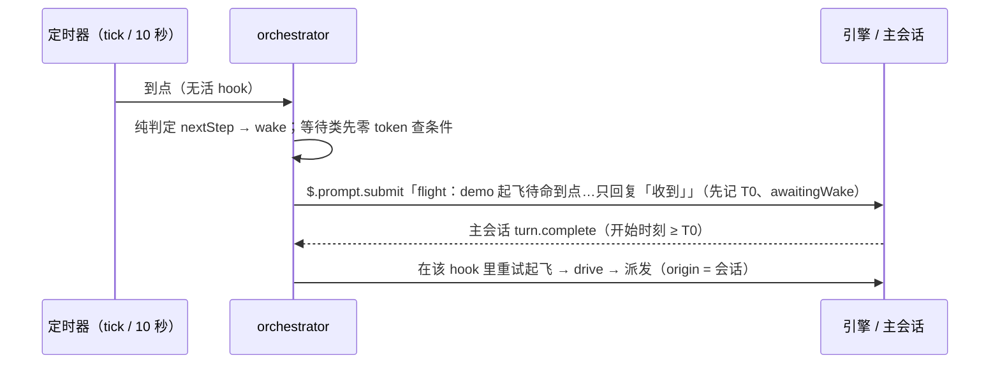
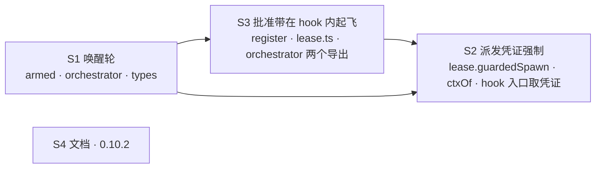

## Context

### 实测事实（CLI 2.1.296，spike 插件 `probespike` 与热重载插件 `pressspike`，2026-10-13）

- **会失效的情形**：插件的 `$` 调用如果不在「处理外部事件、尚未返回的 hook」的异步链里，引擎就把它算作插件自己发起。这样 `$.agent.spawn` 出的 agent，后续工具调用的 origin 都是插件，插件自己的 hook 一律按 re-entry 跳过（含 `.catch`）。
  - 被跳过的 hook：`tool.call`、`tool.check`、`turn.step`、`classic.SubagentStop`。只有 `turn.complete` 照常到达。
  - debug 日志原文：`tool.call skipped: re-entry (the plugin's own code raised it; origin probespike)`。
  - agent 拿到的错误：`<plugin> registered the tool X but no tool.call hook answered this call`。
- **坏的写法**（都已复现）：
  - 在 `clock.after` 回调里调用另一个 hook 造的闭包（= 批准带按键起飞）；
  - session.start 的 `$` 在它自己排的定时器里派发（= 看门狗、待命 tick）；
  - 在 hook 里不 await 地调用，等派发时 hook 已返回。
- **好的写法**（都已复现）：
  - 在活着的 hook 里直接派发，或 await 一条链路再派发（中途 sleep、跨文件闭包都不影响）；
  - 在 agent 结束的 `turn.complete` 里派发（= drive 现状）；
  - 定时器先 `$.prompt.submit` 一轮，在那一轮主会话的 `turn.complete` 里派发。
- **交互实测**：
  - `ui.press` hook 用 `process.run` 挂起 120 秒，期间人照常输入、发消息；
  - 期间按别的按钮也照常处理，说明按键是并发的；
  - 挂起结束后派出的 agent，Bash 守卫与插件工具都生效。
- **没有现成的判据区分好坏 agent**：
  - `$.agent.list()` 的 `spawnedBy` 在两种 agent 上都是插件名；
  - `turn.complete` 的 usage 里没有工具调用次数。
- `$.process.run` 默认 30 秒超时，上限 10 分钟。

### 生产证据（flight-armed-followups）

- 12:50:57–12:51:21 按键起飞，派出 S1–S3，三个执行体调用 measure 全部失败。
- 12:52:32 起，drive 重派的执行体 measure 正常。同一时段，首轮的 S1 仍在失败。

### 现状代码（0d67541）

- `register.tsx`：
  - `startTakeoff`：`clock.after(0)` → `takeoffNow`；
  - `startResume`：`clock.after(0)` → `resumeFlight`；
  - `ui.press` 不查进行中；
  - `startTakeoff` 里 `await refresh($)` 未吞错。
- `orchestrator.tsx`：
  - `runStep` 的 `wait.ms`：`clock.after(ms)` → `advanceArm(timer)` → 重试起飞；
  - `watchTick` 末尾：`advanceAll(tick)` → 重试起飞；
  - `watchOne`：停飞后 `triage` 派诊断员（在 `clock.every` 回调里）；
  - `submitFix`：成功与失败都按 change 重读待命，没有绑定安排它的那次。
- 派发都经 `ctxOf($).spawn`。调用点有执行体、解冲突、诊断员、评审员、修复体。

## Goals / Non-Goals

**Goals:**
- 插件派出的每个飞行 agent，工具调用都经过插件的包络、账本守卫与 measure。
- 定时到点的重试与看门狗诊断仍然无人值守，只是改走唤醒轮。
- 以后新增的派发如果写在回调里，当场被拒并留证据，不会悄悄绕过包络。
- 顺带修 #56 留下的 5 项 MEDIUM（见 D6）。

**Non-Goals:**
- 不改判定器与账本事件类型。
- 不做「agent 结束后再对账」的事后检测（见 D5 的否决理由，记入 backlog）。
- 不修「排队中的 drive 不算正在飞」（#56 MEDIUM，与本缺陷无关，留后续）。
- 不改批准语义（铁律 7）：唤醒轮只请模型回复「收到」，模型仍然没有起飞入口。

## Decisions

### D1 · 唤醒轮：定时到点只唤醒，不起飞（S1）

- **`armed.ts` 的纯判定**：
  - `tick` / `timer` 事件不再给出 `retry`，改为给出 `wake`；`awaitingWake` 已为真时给出 `wait`，不重复唤醒；
  - `main-turn` 事件遇到 `awaitingWake` 时给出 `retry`；
  - `beforeRetry` 清掉 `awaitingWake`。
- **等待类先查条件**，零 token：
  - `wait-baseline`：跑一次 `slice-gate.py preflight`。stderr 仍含「基线仍在跑」就不唤醒；其余结果（通过或别的失败）都唤醒，让真实的重试给出真实的拒绝。
  - `wait-agents`：上一 attempt 派出的 agent 在 `$.agent.list()` 里仍处于运行态，就不唤醒。
- **提交顺序**：
  1. 先记 `awaitingWake: true` 与 `submittedAt: T0`；
  2. 再在 `clock.after(0)` 里提交唤醒文本（`wakePrompt`）；
  3. 提交失败就放弃待命并通知，原因含「提交唤醒失败」。

  主会话 `turn.complete` 沿用 #56 的对准规则（开始时刻 ≥ T0），对 `awaitingModel || awaitingWake` 的待命以 `main-turn` 推进。
- **否决的方案**：
  - **借自己的命令拿一个活 hook**：实测插件调自己注册的命令，自己的 hook 不应答。
  - **等现成事件，不唤醒**：偶发类就没有触发源了。
  - **定时器只通知人**：无人值守能力退步。

### D2 · 看门狗诊断员经唤醒轮（S1）

- `watchOne` 停飞后，不再在 tick 里 `triage`，改为记下待派诊断（模块内 `pendingTriage`：change → flight、haltKind、reason、T0），然后提交唤醒文本：「flight：<change> 已被看门狗停飞，插件将在这一轮结束后派只读诊断员。这一轮只回复「收到」…」。
- 主会话 `turn.complete` 时，对开始时刻 ≥ T0 的待派项调 `triage`（`triage` 本身幂等：已派过就不再派）。
- 唤醒失败只记一行、通知人，不重试。
- `driveNow` 里的停飞诊断本来就在活 hook 里，保持不变。

### D3 · 批准带按键在 hook 内起飞（S3）

- `ui.press` 处理里直接 await 起飞或续飞，不再 `clock.after(0)`。
- 按键处理整体包在 `withLease` 里，取得的凭证传给 `takeoffNow(args, { lease })`，续飞时经 `depsOf` 的闭包传入。
- **进行中再按**：`inFlight` 已有该 change，就 toast「flight：<change> 正在起飞，稍候」并返回，不再起第二次（实测按键并发）。
- **重绘失败**：按键路径的重绘一律吞错；进行中记录在 `finally` 里删除。
- **基线结束后恢复状态行**：续飞结束（含异常）后调 `restoreStatusNow()`。它是 orchestrator 在 session.start 里造好的无 `$` 闭包，复用 #56 的 `restoreStatus`：
  - 还有待命，就显示其一；
  - 否则有在飞的 change，就显示它的进度；
  - 都没有才清空。
- **长时间挂起**：续飞要等基线跑完。`process.run` 本来就带 `BASELINE_TIMEOUT_MS`（10 分钟），交互实测挂起期间输入不受影响。

### D4 · 派发凭证（S3 建模块，S2 强制）

- 新模块 `lease.ts`（纯，不含 `$`）：
  - `Lease = { readonly alive: boolean }`；
  - `withLease(body)` 在 body 返回或抛错时把凭证置为失效；
  - `leaseDeny(lease)` 对缺失或失效的凭证给出拒绝文本：「flight：派发须在处理外部事件的 hook 里（定时器或已返回的回调不能派发）」；
  - `guardedSpawn(lease, spawn)` 拒绝时不调用 spawn。
- **`ctxOf($, lease?)`**：`spawn` 经 `guardedSpawn`。各调用点原有的被拒分支照常工作：执行体与解冲突记 blocked，进而停飞并派诊断员；诊断员只记一行；评审员与修复体按原有拒绝处理。
- **凭证的来源**（只在 hook 入口取得）：
  - `command.run`（`/opsx-apply`、`/flight resume`）；
  - 子 agent 的 `turn.complete`（drive、agent-ended 推进）；
  - 主会话的 `turn.complete`（main-turn 推进、待派诊断）；
  - `ui.press`（S3）。
- **凭证的流向**：`takeoffArmed` → `runStep` → `takeoff` → `drive` → `driveNow` → `ctxOf`；`triage` 用调用方的 ctx。
- **否决的方案**：
  - **静态扫描「回调里不得派发」**：脆弱，换种写法就漏掉。
  - **只靠文档约定**：这次的缺陷正是写法正确、语义踩坑，约定挡不住。

### D5 · 不做事后对账（决策页 Q5 的收窄，2026-10-13 由我按用户授权决定）

- **原计划**：agent 结束时，插件 hook 从没见过它的工具调用，就判红停飞。
- **实测发现的问题**：
  - 引擎没有能区分好坏 agent 的字段（`spawnedBy` 相同，usage 里没有工具次数）；
  - 只能用「没收到任何 `turn.step` / `tool.call`」作信号，但测试世界里几十个用例都是不模拟这些就结束 agent 的，会大面积误判。改测试世界的公共 helper 牵涉 orchestrator / landing / flight 三个测试文件，与本 change 的范围不相称。
- **替代**：D4 的派发时强制。它挡在 agent 出现之前，覆盖的正是这次的缺陷类型：派发不在活 hook 里。
- **backlog**：等引擎提供 origin 字段，或测试世界默认模拟 `turn.step` 之后，再补事后对账。

### D6 · 顺带收的 #56 MEDIUM

| 项 | 归属 |
|---|---|
| `startTakeoff` 里 refresh 抛错会永久留下「进行中」 | S3（D3） |
| `ui.press` 不查进行中 | S3（D3） |
| 基线结束后状态行不清 | S3（D3） |
| `submitFix` 没绑定安排它的待命：成功时以 `since` 核对后才标记 `awaitingModel`，失败时同样核对后才放弃；唤醒提交同法 | S1 |
| `opsx-propose` 命令 description 旧字样 | S4 |

### D7 · 切片编排

- 4 片、3 层。`orchestrator.tsx` 依次由 S1、S3（只加两个导出）、S2 修改，三片串行，同一 wave 里没有重叠。
- S2 必须在 S3 之后：先让按键路径把凭证传过来，再开启强制，否则合回后按键起飞的用例会被拒。

## Risks / Trade-offs

- **[唤醒轮多一轮主会话对话]** → 只在定时到点、且条件已满足时才发，而且每个待命同一时间只有一次。重试预算不变（transient / model 最多 3 次）。正文要求模型只回复「收到」、不要发 `/opsx-apply`。
- **[主会话正忙时唤醒排队]** → 重试推迟到那一轮结束；待命 30 分钟有效期不变，到期照旧放弃并通知。
- **[按键 hook 挂起数分钟]** → 已实测输入不受影响；按键并发由 `inFlight` 拦住。
- **[测试世界模拟不出 origin]** → 单测断言结构，包括按键返回前已起飞、定时器只提交不派发、无活凭证被拒。真引擎验证放在合入后冒烟：按键起飞，看首轮执行体能否调到 measure。
- **[凭证可被误用]**：回调里调用 `withLease` 自己造一个凭证，就能绕过 → 本 change 不防恶意绕过，只防这次这类无意的写法。`lease.ts` 的注释与 ADR 写明这条规则。

## Migration Plan

- 插件 0.10.2，合入后：主检出快进 → `claude plugin update flight@intent-driven` → `/reload-plugins`。
- 合入后冒烟：
  1. 按批准带「批准起飞」，看首轮执行体 measure 正常；
  2. 基线还在跑时发 `/opsx-apply`，看基线跑完后出现一轮「只回复收到」，随后自动起飞。
- 回退：退回 0.10.1。期间起飞与续飞改发命令，不按批准带。

## Open Questions

- 无。现行 ADR 的相关条款：
  - DRAFT-flight-armed-takeoff 的第 5 条「按键即起飞，经 takeoffNow 闭包」仍成立，本 change 只补充调用时机；
  - 第 1 至 3 条的有界重试仍成立，只是定时到点改走唤醒轮。

  新约束写入 `DRAFT-flight-dispatch-live-frame`，不取代既有条款。
