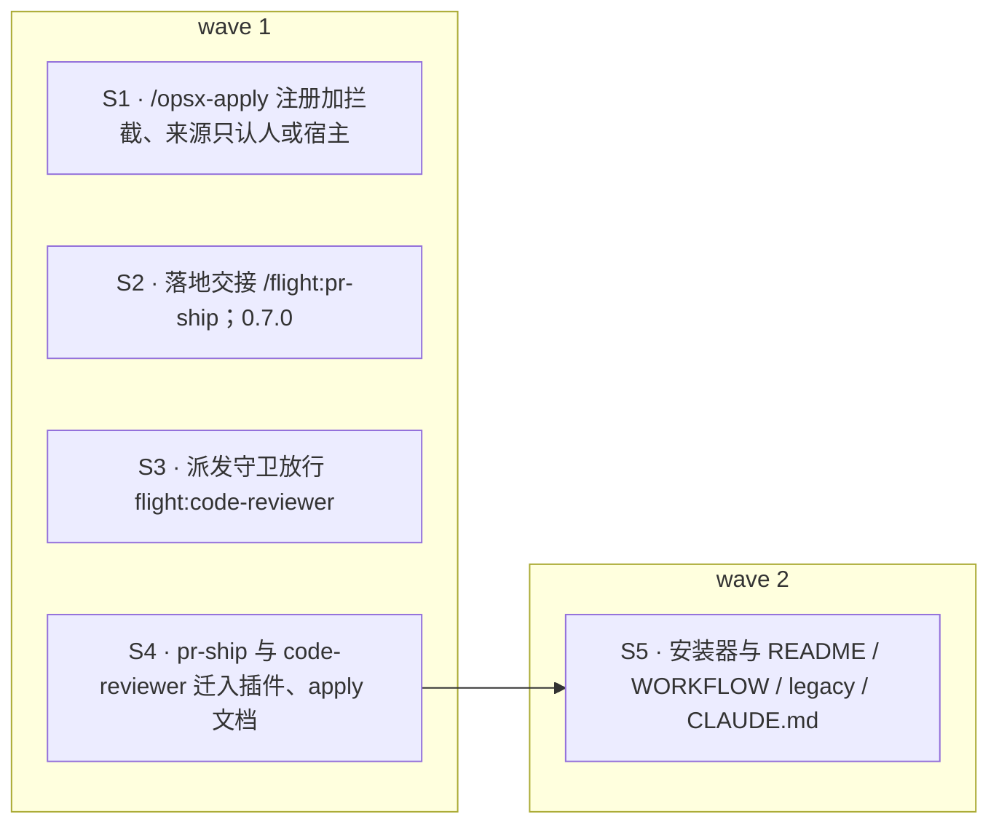

## Context

- **入口现状**：`orchestrator.tsx` 用 `on('command.run', { command: 'opsx-apply' })` 接管命令。命令名本身由项目的 `.claude/commands/opsx-apply.md` 提供：
  - 下游项目由 `install.sh` 装上这个文件；
  - 本仓库靠根目录 `.claude/commands/opsx-apply.md` 软链提供，这个软链是 2026-10-12 补的，未跟踪。
- **出口现状**：`landing.tsx` 落地后调用 `ctx.runCommand('pr-ship', f.change)`，最终是 `$.command.run`。
  - 本仓库根目录没有 `pr-ship`，每次都失败，只记一条提示。
  - 传的参数是 change 名，而 `pr-ship.md` 把参数当作 target branch，两边口径本就不一致。
- **来源现状**：
  - #50 的 `HUMAN_ORIGINS = ['composer', 'bridge']` 只用于 `/flight abort` 与 `resume`；
  - `/opsx-apply` 起飞不查来源；
  - 无头运行（`claude -p`、Agent SDK）的来源是 `sdk`，现在会被 abort / resume 拒绝。
- **pr-ship 与 code-reviewer**：两者在 `template/.claude/` 下，由安装器复制到项目。
  - `pr-ship.md` 里的判定器路径写死为 `.claude/hooks/…`，change 目录写死为 `openspec/changes/<name>`。本仓库实际是 `template/.claude/hooks` 与 `template/openspec/changes/<name>`，主会话每次都要手动换算。
  - 第 8 步派发 `subagent_type=code-reviewer`。
- **派发守卫**：`envelope.ts` 的 `spawnVerdict` 规定，`flight:*` 只能由 flight 控制面派发。主会话派发 `flight:code-reviewer` 会被拒。
- **实测**（2026-10-12，CLI 2.1.296，无头模式）：
  - `$.command.register` 与项目或用户命令文件同名时，引擎拒绝，原话是「`$.command.register: "/filecmd" refused: it is the user's /filecmd`」。此时 `command.run` hook 仍能拦截该文件命令，来源为 `sdk`。
  - 插件命令返回 `{ text, context }` 后，模型不会接着作答。
  - 在 `command.run` hook 里调 `$.prompt.submit` 被拒，原话是「called from a command.run hook, it would wait on the turn this hook is holding; submit from a later event (turn.complete)」。
  - 插件自带的 `commands/<名>.md` 注册为 `<插件>:<名>`，`$.command.list()` 里的来源为 `plugin`。不带前缀直接发 `/<名>`，找不到这个命令。
  - 在子 agent 的 `turn.complete` 里调 `$.command.run({ command: '<插件>:<名>' })`，来源为 `{ kind: 'plugin' }`。命令在当前主轮结束后运行，模型照正文作答。`$.prompt.submit` 同样可行。
  - skill 与命令在调用时，参数会以「ARGUMENTS: …」附在正文后，本会话的 skill 调用即如此。

## Goals / Non-Goals

**Goals**
- 不依赖项目里装的命令文件，插件就能提供 `/opsx-apply` 入口和 `/flight:pr-ship` 出口。
- 会写账本的入口只认人或宿主程序，模型够得着的间接途径（定时任务、跨会话消息、插件代发）一律拒绝。
- 落地交接在任何项目里都能接上，判定器与 change 目录由插件给出，不再靠模型猜。

**Non-Goals**
- **模板整体改为插件分发**：skills、其余命令、hooks 的迁移另立 change。本 change 只迁入口与出口直接需要的 `pr-ship` 与 `code-reviewer`。
- **ship 机械步骤由插件执行**：提交、预合并、push、建 PR 仍由模型按 `/flight:pr-ship` 文档执行（用户定：先迁入插件，机械化以后再做）。
- **判定器收口**：takeoff-gate、session-model 等另立 change。
- **#50 遗留的 MEDIUM**：abort 两段停、动作内查停飞等另立 change。只在这里补上「来源规则」的文档。

## Decisions

### D1 · `/opsx-apply` 入口：注册加拦截两手（用户定）
- **注册**：在带 `{ cwd: /^/ }` matcher 的 `session.start` hook 里，与 `flight` 一起调用 `$.command.register({ name: 'opsx-apply', description: '飞行模式 apply：由 flight 插件状态机执行（批准后起飞）', argumentHint: '<change>' })`。
- **被拒即忽略**：项目或用户已有同名命令文件时，引擎拒绝注册，异常吞掉、不提示，`command.run` hook 照旧接管那个文件命令。其他注册失败同样忽略。
  - 项目里没有命令文件、注册又失败时，入口不存在，`/opsx-apply` 报 Unknown command。这时等于插件缺席，按铁律 10 不起飞。
- **命令文件保留**：模板仍安装 `.claude/commands/opsx-apply.md`，插件缺席时它告诉模型「即停飞」，`--gate=per-task` 也要读它。

### D2 · 写账本的入口只认人或宿主程序（用户定）
- **认可的来源**：`HOST_ORIGINS = ['composer', 'bridge', 'sdk']`，取代 #50 的 `HUMAN_ORIGINS`。
  - `sdk` 是 `claude -p` 或 Agent SDK 宿主自己发起的一轮，由引擎盖章，模型造不出来。阶段 5 的无头评测要靠它。
- **适用范围**：
  - `/opsx-apply` 在走起飞路径之前查来源；
  - `--engine=workflow` 的拒绝回复与 `--gate=per-task` 透传不写账本，不查来源；
  - `/flight abort`、`/flight resume` 照旧查来源，只是加上了 `sdk`；
  - `status` 与 `panel` 不查来源。
- **拒绝文案**：统一为 `flight：<命令> 会写账本，只接受人或宿主程序发出（终端、Remote Control、SDK；本次来源：<kind，未标明时写「未标明」>）`，不读写账本、不停 agent。

### D3 · 不变量随之更新
- 插件注册的斜杠命令：项目里没有同名命令文件时，恰为 `flight` 与 `opsx-apply`；有同名文件时只有 `flight`。
- 模型可调用的工具仍恰为 `submit_findings` 与 `measure`。
- 任何工具或命令在任何输入下都不写 approve。
- 本要求取代 flight-interaction 中「插件注册的命令恰为 flight」与「只接受人在终端发出」两处约束。`flight.test.tsx` 的两条守卫测试随之改为期望 `['flight', 'opsx-apply']`。

### D4 · 落地交接到 `/flight:pr-ship`
- **调用**：`landing.tsx` 落地后调用 `ctx.runCommand('flight:pr-ship', args)`，`args = --worktree <f.changeTree> --change-dir <f.changeDir> --judges <f.hooksDir>`。
  - 三个值都由插件给出：worktree 是 change worktree 的绝对路径，change 目录相对 worktree，判定器目录是主检出副本的绝对路径。
  - 判定器与飞行门禁用同一份，即 `f.hooksDir`。
- **失败**：
  - log：`落地完成，但接 /flight:pr-ship 失败：<原因>`；
  - toast：`flight：<change> 已落地，但接 /flight:pr-ship 失败：<原因>；请手动运行 /flight:pr-ship <args>`；
  - 照旧不停飞。
- **时机**：落地由子 agent 的 `turn.complete` 驱动，实测这时 `$.command.run` 可以把插件 markdown 命令交给主会话模型执行。

### D5 · pr-ship 与 code-reviewer 迁入插件（用户定）
- **迁移**：`git mv` 到 `template/plugins/flight/commands/pr-ship.md` 与 `template/plugins/flight/agents/code-reviewer.md`，模板不再保留副本，单一来源。
- **`pr-ship.md` 的改写**：
  - **Input**：`/flight:pr-ship [<target>] [--worktree <path>] [--change-dir <path>] [--judges <dir>]`，缺省值见下表；飞行落地时由插件给齐三个参数。

    | 参数 | 缺省 |
    |---|---|
    | `--worktree` | 当前目录 |
    | `--change-dir` | `openspec/changes/<name>` |
    | `--judges` | `.claude/hooks` |
    | target | `main` |

  - **在 worktree 里运行**：所有 git、gh 与判定器命令都在 `--worktree` 里以子 shell `(cd <worktree> && …)` 运行。
  - **路径改写**：
    - 所有 `python3 .claude/hooks/<脚本>` 改为 `python3 <judges>/<脚本>`；
    - 所有 `openspec/changes/<name>` 改为 `<change-dir>`。
  - **评审员**：第 8 步与第 10 步派发 `subagent_type=flight:code-reviewer`，仍显式 `model: "<main>"`。
  - **其余**：其余步骤、问询预算、签名、收尾复裁都不变。
- **`code-reviewer.md`**：正文与工具集不变，只把描述里的 `/pr-ship` 改为 `/flight:pr-ship`。插件 agent 的类型名自动为 `flight:code-reviewer`。
- **可见性**：`agent.offer` 的 `HIDDEN` 列表不含它，模型可见。

### D6 · 派发守卫放行 `flight:code-reviewer`
`spawnVerdict` 对 `subagentType === 'flight:code-reviewer'` 的处理：

| 情况 | 结果 |
|---|---|
| 非插件来源（主会话）派发 | 不再按「`flight:*` 只能由控制面派发」拒绝 |
| 不带 `model` | 照旧拒绝（铁律 11） |
| `parentInFlight` 且来源不是插件 | 照旧拒绝「飞行中的 agent 不得再派发子 agent」 |

其他 `flight:*` 类型的判定不变。

### D7 · 安装器与文档
- **`install.sh`**：
  - **退役不变**：退役文件循环保持原样。
  - **新增「已迁入插件」**：另加一组 `.claude/commands/pr-ship.md`、`.claude/agents/code-reviewer.md`。在目标项目里存在时输出：

    ```
    以下文件已迁入 flight 插件（改用 /flight:pr-ship 与 flight:code-reviewer），旧副本不再更新，可手动删除（安装器不代删）：
    ```

    后面逐个列出文件。
  - **结尾提示同步**：结尾的「更多」段改成 14 个 slash command，agent 由 flight 插件提供。
- **文档**：README、`docs/WORKFLOW_zh.md`、legacy skill、仓库 `CLAUDE.md` 第 6 条，把 `/pr-ship` 改为 `/flight:pr-ship`，把 code-reviewer 的位置与类型改为插件的 `flight:code-reviewer`。ADR 是历史记录，不改。
- **命令与 skill**：`/opsx-apply` 命令与 `openspec-apply-change` skill 同改，在 S4 里完成：
  - 改为 `/flight:pr-ship`；
  - 写明 D2 的来源规则（终端、Remote Control、SDK），补上 #50 的文档遗留。

### D8 · 版本
插件 0.7.0；`plugin.json` 的 description 改为「落地接 /flight:pr-ship」。

## 切片与 wave



- **wave 1 互不依赖**：S1–S4 所有权不相交，测试世界各自用假应答，不需要彼此的实现。
- **S5 依赖 S4**：S5 要断言「全新安装后没有这两个文件」，只有 S4 把它们迁出模板之后才成立。
- **S4 owns 12 条**：已到上限。读这两个文件的 6 个测试都归 S4，因为它们的路径常量要随迁移一起改。
- **S1 的测试改动**：S1 把 `orchestrator.test.tsx` 里 58 处 `/opsx-apply` 调用补上 `origin: { kind: 'composer' }`，这是机械改动；`test_flight_takeoff_commit.py` 包装的也是这份文件里的用例，因此列入 S1 的 verify。

## Risks / Trade-offs

- **命令改名**：`/pr-ship` 改为 `/flight:pr-ship`，用户要改习惯；已装项目的旧副本仍可用，但不再更新。安装器会列出旧副本。
- **来源盖章依赖引擎**：
  - 若真实引擎给终端命令标的不是 `composer`，人发出的起飞也会被拒。拒绝语写出看到的来源，第一次起飞即可核对。
  - `sdk` 在本仓库按文档认定为宿主程序，未做更多实测。
- **参数靠模型读取**：`/flight:pr-ship` 的三个参数由模型从「ARGUMENTS」读出再代入命令。读错时，判定器或 change 目录找不到，命令会报错停下，不会静默跑错。
- **本 change 自己的飞行**：插件 0.6.0 没有注册 `opsx-apply`，起飞靠根目录软链；落地交接照旧失败，由主会话手动走。
