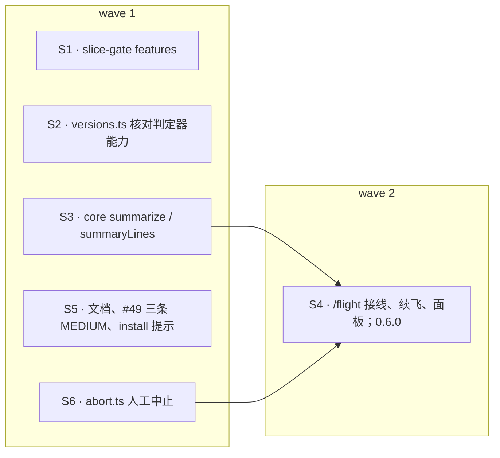

## Context

- **状态的唯一来源**：飞行状态全部在账本 `refs/flight/<change>/ledger` 里，由 `core.reduce` 归约成 `State`。现有的状态行（`orchestrator.tsx` 的 `showStatus`）只显示 wave、运行数与阻断数。
- **停飞路径**：`landing.tsx` 的 `runLandingAction(ctx, f, { kind: 'halt', reason })` 记停飞事件并提交记录。之后 `driveNow` 看到这个 attempt 已停飞，就不再推进。已派出的 agent 不会被终止。
- **起飞路径**：`orchestrator.tsx` 的 `takeoff($, args)` 依次做这些核对：
  1. 版本下限；
  2. 定位 worktree 与 change 目录；
  3. takeoff-gate；
  4. git 版本；
  5. `checkPluginCopy`、`checkJudges`（`ledger.py events`）；
  6. 跨会话；
  7. 工作区与授权提交；
  8. lint / preflight；
  9. 指纹。

  核对完写 takeoff 事件，再 drive。再发 `/opsx-apply` 时，就从账本续飞。
- **插件 API 实测**（2026-10-12，CLI 2.1.296，无头模式，default 与 bypass 两种权限模式都试过，`scratchpad/mods/abort-spike`）：
  - **停止**：`$.tool.call({ tool: 'TaskStop', task_id })` 能停掉插件自己派出的 agent，不弹询问，返回 `{ result: { message: 'Successfully stopped task: …' } }`；
  - **列表状态**：`$.agent.list` 里该 agent 的状态由 `running` 变为 `killed`；
  - **结束事件**：`turn.complete` 立即到达（`reason: 'aborted'`、`isAborted: true`），`classic.SubagentStop` 不触发。
- **测试世界可模拟**：`command.register`、`agent.list`、`tool.call`、`ui.open` 都是可挂 hook 的事件（`flight.test.tsx` 与 `orchestrator.test.tsx` 已在用前三个）。

## Goals / Non-Goals

**Goals**
- 人能随时看到飞行进度（`/flight status`、面板），能中止本会话起飞的飞行并停下在飞的 agent，能显式续飞未落地的 attempt。
- 判定器能力不足（主检出未快进）时，在起飞前机械地拒飞。
- 收掉 #49 的三条 MEDIUM。

**Non-Goals**
- **自动停飞不停 agent**（用户定）：指纹变化、账本读失败等仍只记停飞。
- **不中止另一个会话的飞行**：TaskStop 只认本会话的任务。
- **「SubagentStop hook skipped: python3 aborted」成因**：仍未查明。实测排除了「重复触发」和「hook 预算」两种解释，需要在真实飞行里开 `claude --debug` 定位，不在本 change 处理。
- **包络兜底与 `/pr-ship` 进插件**：各自另立 change。

## Decisions

### D1 · 判定器声明能力（用户定）
- **`slice-gate.py features`**：每行打印一项能力，退出 0。本次声明三项：
  - `evidence-ledger-only`：G5 只按账本判；
  - `g5-per-target`：逐目标先红；
  - `guards`：切片护栏。

  以后新增能力时在这里追加一行。
- **`versions.ts` 的 `checkJudges`**：在核对 `ledger.py events` 之后，再跑 `slice-gate.py features`。
  - 子命令不存在（退出码非 0）：拒飞，原因写「判定器过旧（slice-gate.py 没有 features 子命令）」，后接 `UPDATE_MAIN`；
  - 缺少 `REQUIRED_FEATURES`（导出常量，就是上面三项）中的任一项：拒飞，原因写「判定器缺少能力 <列表>」，后接 `UPDATE_MAIN`。
- **调用方不改**：`checkJudges` 的调用签名不变，所需能力用模块常量，orchestrator 不需要改动。

### D2 · 进度归约（core.ts，纯函数）
`summarize(state: State): FlightSummary`，结构如下：

```ts
type SliceRow = {
  id: string
  wave: number
  phase: string   // 待派 / 执行中 / 门禁红（n 次）/ 已合回 / 阻断（gate|infra）
  agent?: string
  reds: number    // 本 attempt 门禁红次数
  measured: string // 测量见红情况：如「3/3 先红」，没有测量为「-」
  review: string  // 评审：未开始 / 进行中 / <n> 条（CRITICAL/HIGH <k>）
}

type FlightSummary = {
  change: string
  attempt: number
  waves: number
  wave: number    // 当前 wave，已全部完成为 waves
  slices: SliceRow[]
  fix: string     // 未派 / 进行中 / 已合回 / 无需
  final: string   // 未跑 / 绿 / 红
  end: string     // 在飞 / 已落地（ready|draft）/ 已停飞（<原因>）
}
```

`summaryLines(s): string[]` 渲染成文本行：
- 首行：`✈ <change> · attempt <n> · W<i>/<n> · <end>`；
- 每片一行：`<id> W<wave> <phase> · 门禁红 <reds> · 测量 <measured> · 评审 <review>`；
- 末行：`修复 <fix> · final <final>`。

只读本 attempt 的事件（`attempt === state.attempt`），合回与评审跨 attempt 计入（与 `core.next` 口径一致）。

### D3 · 人工中止（新模块 abort.ts）
```ts
abortFlight(x: {
  state: State
  session: string
  halt: (reason: string) => Promise<boolean>      // 记停飞，成功为 true
  live: () => Promise<string[]>                   // 本 attempt 仍在飞的 agentId
  stop: (agentId: string) => Promise<string | undefined>  // 停一个，失败返回原因
}): Promise<string>
```
返回给人看的回复文本。依次处理：
1. **没有 takeoff，或本 attempt 已经落地或停飞**：返回「没有在飞的 attempt」，什么都不做。
2. **最新 takeoff 的 `by.session` 不是本会话**：返回「由另一个会话（<前 8 位>）起飞，到那个会话里 /flight abort」，什么都不做。
3. **记停飞**：调用 `halt('人工中止（/flight abort）')`。失败就返回「记停飞失败，未停任何 agent」。**先记停飞再停 agent**：被停的 agent 随即触发 `turn.complete`，`driveNow` 看到这个 attempt 已停飞，就不会再推进。
4. **停 agent**：对 `live()` 返回的每个 agentId 调用 `stop`，回复里逐个列出「已停 / 未停（原因）」；没有在飞的 agent 时写「没有在飞的 agent」。
5. 末尾提示：未提交的改动留在各自 worktree，可用 `/flight resume <change>` 续飞。

### D4 · `/flight` 命令接线（orchestrator.tsx）
- **注册**：在 `session.start`（带 cwd matcher 的那个 hook）里调用 `$.command.register({ name: 'flight', description: '飞行：status | panel | abort | resume' })`，由 `command.run { command: 'flight' }` 分派。
- **抽出 `locate($, name)`**：把 `takeoff` 里「定位 worktree、change 目录、判定器目录、构造 Flight」的部分抽成这个函数，供 takeoff / status / resume 共用，起飞行为不变。
- **省略 `<change>`**：本进程只有一个在飞的 flight（`flights` 与 `active`）时取它；否则回复用法，要求给出 change 名。
- **四个子命令**：
  - `status`：读账本，`summaryLines(summarize(state)).join('\n')`。
  - `panel`：先刷新面板状态，再 `$.ui.open({ id: 'flight', title: '✈ <change>' })`。
  - `abort`：调用 `abortFlight`，传入的三个函数如下。之后刷新状态行与面板。
    - `halt`：调用 `runLandingAction(ctx, f, { kind: 'halt', reason })`，再读账本确认停飞事件已写入；
    - `live`：本 attempt 的 dispatch 去掉已有 `ended` 的，再与 `$.agent.list()` 中状态属于 `LIVE` 的取交集；
    - `stop`：`$.tool.call({ tool: 'TaskStop', task_id })`，抛错返回原因。
  - `resume`：调用 `takeoff($, args, { resume: true })`。`takeoff` 读到账本后（跨会话判断那里）：
    - 账本没有 takeoff：返回「<change> 从未起飞：用 /opsx-apply <change>」；
    - 最新 attempt 已落地：返回「<change> 已落地（attempt <n>），没有可续飞的」；
    - 其余照常起飞。回复前加一行「续飞 attempt <n>：已合回 <k> 片跳过」。
- **其他参数**：其余子命令或缺省时，回复用法。

### D5 · 飞行面板（用户定：起飞时自动打开）
- **状态**：`types/index.d.ts` 的 `PluginState.flight` 增加 `panel: FlightPanel`，即 `{ change: string; lines: string[] }`。
- **写入**：`showStatus` 每次刷新状态行时，同时 `update` 面板 atom 为当前 `summaryLines`。
- **绘制**：`ui.render { component: 'Pane', requestId: 'flight' }` 每行一个 `Text`；没有内容时显示「尚无飞行」。
- **打开时机**：`takeoff` 成功（写入 takeoff 事件并 drive）之后调用 `void $.ui.open({ id: 'flight', title: '✈ <change>' })`。终端宽度不够时由引擎挂起，宽度够了再显示（引擎行为）。

### D6 · #49 的三条 MEDIUM 与文档
- **`/opsx-apply` 命令与 skill 的停飞段**：「模型读到本命令即停飞」一段（命令与 skill 同改）开头补一句：
  - 本轮没有 `/opsx-apply` 命令（例如用户用自然语言要求开始实现、触发了本 skill）：不按插件缺席处理，停下并提示人发出 `/opsx-apply <name>`；
  - 本轮已经发了 `/opsx-apply`（且不是 `--gate=per-task`），仍读到这里，才按插件缺席处理。
- **`/opsx-apply` 命令的 Guardrails**：改成与 skill 一致的写法，不再出现「PreToolUse hook」。
- **`install.sh` 退役文件提示**：改为「已退役：仍可被调用，且不再受起飞批准拦截，请尽快手动删除」。
- **`/flight` 的用法**：写进命令、skill（同改）与 README 的飞行流程，包括四个子命令、面板自动打开、abort 只停本会话起飞的飞行。

### D7 · 版本
插件 0.6.0。

## 切片与 wave



- **接口约定**：`slice-gate.py features` 每行打印一项能力名（S1 写，S2 读）。S2 的 TS 测试用假输出，两片之间不设依赖。

## Risks / Trade-offs

- **TaskStop 的兼容性**：TaskStop 是内置工具，其输入 `task_id` 接受 agentId 是实测结论（2.1.296），引擎升级可能改变。abort 停不下时会在回复里列出原因，停飞事件照样已写入，控制面不会再推进。
- **能力核对会拦住老判定器**：只要主检出没快进就拒飞。这正是本 change 要的行为，提示里写明怎么处理。
- **面板挤占终端宽度**：窄终端由引擎挂起（不显示），状态行仍在。
