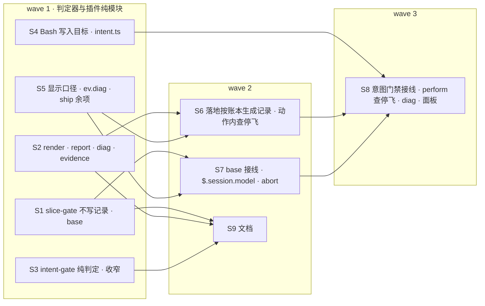

## Context

现状均于 2026-10-13 在 change 1 分支（`worktree-flight-ship-ledger` @ e3faae5）上核实：

- **写状态的子命令**：
  - `slice-gate.py start`（`cmd_start`）写 `<toplevel>/.openspec-slice` 标记 `{slice, change_dir, base, started, evidence}`，并记 timeline 的 `slice-start` 行。带 `--expect-branch` 时先做 G0 基点校验（`_base_check`）。
  - `slice-gate.py record`（`cmd_record`）往 `gate-report.md` 追加门禁行与天花板表，再记 timeline 的 `gate` 行。
  - `gate`、`final`、`baseline` 也会自己写 `gate-report.md` / `timeline.md`。`timeline.py record` 的事件名是自由参数。
- **插件里的调用点**：
  - `orchestrator.tsx` `startSlice` 调 `start`，从 stdout 取 base，交给起点测量和 dispatch 事件的 `base`；之后门禁与 measure 都显式带 `--base`。
  - `land.ts` `afterMerge` 调 `record`。
  - `mergeFix` 调 `timeline record fix`，`closeout` 调 `timeline record apply-done`。
  - 首次起飞调 `timeline record approve` 并提交 `chore(flight): approve`。
- **写入落空**：`judge` 的 cwd 是切片 worktree，`--change-dir` 是相对路径。所以 `start` 与切片 `gate` 写的记录都落在切片 worktree 里；G6 又禁止执行体提交记录，这些行进不了分支。`timeline report` 的「切片 start → gate ok」在飞行模式下从未打印过。
- **记录的读者**（都只是给人看，或是兼容旧数据）：
  - `spec_html.py` 读 `gate-report.md` 判 scenario passed，并渲染 `timeline.md`；
  - `/opsx-verify` 读 `gate-report.md`；
  - `/flight:pr-ship` 两种模式都调 `timeline.py record pr-open` 再跑 report；
  - `slice-gate.py ship` 已只读账本（change 1）。
- **标记的读者**：
  - `intent-gate.py` 按标记做 owns 检查；
  - `test-evidence.py` 有标记就不写 `evidence.log`；
  - `slice-gate.py gate` / `measure` 缺 `--base` 时取标记的 base，门禁绿时删标记；
  - 插件 TS 不读标记。插件包络 `envelope.ts` `writeVerdict` 已按 agentId 把 Write / Edit / NotebookEdit 限在本片 owns 内。
- **意图门禁**：
  - `intent-gate.py` 只读 stdin 的 `tool_input.file_path` / `path`；注册在 PreToolUse，matcher 为 `Write|Edit`。
  - 「apply 上下文」= 项目里任一 change 的 `tasks.md` 有未勾项。
  - stdin 解析失败、没有目标、任何异常都放行。
  - 包络没有解析 Bash 写入目标的代码。
- **abort**：
  - `abortCommand` 先经 `runLandingAction` 记 halt。`live()` 里 `await queue` 等整条 drive 串行队列做完，再求在飞 agent，用 `$.tool.call({tool:'TaskStop'})` 停。
  - `abortFlight` 见本 attempt 已有 land / halt 就回答「没有在飞的 attempt，无需中止。」。
- **动作内不查停飞**：`perform` 与 `runLandingAction` 执行前都不看账本；只有 `driveNow` 在每轮开头和动作之间查。
- **显示**：
  - `summarize` 的评审列不看 `blocked review:<S>`；修复列不看 `blocked fix`，`fix-r<k>` 不进摘要。
  - 面板只在 drive 每轮开头、abort 后、`/flight panel` 时刷新，drive 写下 halt / land 后不刷新。
- **python3 aborted**：
  - 执行体收口的 `on('classic.SubagentStop')` hook 没有 `.catch`。memory 记有 5 次「`classic.SubagentStop hook skipped: threw flight: $.process.run(python3) aborted`」，都在门禁或评审记账后约 100ms、ended 之前；账本完整，成因未明。
  - 引擎的 `.catch` 处理器能拿到 `next.error: { kind: 'throw' | 'timeout' | 're-entry', message?, budget }`（2.1.295 类型定义 `HookFailure`）。
- **判主模型**：
  - 起飞时 `io.run(['python3', <hooks>/session-model.py])`，它按子串匹配取别名 opus / sonnet / haiku / fable。
  - 引擎有 `$.session.model(): Promise<string>`（「与 /model 显示一致」）。`docs/flight-control-plane.html` 记有实测返回 `claude-opus-5-5`。
  - 插件测试可用 `on('session.model', …)` 在插件之下作答，与现有的 `session.cwd` / `session.id` 写法相同。

## Goals / Non-Goals

**Goals**

- 飞行中判定器只读、只判；记录文件在落地时从账本一次生成。
- 意图门禁覆盖 Bash 写法，「apply 上下文」只认目标所在 worktree 的 change。
- D4 的 1–5 项：abort 不必等动作做完；停飞后不再派发或合回；残留 agent 停得掉；阻断态显示如实；SubagentStop 失败留证据。
- 插件判主模型改用引擎 API。
- 收掉 change 1 的 4 条 MEDIUM 与 6 条 LOW。

**Non-Goals**

- `stop-gate.py` 与 `slice-gate.py checkpoint` 两个空壳不删，旧注册不清，留给 change 3（D3-A）。
- 解释器脚本内部的写文件（例如 `python3 x.py` 里 `open(...).write`）不做静态分析。飞行中由 G6 的改动清单兜底，飞行外由 PR 评审兜底。
- 包络「整串兜底」（D4 第 6 项）不做。
- 不查明「python3 aborted」的成因，只留证据。

## Decisions

### D1 · 判定器在飞行中不写记录；`base` 取代 `start`（D1-A）

`slice-gate.py`：

- 删除 `start`、`record` 两个子命令，以及只为它们服务的函数。新增只读子命令：

  ```
  slice-gate.py base <S> --change-dir <D> [--base <X>] [--expect-branch <B>]
  ```

  - **cwd**：切片 worktree。
  - **S 不在计划里**：die，退出 2。
  - **带 `--expect-branch` 且 G0 不过**：打印 `{"slice": S, "ok": false, "commit": "", "failed": ["G0 base: …"], "warnings": [], "summary": "基点校验未通过"}`，退出 1。
  - **否则**：打印 `{"slice": S, "base": <X 或 git rev-parse HEAD>}`，退出 0。
  - **不写任何文件**：不写标记，不写 timeline。
- `gate`、`measure` 的 `--base` 改为必填。标记回退与「门禁绿时删标记」一并去掉。
- `gate`、`final`、`baseline` 不再写 `gate-report.md`、`timeline.md`，也不再写天花板表，只打印 JSON。`baseline` 仍写 `gate-baseline.json`，它是计划工件。
- 标记退役：删掉 `.openspec-slice` 的常量、读写函数与改动清单里的排除项。`BOOKKEEPING` / `FLIGHT_RECORDS` 里的 `timeline.md`、`gate-report.md` 保留，它们仍是落地时提交的记录。
- `FEATURES` 增加 `ledger-records`。

### D2 · 落地时由 `timeline.py render` 从账本生成记录；`report` 按账本计算

`timeline.py`：

- 删除 `record` 子命令。
- 新增：

  ```
  timeline.py render --change-dir <D>
  ```

  - **输入**：读账本（`ledger.read_events`）与 `<D>/gate-baseline.json`。
  - **输出文件**：整份重写 `<D>/timeline.md` 与 `<D>/gate-report.md`。
  - **stdout**：打印 `{"timeline": <路径>, "report": <路径>, "events": <账本事件数>}`，退出 0。
  - **账本读不出**：stderr 写原因，退出 1，不写任何文件。
  - **幂等**：账本不变时，两次运行的输出逐字节相同。
- **`timeline.md` 的格式**：
  - 第一行 `<!-- timeline：timeline.py render 从账本生成，勿手改 -->`；
  - 其后每行 `<ISO 时间>\t<事件>\t<备注>`，时间统一为 `%Y-%m-%dT%H:%M:%SZ`；
  - `gate-baseline.json` 有 `at` 时，首行是 `baseline`，备注 `exit <n>, <sec>s ok|red`；
  - 之后每条账本事件一行（含 measure），按账本顺序，事件列即账本的 `ev`；
  - 备注按下表；所有备注取首行，`\t` 与换行替换为空格。

  | ev | 备注 |
  |---|---|
  | approve | `fp <前 8 位>` |
  | takeoff | `attempt <n> · 主模型 <model>` |
  | dispatch | `<slice> <role> <agent 前 8 位>` |
  | measure | `<slice> 目标 <n> 个 · 红 <k> 个` |
  | gate / merge | `<slice> ok` 或 `<slice> red` |
  | ended | `<agent 前 8 位> <reason> <model 或 ->` |
  | review | `<slice> <n> 条（CRITICAL/HIGH <k>）` |
  | blocked | `<slice> <kind>：<reason>` |
  | final | `ok` 或 `red` |
  | land | `<verdict>` |
  | halt | `<reason>` |
  | ship | `<verdict> <pr>` |
  | diag | `<where> <kind>：<error>` |
  | 其他 | 空 |

- **`gate-report.md` 的格式**：
  - 表头与现有格式相同：`# Gate Report` 与 `| 时间 | 切片 | 结论 | commit | failed | warnings |`；
  - 账本里每条 gate 与 final 事件一行，按账本顺序，含红的与各 attempt 的；final 行的「切片」列为 `final`；
  - failed / warnings 用 `; ` 连接，`|` 换成 `/`，空写 `-`；commit 取前 10 位；
  - 天花板表照搬现有 `record_ceilings` 的表头与行格式，数据取自 gate 事件的 `ceilings` 字段，按 `ceiling_rows_from_json` 的口径容错；
  - 写法从 `slice-gate.py` 移入 `timeline.py`。
  - `spec_html.py` 与 `/opsx-verify` 读这张表的口径（第三列 ok / red、每片取最后一行）不变。
- **`report`**：
  - **账本模式**（账本里有 takeoff）：
    - 先打印与 render 相同的事件行，`timeline.md` 不存在也照常输出；
    - 再打印：
      - `批准 → apply 完成：<min>`：第一条 approve 到最后一条 land；
      - `批准 → PR 打开：<min>`：第一条 approve 到第一条 ship；
      - 每片 `切片 <S>：派发 → 门禁绿 <min>`：该片第一条 executor dispatch 到其后第一条 ok 的 gate；
      - 门禁红次数、测量统计：口径同现在；
      - diag 事件数大于 0 时，加一行 `诊断：<n> 条`。
  - **兼容模式**（账本里没有 takeoff，或账本读不出）：沿用现有的 `timeline.md` 口径，供旧 change 的记录使用。
- **`ledger.py`**：事件表增加 `diag`，必填 `attempt`（整数）、`where`（非空字符串）、`error`（字符串）；`kind`、`agent`、`budget` 可选。

### D3 · 落地顺序（取代 change 1 的 closeout 末两步）

`landing.tsx` 的 land 分支改为：

1. `closeout`：
   - 跑 `slice-gate.py ship`，按其 JSON 写 `review-findings.json`，勾选 `tasks.md`；
   - 返回 `{verdict, reasons}`，不再记 `timeline record apply-done`，也不提交；
   - ship 输出无法解析时，返回 draft，reasons 为「ship 输出无法解析：<首行>」。
2. 追加 land 事件 `{attempt, verdict}`。
3. 生成并提交记录：
   - 跑 `timeline.py render --change-dir <D>`，cwd 为 change worktree；
   - 再以 `chore(flight): 收口` 提交 `review-findings.json`、`tasks.md`、`timeline.md`、`gate-report.md`。
   - 这一步失败不改裁决：记录只给人看，裁决以账本为准。失败时 `ctx.log` 写「落地记录生成失败：<原因>」并 toast，照常交接 pr-ship。
4. 打印飞行记录。verdict 为 draft 且 reasons 非空时，在飞行记录里加一行 `draft 原因：<reasons>`（change 1 MEDIUM）。
5. 交接 `/flight:pr-ship`，同 change 1。

其他调整：

- **合回不写记录**：`afterMerge` 不再调 `record`；`mergeFix` 不再调 `timeline record fix`。`mergeFix` 的 `note` 形参保留不用，改名 `_note`，因为并行的 S7 还按原位置传参。
- **final 事件带 warnings**：`final` 事件写入 `warnings`（门禁 JSON 的 warnings），供 render 填 gate-report。

### D4 · `.openspec-slice` 退役后的两处替代

- **切片所有权**：由插件包络按 agentId 执行（已有，D6 补上 Bash）。classic `intent-gate.py` 删掉标记逻辑。插件缺席时不会有飞行，不需要 classic 管 owns。
- **飞行中不写 `evidence.log`**：`test-evidence.py` 改看 git toplevel 的当前分支，以 `flight/` 开头即飞行 worktree，不写。切片、修复、解冲突 worktree 的分支都在 `flight/<change>/…` 下。标记不再被读取。

### D5 · 意图判定收窄，新增 `check` 子命令（D2-A）

`intent-gate.py`：

- **纯判定**：抽出 `judge(target_abs, cwd) -> (allow: bool, reason: str)`。豁免目录、mini 声明、「根下无 openspec/ 放行」「目标在根外放行」都不变。
- **apply 上下文收窄**：
  - 判法：取目标最近的已存在祖先目录，在其中求 `git rev-parse --show-toplevel` 与当前分支 `git symbolic-ref --short -q HEAD`。
  - 分支名形如 `worktree-<name>` 或 `flight/<name>/<…>` 时，只有 `<root>/openspec/changes/<name>/tasks.md` 有未勾项才算 apply 上下文（root 为最近的含 `openspec/` 的目录）。
  - 不满足时拒绝，原因：「change <name> 没有未完成的任务（tasks.md 不存在或已全部勾选）：先补工件；收口后的修改须经用户授权在 tasks.md 追加任务」。
  - 其他分支（main、未按约定命名的分支、detached）沿用原判法：任一 change 有未勾项即可。
  - 收窄只会多拒、不会多放，符合铁律 1「只能加严」。
- **classic 模式**（无参数，读 stdin）：
  - 只用 `judge`，输出形状不变；
  - 异常仍放行：薄地板，不因判定器自身的故障挡住人；
  - 标记逻辑删掉。
- **check 模式**：

  ```
  intent-gate.py check --cwd <C> <PATH> [<PATH> …]
  ```

  - **路径**：相对路径相对 `--cwd`。
  - **判完**：stdout 打印 `{"allow": <全部放行>, "denied": [{"path": <绝对路径>, "reason": <原因>}]}`，退出 0。
  - **任何异常**：stderr 写原因，退出 2。

### D6 · 插件侧意图门禁（D2-A）

`envelope.ts` 新增 `bashWriteTargets(command, cwd): { targets: string[]; unresolved: string[] }`：

- **targets**：取出命令的写入目标，解析为绝对路径。
- **识别的写法**：
  - 重定向 `>`、`>>`、`>|`、`&>`、`&>>`、`<n>>`、`<n>>>`（目标可紧贴，也可为下一个词）；
  - `tee`（`-a` 等选项之后的文件）；
  - `sed -i[后缀]` / `--in-place[=后缀]`，以及 `perl -i`（脚本之后的文件；用了 `-e` / `-f` 时，所有非选项参数都是文件）；
  - `cp`、`mv`、`install`、`ln` 的最后一个非选项参数（`-t <DIR>` 时取该目录）；
  - `touch`、`rm`、`rmdir`、`mkdir`、`truncate` 的文件参数；
  - `dd of=<FILE>`。
- **排除**：fd 复制（`>&2`、`2>&1`），以及 `/dev/null`、`/dev/stdout`、`/dev/stderr`、`/dev/tty`。
- **引号与 heredoc**：引号里的 `>` 不算重定向；heredoc 的正文不解析。
- **相对路径**：按命令里的 `cd` / `pushd` 跟踪（复用现有 `cdArg` 口径），最终相对 `cwd` 解析。
- **unresolved**：含 `$`、反引号、`*`、`?`、`[`、或以 `~` 开头的目标词，原样放进 unresolved。
- **管道与组合**：逐段解析，复用 `denySegments` / `words` 的切分。

包络（飞行 agent）：

- `envelope.ts` 新增纯函数 `bashWritesVerdict(who, command): Deny | undefined`（S4）。它取 `bashWriteTargets(command, who.worktree)`：
  - 每个 target 交给 `writeVerdict(who, target)`，与 Write / Edit 同一口径：评审员一律拒写，其余角色须在本 worktree 且匹配 owns；
  - unresolved 非空时拒绝：「写入目标无法静态判定：<词>」。
- 接线（S8）：`orchestrator.tsx` 的 `envelopeVerdict` 对 Bash 先走现有的 `bashVerdict`，通过后再走 `bashWritesVerdict`。

新模块 `intent.ts`：纯模块，只经 `Io`，不碰 `$`。

- `toolTargets(tool, e, cwd): string[]`：
  - Write / Edit 取 `file_path`，NotebookEdit 取 `notebook_path`，相对路径按 cwd 解析；
  - Bash 取 `bashWriteTargets(command, cwd).targets`；
  - 其他工具返回空数组。
  - 主会话的 unresolved 不判：已知局限，见 Non-Goals。
- `intentVerdict(io, hooksDir, cwd, targets): Promise<{deny: string} | undefined>`：
  - targets 为空：不运行任何命令，返回 undefined；
  - 否则只运行一次 `python3 <hooksDir>/intent-gate.py check --cwd <cwd> <targets…>`；
  - 退出 0 且 allow：返回 undefined；
  - 有 denied：返回 `{deny: 'flight：意图门禁拒绝写入 <path>：<reason>'}`，多条时逐条换行；
  - 退出非 0、或 stdout 不是期望的 JSON：返回 `{deny: 'flight：意图门禁判定失败（<首行>），写入一律拒绝'}`。这是 fail closed。

接线（`orchestrator.tsx` 的 `tool.call`，S8）：

- **作用范围**：工具为 Write / Edit / NotebookEdit / Bash，且调用方是主会话（没有 agentId）或非飞行 agent（`flyingWho` 为 undefined）。
- **顺序**：先走现有的主会话 / 包络检查，通过后再做意图判定。
- **参数**：
  - cwd 取 `$.session.cwd()`；
  - hooksDir 取会话所在仓库主检出的判定器目录：`git -C <cwd> rev-parse --path-format=absolute --git-common-dir` 的父目录，交给 `judgesDir`。
  - 按会话缓存；求不出（不是 git 仓库或没有判定器）时放行，与「项目没装意图门禁」同义。
- **飞行 agent**：只走包络，不调意图判定，因为 owns 比 apply 上下文更严。

### D7 · abort 两段停，以及停残留 agent（D4 第 1、3 项）

`abortFlight` 的依赖增加 `drain: () => Promise<void>`。`live()` 不再等队列。流程：

1. 没有 takeoff，或本 attempt 已 land：回答「没有在飞的 attempt，无需中止。」。
2. attempt 属于另一会话：回答同现在。
3. **本 attempt 已 halt**（自动停飞）：
   - `live()` 为空：回答「没有在飞的 attempt，无需中止。」；
   - 否则逐个 `stop`，不另记 halt，回答「<change> attempt <n> 已停飞（<halt 原因首行>）；停掉残留 agent：」，再列出各 agent，最后附 `/flight resume <change>` 提示。
4. **在飞**：
   - `halt` 失败时，回答同现在；
   - 否则第一段：`live()` 后逐个 `stop`；
   - `await drain()`；
   - 第二段：再求一次 `live()`，只停第一段没有出现过的 agent；
   - 回答列出两段的结果。

`orchestrator.tsx`：`abortCommand` 的 `live()` 去掉 `await queue`，`drain` 传 `() => queue`。`/flight abort` 省略 change 的规则不变：残留场景要显式给出 change。

### D8 · 动作内查停飞、阻断态显示、面板刷新（D4 第 2、4 项）

- **`io.ts` 新增 `stoppedNow(io, f): Promise<string | undefined>`**：
  - 读账本，按最新 takeoff 的 attempt 查找；
  - 有 halt 返回 `'halt'`，有 land 返回 `'land'`；
  - 账本读不出返回 `'unreadable'`；
  - 都没有返回 undefined。
- **调用点**：
  - `runLandingAction`（S6）在派发评审员 / 修复体的 `ctx.spawn` 之前调用；
  - `perform`（S8）在派发执行体 / 解冲突 agent 的 `ctx.spawn` 之前，以及合回（切片、解冲突、修复）之前调用。
  - 非 undefined 时直接返回：不派发、不合回、不追加事件。
- **`summarize`**（S5）：
  - 评审列：已有 review 照旧显示条数；没有 review 但有 `blocked review:<S>` 时显示 `阻断（<kind>）`；其余照旧。
  - 修复列：
    - 取本 attempt 最新一个修复体 dispatch，slice 为 `fix` 或 `fix-r<k>`；
    - 已合回显示 `已合回`，有 blocked 显示 `阻断（<kind>）`，否则显示 `进行中`；
    - `fix-r<k>` 前缀 `第 <k> 轮 `；
    - 没有修复体 dispatch、但有 `blocked fix` 时显示 `阻断（<kind>）`；
    - 其余照旧（`未派` / `无需`）。
- **面板刷新**（S8）：`driveNow` 在执行完 halt 或 land 动作后，按最新账本刷新面板，状态行照旧清空。

### D9 · SubagentStop 失败留 diag（D4 第 5 项）

- **核心层**（S5）：`core.ts` 的 `ev` 增加 `diag(b, {attempt, where, error, kind?, agent?, budget?})`。`reduce` / `next` / `summarize` 忽略 diag：账本里多一条 diag，下一批动作不变。
- **接线**（S8）：
  - `orchestrator.tsx` 给 `on('classic.SubagentStop', …)` 加 `.catch(handler)`；
  - handler 用 `next.error` 追加 `diag {attempt, where: 'SubagentStop', agent: e.agent_id, kind, error: message ?? '', budget}`，再 `return next(e)`；
  - 对引擎而言等同 hook 缺席，与现在一致；追加失败时吞掉。
  - `io.ts` 的 `EVENTS` 增加 `diag`。
- **判定器**（S2）：`ledger.py` 认识 diag；`timeline report` 统计 diag 条数。

### D10 · 判主模型改用 `$.session.model()`（已定）

`orchestrator.tsx` 起飞时：

- **未给 `--model=`**：
  - 调 `$.session.model()`，按 `session-model.py` 的 `ALIASES` 子串规则取别名（不区分大小写）；
  - 取不出、或调用抛错：拒飞，提示「flight：判不出主模型（<原值或错误首行>），用 --model= 指定」。
- **给了 `--model=`**：不调。
- **不再调用 `session-model.py`**；它只留给飞行外使用。

### D11 · change 1 遗留

全修的 4 条 MEDIUM：

| 来源 | 修法 | 片 |
|---|---|---|
| S3 `landing.tsx` followup 空 base | `reviewPlan` 的 followup 分支在 base 为空、或等于 commit 时，返回 error，记 `blocked review:<slice>`（infra），原因「复核范围缺 base」 | S6 |
| S3 `landing.tsx` closeout 丢 reasons | 见 D3 第 4 步 | S6 |
| S6 `pr-ship.md` 无 GitLab 分支 | 飞行模式第 7 步：origin 为 GitLab 时 `glab mr create --draft`，不调 ship 工具，报告「只支持 GitHub，MR 保持 draft，交人决定」 | S9 |
| S6 `pr-ship.md` Output Summary 计数 | 「已自动修复」「评论中列出」两行标明只在飞行外填写；飞行模式写「见 ship 评论」 | S9 |

修的 6 条 LOW：

- **S1**：`test_slice_gate_reuse_preflight.py` 的孤立 `import pytest` 与过时的骨架注释。
- **S4 ship**：
  - `parseShip` 校验 `review` 的形状；
  - `git remote get-url origin` 失败时单独报「读取 origin 失败」；
  - `ship.test.ts` 的 ready 断言写全 argv，不含 `--undo`。
  - 以上三条归 S5。
- **S6**：`opsx-apply.md` 与 SKILL 里「起飞只接受人发出的命令」改为指向「飞行中的交互」，归 S9。

留待以后的 6 条 LOW（写进 PR 说明）：

- **S2**：
  - `core.ts:245` 复核 base 取不到时退化为空串，下游已由 S6 的阻断兜住；
  - 修复轮各分支缺快照用例。
- **S3**：
  - 全量评审起点取主 worktree HEAD 与 commit 的 merge-base；是否改为 main 或起飞时记下的基线，需要另议；
  - `wholeBase` 的另两条失败分支缺用例。
- **S5**：
  - `tools-and-commands-invariant` 的输入与 spec 不一致；
  - `ship-tool-main-session-only` 没有用「另一个在飞 change 的执行体」造世界。

### D12 · 文档（S9）

- **`pr-ship.md`**：
  - 删掉 `timeline.py record pr-open`：飞行模式的 PR 时间取自 ship 事件，飞行外不再记录；
  - 飞行模式不再「另外提交 timeline」；
  - 补上 D11 的两条。
- **`opsx-apply.md` 与 `openspec-apply-change/SKILL.md`（同改）**：
  - 删掉「首次起飞记 `timeline.py record approve` 并提交 approve」；
  - 写明落地时由插件从账本生成 `timeline.md` / `gate-report.md`；
  - 写明意图门禁由插件在 Write / Edit / Bash 上执行，classic 兜底；
  - 来源规则半句按 D11 改。
- **README、WORKFLOW**：同步记录生成方式与意图门禁范围。
- **仓库根 `CLAUDE.md` 铁律 11**：把「`<main>` 由 `.claude/hooks/session-model.py` 判定」改为「`<main>` 飞行中由插件经 `$.session.model()` 判定、飞行外由 `.claude/hooks/session-model.py` 判定」。其余措辞不动。

### D13 · 起飞核对判定器能力

`versions.ts` 的 `REQUIRED_FEATURES` 增加 `ledger-records`（S7）。`io.ts` 的 `EVENT_TYPES` 随 diag 扩到 14 种（S8），起飞时照旧核对 `ledger.py events`。

## 切片与 wave



| 片 | wave | deps | 要点 |
|---|---|---|---|
| S1 | 1 | – | `slice-gate.py`：删 start / record，新增只读 `base`；`--base` 必填；不写记录；标记退役；`ledger-records` |
| S2 | 1 | – | `timeline.py render` / `report` 按账本；删 record；`ledger.py` 认 diag；`test-evidence.py` 按分支识别飞行 |
| S3 | 1 | – | `intent-gate.py` 纯判定、`check` 子命令、apply 上下文收窄、去标记 |
| S4 | 1 | – | `envelope.ts` `bashWriteTargets` 与飞行 agent 的 Bash 写入限 owns；新模块 `intent.ts` |
| S5 | 1 | – | `core.ts` 阻断态显示、`ev.diag`、`ev.final` 带 warnings；`ship.ts` 3 条 LOW |
| S6 | 2 | S2, S5 | `landing.tsx` / `land.ts` 落地顺序、合回不写记录、M1、M2、动作内查停飞；`io.ts` `stoppedNow` |
| S7 | 2 | S1, S5 | `orchestrator.tsx`：派发改调 `base`、起飞不记 timeline、`$.session.model()`；`abort.ts` 两段停与残留；`REQUIRED_FEATURES` |
| S9 | 2 | S1, S2, S3 | 文档与铁律 11 |
| S8 | 3 | S4, S6, S7 | `orchestrator.tsx`：意图门禁接线、perform 查停飞、SubagentStop diag、面板刷新；`io.ts` EVENTS diag；**修复因 S6 落地顺序变化而失配的 orchestrator 测试世界** |

**分层的理由**（吸取 change 1 的教训：门禁只跑本片 verify，跨片失配要到 final 才暴露）：

- **wave 1 各片互不断言对方要改的行为**：
  - Python 判定器各片的测试文件互不相交：`test_evidence_timeline.py` 同时测 `test-evidence.py` 与 `timeline.py`，所以两者归同一片 S2；`test_ship_verdict.py` 里有 `timeline report` 的用例，也归 S2。
  - 插件纯模块不改 `next()`，不改任何被 orchestrator 测试世界依赖的签名。
- **orchestrator 分两层**：
  - S7 在 wave 2，与 S6 并行。S6 改了落地顺序，orchestrator 测试世界里走到落地的用例可能因此失配；
  - S8 在 wave 3，依赖 S6 与 S7，拥有 `orchestrator.test.tsx`，负责把这些用例对齐，切片包里点名。
- **`io.ts` 的 EVENTS 加 diag 放在 S8**：EVENT_TYPES 一变，orchestrator 测试世界里 `ledger.py events` 的应答就要跟着变，两者须在同一片。

## Risks / Trade-offs

- **意图门禁变严，可能挡住现有工作方式**：
  - 未按约定命名的 worktree 分支，沿用原判法，不受影响；
  - 形如 `worktree-<name>` 却没有同名 change 的 worktree 会被拒写源码，须用 mini 声明。
  - 本仓库的停车位 worktree（`worktree-flight-envelope-followups`）不写源码，不受影响。
- **插件意图判定 fail closed**：判定器坏了，主会话的写入会全部被拒。拒绝原因写明「判定失败」与首行，便于人修；classic 地板仍是 fail open。
- **Bash 解析只覆盖常见写法**：解释器脚本内部写文件不在范围内，见 Non-Goals。飞行 agent 的 unresolved 目标一律拒绝，可能误拒少量合法写法，例如 `> "$OUT"`；执行体可改用字面路径。
- **记录从账本生成后，`gate-report.md` 行数变多**：账本里的红门禁也会列出，比现在更完整。`spec_html` 与 `/opsx-verify` 都按「每片最后一行」读，不受影响。
- **diag 只是证据**：它不改变 hook 失败后的行为。若成因是 hook 预算超时，diag 的 kind 会是 `timeout`，之后另立 change 处理。
- **本次飞行的控制面仍是 0.7.0 与 ac5d051 的判定器**：本 change 删掉的 `start` / `record` 在这次飞行里照常被调用（主检出的版本），不受影响。合入后须快进主检出、更新插件，否则 0.8.0 起飞会因缺 `ledger-records` 被拒。
