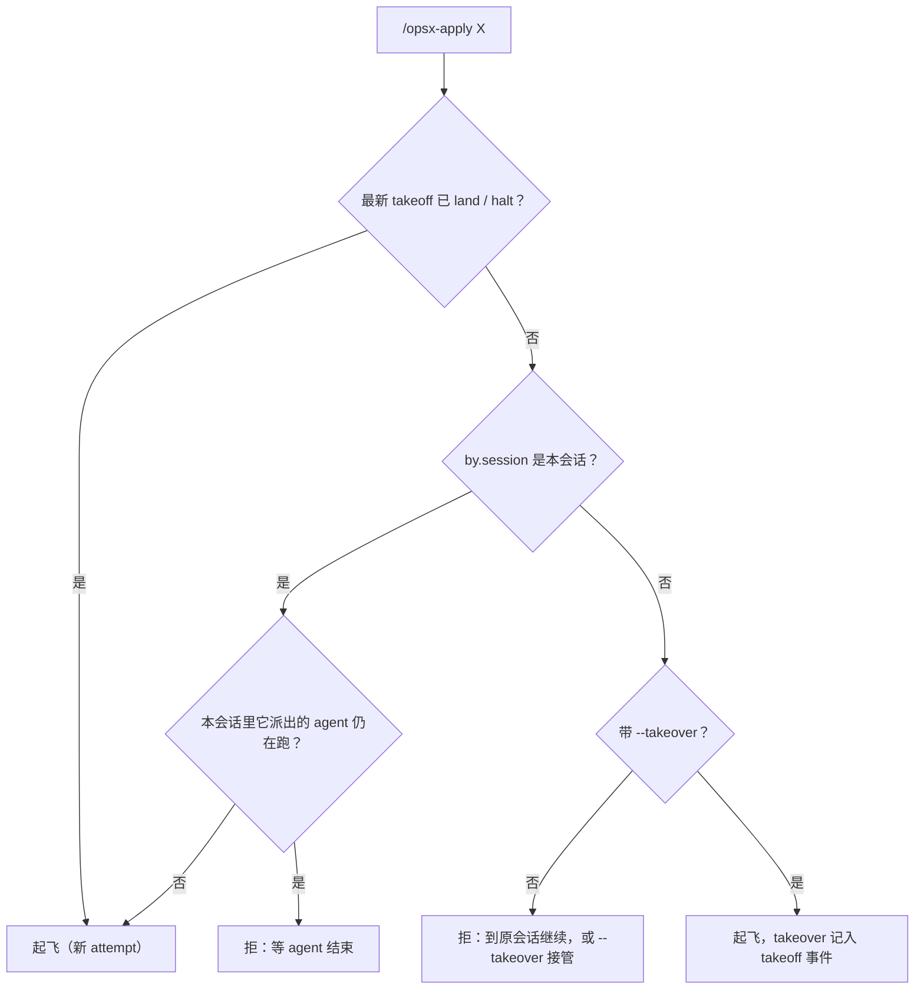
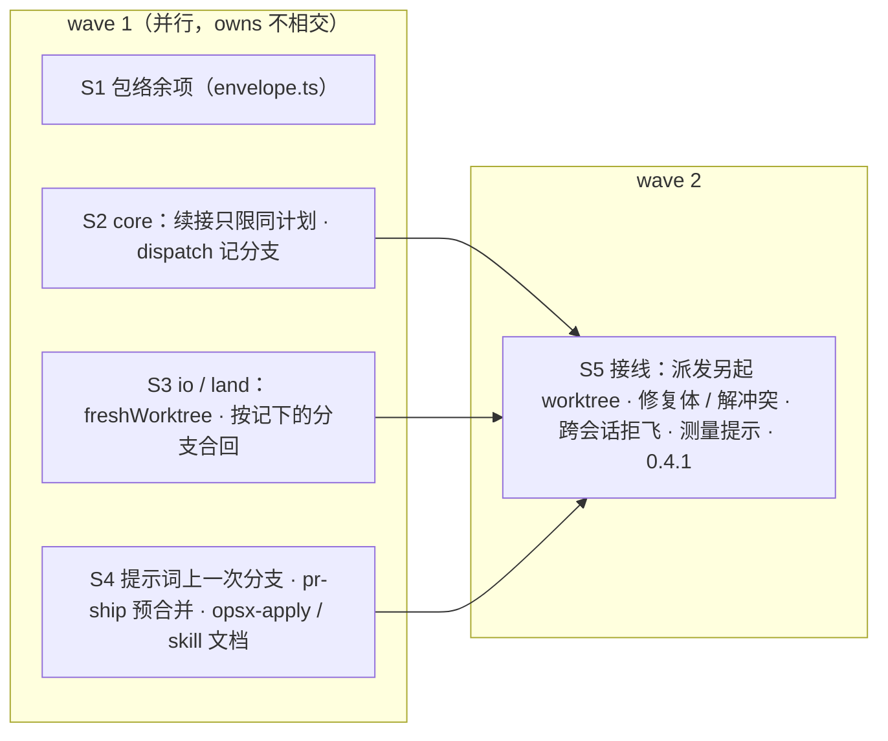

## Context

flight-measure（#46）飞了四次 attempt，证据都在账本 `refs/flight/flight-measure/ledger` 和 PR #46 正文的「飞行实况」里：
- **attempt 1**：S7 阻断后，控制面仍派出修复体。#45 已修，切片阻断时直接停飞。
- **计划修订之后**：attempt 2/3 的 S7 被派进旧 worktree。`ensureWorktree` 见到路径已存在就原样复用，切片包、`slices.json` 与门禁判定的 owns 都是旧版本。
- **attempt 2 与 3 来自两个会话**：起飞前的并发检查用 `$.agent.list()`，只看得到本会话的 agent。
- **修复体**：`ensureWorktree(FIX)` 复用了 attempt 1 从旧尖端切出的 worktree，它的全量 final 必然红。

**用户在本 change 规划时定的两点**（2026-10-11）：
- 跨会话起飞默认拒飞，`--takeover` 显式接管；
- 新派发遇到同名旧 worktree 时另起一棵，旧的原样保留。

**相关事实**：
- 合回、解冲突、修复合回现在都把分支名写死为 `flight/<change>/<S>`、`flight/<change>/<S>-resolve`、`flight/<change>/fix`。
- 账本的 dispatch 事件允许表外字段（`ledger.py` 与 `io.ts` 都只校验必需字段）。
- 铁律 6：不删 worktree。

## Goals / Non-Goals

**Goals**：
- 续飞永远不会把执行体或修复体派进过期的现场；
- 同一个 change 不会被两个会话同时驱动，除非人显式接管；
- #46 评审留下的包络缺口闭合；
- `/pr-ship` 的冲突检查如实。

**Non-Goals**：
- **清理旧 worktree**：清理仍是人的动作，交给用户执行（铁律 6）。
- **判断另一个会话是否还活着**：插件没有这种能力，由人用 `--takeover` 表态。
- **default 权限模式下 `cd` 前缀判 ask 还是 deny**：仍待实测。

## Decisions

### D1 · 新派发另起 worktree（用户定）
- **函数**：新增 `io.freshWorktree(io, f, name, attempt)`。
  - `<主 worktree>/.claude/worktrees/flight-<change>-<name>` 不存在 → 按 `name` 建，分支为 `flight/<change>/<name>`；
  - 已存在 → 建 `<name>-a<attempt>`，分支为 `flight/<change>/<name>-a<attempt>`；
  - 两者都已存在 → 报错（本片记 blocked infra）。
  - 返回 `{ path, branch }`。
- **新派发**指：没有续接说明的执行体派发、每个 attempt 第一次派修复体、每次派解冲突 agent。
- **续接**（带 `continuation`）复用上一个执行体 dispatch 记下的 worktree 与分支；那棵 worktree 已不存在时退回新派发。
- **dispatch 事件**：多记一个表外字段 `branch`。旧账本的 dispatch 没有这个字段时，由 worktree 路径推出分支（`flight-<change>-<name>` → `flight/<change>/<name>`）。
- **否决**：重置或删除旧 worktree。会丢掉旧现场里未提交的工作，也违反铁律 6。

### D2 · 续接只限同一份计划
`core.next` 决定本 attempt 首次派发某片时：
- **计划指纹不同**：上一个执行体 dispatch 所在 attempt 的 takeoff 指纹，与本次 takeoff 不同 → 一律新派发，不续接、不补跑门禁（regate）。旧现场是按旧计划做的。
- **指纹相同**：行为不变，即上次已绿就 regate，否则带续接说明续接。
- 上一次被 blocked 的切片仍按新派发处理（现状如此）。

### D3 · 按记下的分支合回
- `land.mergeSlice(…, branch)`：合并、已合回判定、越界与空合回检查都改用传入的分支。
- `land.prepareResolve(…, { branch, attempt })`：解冲突 worktree 同样按 D1 另起，合并传入的切片分支。
- `land.finishResolve(…, resolve)`：用解冲突 dispatch 记下的 worktree 与分支。
- `land.mergeFix(…, branch)`：用修复体 dispatch 记下的分支。
- 缺省（不传分支）时沿用旧的拼法，兼容旧账本。
- 控制面传入的分支取自本片最后一次门禁绿的那个 agent 的 dispatch。

### D4 · 提示词给出上一次的分支
新派发另起了 worktree，并且本片先前有过执行体 dispatch 时，执行体提示词加一行：
> 上一次（attempt k）的分支 `<branch>` 留作参考：可以 `git show` / `git diff` 读取，不得 cherry-pick 或 merge；一切以当前切片包为准。

### D5 · 跨会话起飞（用户定）
`takeoff` 读账本后、写任何东西之前：最新 takeoff 的 `by.session` 不是本会话，且该 attempt 没有 land / halt：
- **没有 `--takeover`** → 拒飞，回复：
  > flight：<change> 的 attempt N 由另一个会话（<id 前 8 位>）起飞，尚未落地或停飞；到那个会话里继续，或确认它已结束后用 `/opsx-apply <change> --takeover` 接管
- **有 `--takeover`** → 照常起飞，takeoff 事件多记表外字段 `takeover: <原会话 id>`。

同会话的「agent 仍在运行」检查不变。`--takeover` 不属于透传给 Workflow 的参数。



### D6 · 包络余项（#46 评审 MEDIUM 与范围外线索）
- **前缀命令**：`words` 判前缀（`builtin`、`command`、`exec`、`env`）时，对词先去一层引号，再取 basename。`/usr/bin/env -u FOO git push` 与 `"exec" -a n git push` 都按前缀剥掉，后面的 git 照常判定。
- **目录参数中的展开**：`resolveDir` 对参数做一次去引号后，只要任意位置还有 `$`、反引号、`'` 或 `"`，就返回 null（无法判定）。`cd`、`pushd`、`git -C`、`--git-dir`、`--work-tree`、`env -C` 都走这里，一处改全覆盖。
- **拒绝理由**：「无法判定」的拒绝理由改为「作用目录无法判定（目录栈旋转、相对路径无基准、变量或命令替换等）」。

### D7 · 测量工具判不出归属
`mcp__flight__measure` 的调用处理先查 `ownership`：结果为判不出时，回复「flight：暂时无法判定你的归属（账本读取失败），稍后重试测量」。

### D8 · `/pr-ship` 预合并
第 4 步改为：
```bash
git fetch origin <target>
git merge-tree --write-tree --name-only HEAD origin/<target>
```
- **退出 0**：无冲突。
- **退出 1**：有冲突，输出第一行之后、空行之前列出冲突文件，报告这些文件后停下交用户。
- **其他退出码**：报告错误。

需要 git ≥ 2.38，与 flight 起飞检查一致。

### D9 · 文档与版本
- **文档**：`opsx-apply.md` 与 `openspec-apply-change/SKILL.md` 同步写明：
  - `--takeover` 的含义与适用场景；
  - 新派发另起 worktree、旧现场保留，以及清理交给人。
- **版本**：插件升到 0.4.1。

### 切片与 wave



## Risks / Trade-offs

- **测量协议首飞**：本 change 是测量协议上线后的第一次飞行。执行体须先让测试红并调用 `measure`，G5 按账本判定、不满足即判红。如果首飞暴露出测量协议本身的问题（误判红、测量超时等），如实记入 PR，不绕过门禁。
- **旧 worktree 越积越多**：另起 worktree 不删旧的，清理靠用户（现在已有清理脚本的做法）。这是遵守铁律 6 的代价。
- **`--takeover` 依赖人的判断**：人误接管时，原会话仍在跑的 agent 可能与新 attempt 并发。D1 让新派发另起 worktree，所以两边至少不会改同一棵树；续接的那片仍有风险，接管提示里写明「确认它已结束」。
- **天花板**：
  - 目录参数里只要有引号字符就判为无法判定（去掉一层引号之后），宁可多拒；
  - 兼容旧账本时，分支由 worktree 路径推出。

## Migration Plan

合入后：主检出快进，`claude plugin update flight@intent-driven`，再 `/reload-plugins`，确认起飞回复显示「插件 0.4.1」。

## Open Questions

无。两处取舍已由用户定（见 Context）。
