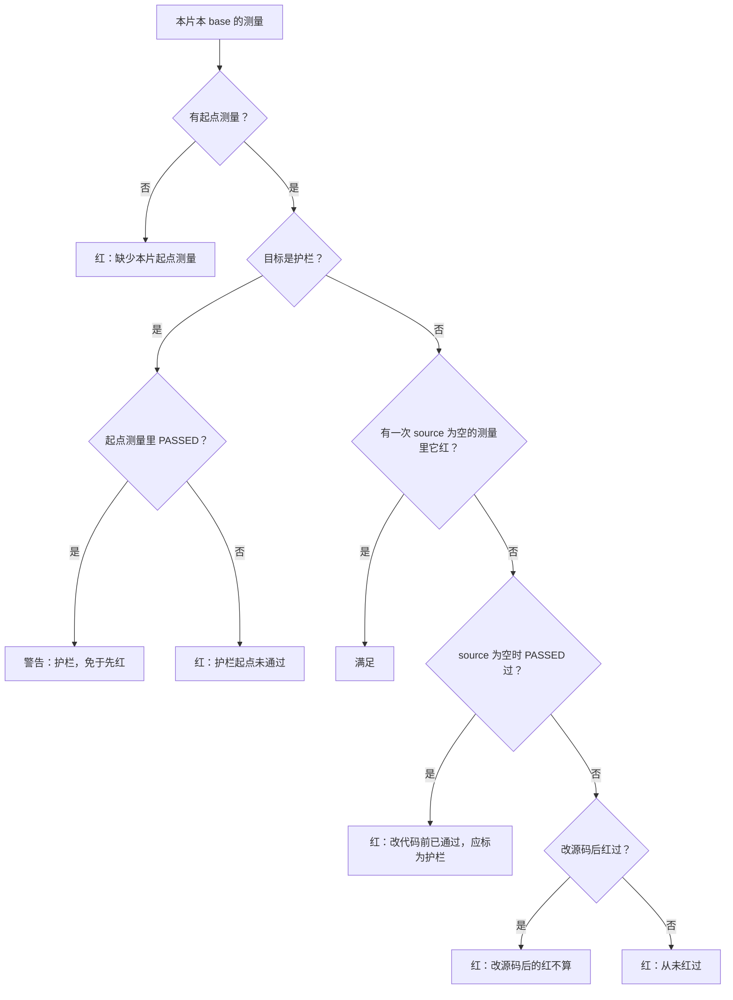
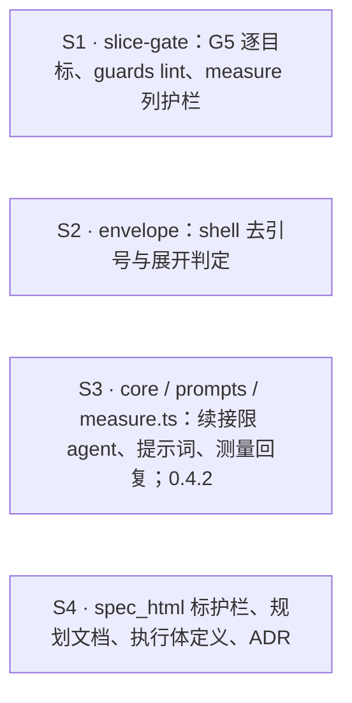

## Context

- **G5 现状**（`slice-gate.py` 的 `g5_ledger_verdict`）：
  1. 缺起点测量（`changed` 为空的测量）→ 红；
  2. 起点测量里 PASSED 的目标 → 自动免于先红（记警告）；
  3. 其余目标逐个要求「在任一测量里红过」，**不看这次红时有没有改源码**；
  4. 另有一条整片判定：必修目标里**至少一个**在 `source` 为空的测量中红过。
- **漏洞**：第 3、4 条合起来，只要整片有一个真红，其余目标都能靠改源码后的红过关。#47 的 S5 就是这样放过了「删一处实现 → 测红 → 恢复」。
- **测量工具**（`measure.ts` 的 `report`）对改源码后的红已提示「不能作为先红证据」，所以工具与门禁的口径不一致。
- **包络**：
  - `progName` 只去掉首尾一层引号，`parseGit` 的程序名、子命令、全局选项都不做去引号；
  - `segmentsVerdict` 用 `toks[0] === 'cd'` 之类的字面比较；
  - `\git`、`git "push"`、`\cd`、`\bash -c` 因此都认不出来。
- **续接**：`core.ts` 的 `firstDispatch` 取 `g = last(gate && slice===s && seq > prev.seq)`，没有限定 agent。

## Goals / Non-Goals

**Goals**
- G5 在逐个目标的粒度上执行铁律 3：每个必须先红的目标，都要在生产代码未改动的控制面测量里红过。
- 免于先红只给人批准过的护栏，而且控制面要亲自测到它在起点已通过。
- 包络对命令名与 git 词先做 shell 去引号再判断；展开出现在命令名位置时判为无法判定。
- 续接不拿别的 agent 的门禁结论。

**Non-Goals**
- **不做完整的 shell 词法分析**。下面几类仍是 ceiling，在注释里写明：
  - 参数里的 `$` 展开（如 `git commit $FLAGS`）不判；
  - 双引号里的反引号不判；
  - 引号里的分隔符照旧切段。
- 不改 G7 与其余门禁项。
- **#47 遗留的 LOW 不在本 change 范围**，原样留在记录里：
  - 跨会话提示在 `by.session` 为空时显示空括号；
  - 测量处理里重复扫描账本；
  - `resolvePath` 重复拼写；
  - 测试空格与过时注释。
- 本 change 自身不使用 `guards`：它由主检出的旧判定器判。

## Decisions

### D1 · G5 逐目标先红（用户定）

`g5_ledger_verdict(events, slice_id, base, pairs, guards)`。`guards` 是本片护栏 scenario 的目标集合。

**取测量**：取本片、本 base 的测量 `ms`，从中再取两组：
- `starts`：`changed == []` 的测量；
- `clean`：`source == []` 的测量。

**判定顺序**：
1. **没有起点测量** → 红：「缺少本片起点测量」（不变）。
2. **护栏目标 t**：
   - 在某次起点测量里是 PASSED → 记警告「G5 measure: t 为护栏（计划已批准），起点测量已通过，免于先红」；
   - 否则 → 红：「G5 measure: 护栏 sid → t 在起点测量里未通过（护栏测试须在规划时写好、base 上已通过）」。
3. **非护栏目标 t**：须存在一次 `clean` 测量，t 在其中为 FAILED 或 ERROR。否则红，失败项按情形区分，都点名 sid → t：
   - **曾在某次 `clean` 测量里 PASSED** → 「在改生产代码之前就已通过：若它描述的行为在 base 上本已成立，应在计划里标为护栏（slices.json guards）并预写测试；不要改坏生产代码造红」；
   - **只在 `source` 非空的测量里红过** → 「只在改了生产代码之后测到红（改源码后的红不算先红证据）」；
   - **从未红过** → 「从未在控制面测量中红过（写好测试后调用 measure 看它红，再写实现）」（措辞不变）。
4. **删除的旧规则**：
   - 整片判定「每次见红时都已改动生产代码」；
   - 「在本片起点已通过，免于先红」的隐式豁免。

**目标的范围**：
- 非 pytest 目标照旧只记警告「无法测量」；
- 多个 scenario 映射到同一测试时，每个 scenario 各判一次，失败项去重。

**代价（用户已知）**：执行体必须先把本片的 scenario 测试全部写好、测一次红，再写实现。切片包的测量协议本来就这样要求。

### D2 · `guards` 字段与 lint（用户定）

- **形状**：`slices.json` 的每个切片可带 `guards: [scenario id]`，缺省为空。整个文件计入计划指纹（`plan_fp.py` 现状），所以改护栏要重新批准。
- **`lint_plan` 加两条错误**：
  - `guards: <S> 的护栏 <sid> 不在本片 scenarios 里`；
  - `guards: <S> 的护栏 <sid> 没有 scenario_tests 映射`。
- **`cmd_lint` 再查一条**（需要读文件，所以不放进纯函数 `lint_plan`）：护栏映射的 Python 测试函数仍带 xfail 标记时报错 `guards: <sid> 的测试 <target> 仍带 xfail（护栏须在规划时写好、base 上已通过）`。
  - 识别标记沿用 G7 已有的装饰器解析（含别名 `XF = pytest.mark.xfail(...)`）；
  - 起飞时 orchestrator 先跑 lint，所以这条也拦得住起飞。
- **`cmd_gate`** 把本片 `guards` 对应的映射目标传给 G5。

### D3 · 测量输出与回复

- **`slice-gate.py measure`**：输出的 JSON 增加 `guards`，内容是本片护栏的映射目标列表（无护栏时为 `[]`）。
- **`measure.ts`**：
  - `MeasureJson` 增加 `guards`，缺省为 `[]`；
  - 回复里，凡 PASSED、不在 `guards` 里、且本次 `source` 为空的目标，追加一行：「注意：<t> 在改生产代码之前就已通过：若它描述的行为在 base 上本已成立，这是计划错误（应标为护栏）；不要改坏生产代码造红，照实收口说明」；
  - 护栏目标不提示。

### D4 · 执行体提示词与执行体定义

- **`prompts.ts` 的 `executorPrompt`**：在「调用 `measure` …看它红」这一行之后，加一行：「某个目标在改生产代码前测量就已通过（且不是护栏）时，不得改坏生产代码来造红：照实收口，写明是哪个 scenario。」
- **`agents/executor.md`**：TDD（测量协议）那一条写明同样的规则，并说明 G5 逐目标判：
  - 先把本片全部 scenario 测试写好、测一次红，再写实现；
  - 改源码后的红不算。

### D5 · 规划文档与 ADR

- **schema.yaml 的 tasks instruction**、`/opsx-propose` 与 `openspec-propose` skill、`/opsx-continue` 与 `openspec-continue-change` skill（命令与同名 skill 同改）：
  - 描述骨架的地方补一段**护栏 scenario**：
    - 行为在 base 上已成立的 scenario（保持原行为、不回归）列进所属切片的 `guards`；
    - 它的测试在规划时写完整、不带 xfail，base 上须通过；
  - 其余 scenario 照旧用 strict-xfail 骨架。
  - `slices.json` 的结构说明里加上 `guards`。
- **`DRAFT-flight-measure-protocol.md`**（仍是草案，直接改）：第 2 条的豁免规则改为「只有 `guards` 里的目标免于先红，且须在起点测量里已通过」，并写明 G5 逐目标判、改源码后的红不算。

### D6 · 审批页标出护栏

`spec_html.py` 的 Scenario 状态表：护栏 scenario 的状态格前加一个 `护栏` 标签（`护栏`），审批人一眼可见哪些 scenario 免于先红。

### D7 · 包络 shell 去引号

**新增 `shellWord(t): string | null`**：对单个词做 shell 去引号，规则如下：
- 单引号内原样保留；
- 双引号内，`\` 只转义 `$`、反引号、`"`、`\`；
- 引号外，`\x` 变成 `x`；
- 不配对的引号按字面去掉；
- 单引号外出现 `$` 或反引号时，返回 null（展开，无法判定）。

**用在这些位置**：
- `progName`（前缀命令、`eval` / `bash -c` 识别、读标准输入的解释器）；
- `cd` / `pushd` / `popd` / `export` 的识别；
- `parseGit` 的程序名、全局选项名、子命令；
- `dangerOf` 与 `bashUpgradable` 的选项匹配：参数先去引号，结果为 null 的保持原样。

**判为无法判定、予以拒绝**，理由含「无法判定」：
- 命令名（剥掉前缀之后的第一个词）、git 子命令或 git 全局选项的 `shellWord` 为 null；
- 反引号命令替换出现在命令名位置：在原始命令里，反引号之前、到上一个分隔符（开头、`&&`、`||`、`;`、`|`、`&`、换行、`(`）之间，除了 `VAR=val` 与前缀命令外没有别的词。

**ceiling**：参数里的展开不判，所以 `git commit -m "$(cat msg)"` 照常放行。

### D8 · 续接只认同一 agent 的门禁

`firstDispatch` 里的门禁结论 `g` 加限制：`e.agent === prev.agent || e.agent === REGATE`。续接说明的 `failed` 与 `base` 也随之只来自这些门禁。`beforeExecutor` 的 base 查找不改：#47 复核已确认，regate 只来自 `g`，所以它被 `g` 的限定覆盖。

### D9 · 版本

插件版本升到 0.4.2。

## 切片与 wave

一个 wave，四片的 owns 互不相交：

- **接口约定**：`slice-gate.py measure` 的 JSON 增加 `guards`（S1 写，S3 读）。S3 的 TS 测试用假输出，缺省 `[]`，所以两片之间不设依赖。

## Risks / Trade-offs

- **逐目标先红要求先写全部测试**。执行体如果习惯逐个目标增量 TDD，会在 G5 红一次。缓解：
  - 提示词与执行体定义都写明；
  - 门禁失败项说明原因；
  - 门禁红后重派一次（现状）。
- **护栏可能被滥用**：规划者可能把真正的新行为标成护栏。缓解有三层：
  - G5 要求护栏在起点已通过，新行为在 base 上不会通过；
  - 审批页标出护栏，由人批准；
  - 评审员看测试质量。
- **G5 加严后，旧的飞行记录在重放判定时可能变红**。门禁只判当前飞行，旧 PR 已合入，不受影响。
- **包络去引号后会多拒一些罕见写法**：例如程序名本身就带引号字符的脚本。方向只会更严。
