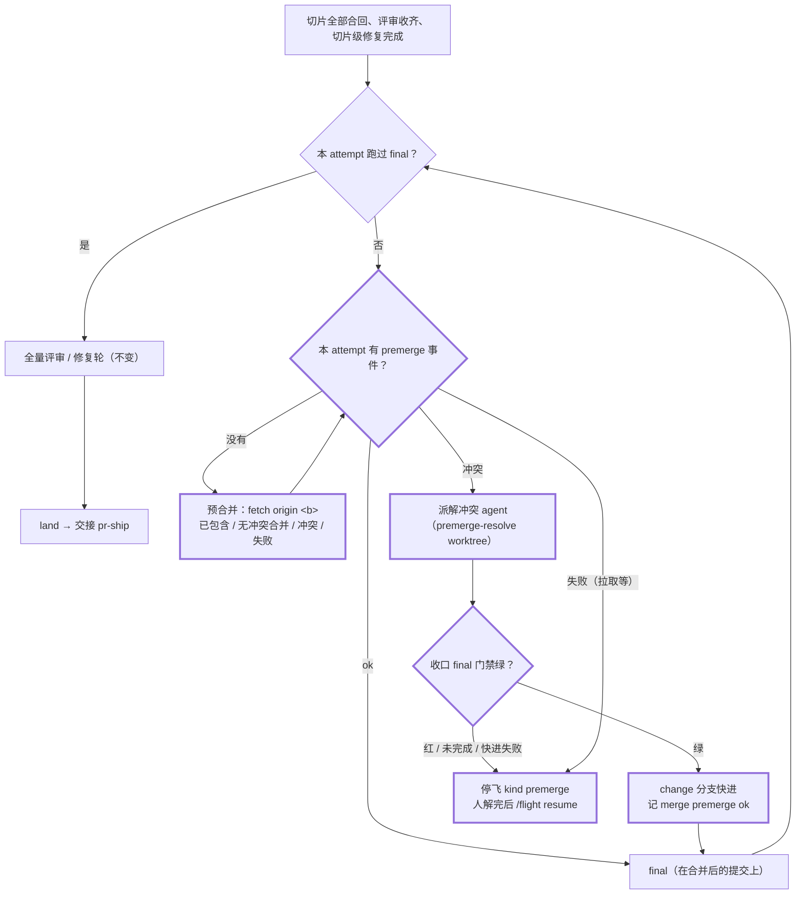
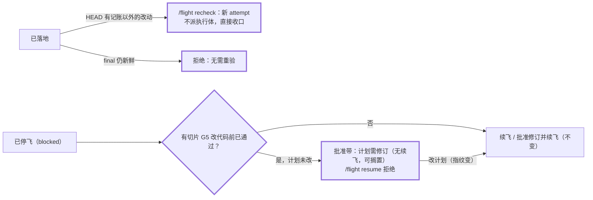

## Context

触发器命中：
- **跨模块**：判定器（`ledger.py`）、插件状态机（`core.ts`）、编排与落地（`orchestrator.tsx`、`landing.tsx`、`land.ts`、`prompts.ts`）、批准带（`register.tsx`）、测试基座、文档。
- **数据模型**：账本新增事件 `premerge`、停飞 kind `premerge`。
- **安全 / git 边界**：控制面开始在本地把目标分支合进 change 分支（见 ADR `DRAFT-flight-premerge-before-final`）。

动机见 proposal；人在 2026-10-14 的决策页 `docs/flight-post-61-adjustments.html` 全选第一项（A1、B1、C1、D1–D3），合成一个 change。

现状（读码核实，main @ `ff19ecd`，插件 0.11.0）：
- **收口顺序**（`core.ts` `closing()`）：切片全部合回且评审收齐 → 切片级修复 → `final` → `wholeReview`（全量评审、修复轮至多 2 轮）→ `land`。落地（`landing.tsx`）在 land 事件后交接 `/flight:pr-ship`，pr-ship 第 4 步才与 target 预合并。
- **全量评审起点**（`landing.tsx` `wholeBase`）：`git merge-base <final commit> <主检出 HEAD>`。主检出落后于 `origin/main` 时，评审范围会混进别人已合入的改动。
- **`ship` 新鲜度**（`slice-gate.py` `_final_fresh`、`ship_verdict`）：final 之后的提交只改了记账文件才算新鲜；评审之后有代码提交即「全量评审过期」。`ship.ts:97` 在裁决 draft 时会把非 draft 的 PR 退回 draft（无缺陷）。
- **解冲突**（`land.ts` `prepareResolve` / `finishResolve`，`orchestrator.tsx` 第 418 行起）：另起 `<S>-resolve` worktree（从 change 分支尖端切出），在其中合并切片分支、派 resolver；收口跑切片门禁；绿则 change 分支 `--ff-only` 快进。
- **续飞**（`orchestrator.tsx` `takeoff()` 第 683 行）：`/flight resume` 对已落地的 attempt 拒绝；普通 `/opsx-apply` 在落地后仍会起新 attempt，新 attempt 里切片已合回、已评审（跨 attempt 计入），`next()` 直接进入 `closing()`。
- **停飞后的批准带**（`register.tsx` 第 255 行）：halt 且非 abort → 计划未改给「续飞」，改了给「批准修订并续飞」，不看停飞原因。
- **G5 预通过**（`slice-gate.py`）：blocked 原因形如 `G5 measure: <scenario> → <target> 在改生产代码之前就已通过：若它描述的行为在 base 上本已成立，应在计划里标为护栏…`，计划不改时结论确定。
- **插件测试**（`tests/test_flight_plugin.py`）：`plugin_run()` 跑一次 `claude plugin test` 并收集 `(pass)` 名单，`assert_ts_passed` 只查名单，不看退出码与 `(fail)` 行。main 上 `orchestrator.test.tsx` 收尾报 `(fail) the file ran to its end`（`a rejection nothing handled: no implementation for turn.step`）；二分到文件末尾 33 个用例（自 `ticker-not-duplicated` 起）后拆半不再复现，取决于用例组合，推测是某用例留下的后台任务在它的测试世界拆掉后才请求 `turn.step`（未核实）。
- **测试世界的 git**（`orchestrator.test.tsx` 第 380 行起）：`remote` 应答 GitHub 地址；`merge-base` 一律 exit 0；遇到 `fetch` / `symbolic-ref` 抛 `unexpected git`。

图（c4-diagrams：目的 = 评审落地流程改动；格式 = 普通 Mermaid flowchart；严格度 = 轻量，作为假设记录）。

收口阶段的动态视图（粗框为本 change 新增）：

落地之后与停飞之后的入口（粗框为本 change 新增或改动）：

图说明：
- **边界**：预合并只写本地 change 分支与 `<change>-premerge-resolve` worktree；不推送、不碰 main。
- **信任**：解冲突的结果只由随后的 final 门禁与全量评审把关，不另设人工确认；解不开就停飞交人。
- **假设**：`origin/HEAD` 在常见克隆里存在；目标分支即 pr-ship 缺省 target；同一 change 同一时刻只有一个会话在驱动（起飞已有跨会话守卫）。

## Goals / Non-Goals

**Goals**：
- 常规落地（目标分支无冲突或冲突可解）在合并后的提交上得到新鲜的 final 与全量评审，`ship` 可判 ready；
- 计划缺陷停飞不再诱导无效续飞；
- 插件 TS 测试的任何失败都会让全量 pytest 变红；
- 每个行为都有 scenario 测试。

**Non-Goals**：
- **不支持 pr-ship 指定的非缺省 target**：飞行内只合 `origin/HEAD` 指向的分支；用别的 target 时照旧可能在 pr-ship 第 4 步冲突，按 `/flight recheck` 重验。
- **不让诊断员的结论参与判定**：B 只看账本 blocked 原因文字（零 token），design D6 不变。
- **计划缺陷只认 G5「在改生产代码之前就已通过」**：G7 映射类错误可能是执行体删了测试，不确定，不纳入。
- **不改历史 change 的 scenario 映射旧名（D3）**：已完成 change 的 `slices.json` 里映射仍是改名前的测试函数名（例如 `test_plugin_version_0_10_3`），不影响任何门禁；约定：历史 change 的映射不随后续改名更新，以后若要对历史 change 重跑门禁再统一处理。本仓库没有独立的 backlog 文件，这条只记在这里。
- **不处理两个会话同时改同一 worktree、批准带刷新撞 `index.lock`**：本次只观察到现象，未核实成因。

## Decisions

### D1 · 收口加预合并（`core.ts`，S2 建立、S4 补冲突分支）
- `closing()` 里，本 attempt 还没有 final 时先看 `premerge`：
  - 本 attempt 没有 `premerge` 事件 → 动作 `{ kind: 'premerge' }`；
  - 最新 `premerge` 的 `ok` 为真 → `{ kind: 'final' }`；
  - `ok` 为假且 `conflicts` 为空（拉取失败等）→ 停飞 kind `premerge`，原因含 `reason` 与「/flight resume」；
  - `ok` 为假且有冲突：S2 先按停飞处理；S4 改为解冲突流程（D4）。
- 之后的 final（整合修复合回、修复轮合回后重跑）不再预合并：预合并每个 attempt 只做一次。
- 新 Action `{ kind: 'premerge' }`；`ev.premerge` 构造器；`HaltKind` 加 `premerge`。
- **否决**：把预合并塞进 final 动作内部（失败与冲突只能伪装成 final 红，会误触发整合修复）。

### D2 · 执行预合并（`land.ts` 新函数 + `orchestrator.tsx` / `landing.tsx` 记事件，S2）
1. 提交遗留飞行记录（`commitRecords`），保证 change worktree 干净；
2. `git remote get-url origin` 失败 → 跳过：`ok: true`，`reason: '无 origin，跳过预合并'`，`ref`、`target` 为空；
3. 目标分支：`git symbolic-ref --short refs/remotes/origin/HEAD`（如 `origin/main`），失败用 `origin/main`；记为 `ref`；
4. `git fetch origin <分支>` 失败 → `ok: false`，`reason: '拉取 <ref> 失败：<首行>'`；
5. `target = git rev-parse <ref>`；
6. `git merge-base --is-ancestor <ref> HEAD` 成立 → 已包含：`ok: true`，`reason: '已包含'`，不合并；
7. `git merge-tree --write-tree --name-only HEAD <ref>`：退出 1 → `ok: false`，`conflicts` 为冲突文件；其他非 0 → `ok: false`，`reason` 为错误首行；
8. 退出 0 → `git merge --no-edit <ref>`；成功 → `ok: true`，`commit` 为合并后的 HEAD；失败 → `ok: false`，`reason` 为错误首行。
- 事件：`{ ev: 'premerge', attempt, ok, ref, target, commit, conflicts, reason }`（`ledger.py` 与 `io.ts` 的事件表同步，S1 / S2）。
- **否决**：在 change worktree 里直接 `git merge` 再看是否冲突（冲突会在 change worktree 留下合并现场，影响后续一切 git 操作）。

### D3 · 全量评审起点（`landing.tsx` `wholeBase`，S2）
- 本 attempt 最新 `ok` 的 `premerge` 有非空 `target` → 起点为 `target`；`target` 等于 final commit 时报「没有可审的改动」（同现状）。
- 没有（跳过预合并的旧仓库）→ 沿用 `merge-base <commit> <主检出 HEAD>`。

### D4 · 预合并冲突交解冲突 agent（`core.ts`、`orchestrator.tsx`、`land.ts`、`prompts.ts`，S4）
- **core**：最新 `premerge` 有冲突时，在该事件之后：
  - 没有 `slice: 'premerge'` 的 resolver 派发 → `{ kind: 'dispatch', role: 'resolver', slice: 'premerge', conflicts }`；
  - 解冲突 agent 未结束 → 等；
  - 结束且最后一条收口门禁绿 → `{ kind: 'merge', slice: 'premerge', via: 'resolve' }`；
  - 结束但门禁红 / 没有结论 → 停飞 kind `premerge`：「预合并冲突未解开：<冲突文件>；人工在 change worktree 合并 <ref> 并提交后 /flight resume」；
  - `merge premerge` 失败 → 同上停飞；成功 → `{ kind: 'final' }`。
- **派发**：`prepareResolve(io, f, 'premerge', { branch: <ref>, attempt })`，在 `<change>-premerge-resolve` worktree（被占用则 `-a<attempt>`）从 change 分支尖端合并 `<ref>`；不调 `sliceBase`（premerge 不是计划切片）。提示词用新的 `premergeResolverPrompt`：说明是把目标分支合进 change 分支、两边意图都保留、只解列出的文件。
- **收口**：`classic.SubagentStop` 对 `slice === 'premerge'` 的 resolver 跑 `final` 门禁（`runFinal`，cwd 为解冲突 worktree），不跑切片门禁；其余沿用 `stopVerdict`。
- **合回**：`finishResolve` 快进；`premerge` 不刷新接口摘要；land 的 `merged` 列表排除 `premerge`。
- **否决**：解冲突后直接在 change 分支上提交（绕开 worktree 隔离与收口门禁）。

### D5 · `/flight recheck <change>`（`orchestrator.tsx`，S4）
- 只认人发出（`HOST_ORIGINS`）；`FLIGHT_USAGE` 补上它。
- 前置：最新 attempt 已落地；跑判定器 `slice-gate.py ship --change-dir <dir>`，`reasons` 里有「final 过期」或「全量评审过期」才继续，否则回「flight：<change> 无需重验：final 与全量评审仍新鲜」；未落地回「flight：<change> 尚未落地：在飞或停飞时用 /flight resume」。
- 继续时走普通起飞（非 resume）：新 attempt 里切片已合回、已评审，`next()` 直接进入收口 → 预合并 → final → 全量评审 → land → 交接 pr-ship。回复首行同起飞回复。
- **否决**：让人重发 `/opsx-apply <change>`（可用但语义不清，且不判新鲜度，误发会白跑一轮 final 与评审）。

### D6 · 计划缺陷（`core.ts` 纯函数 S2；`orchestrator.tsx` S4；`register.tsx` S5）
- `planDefect(state): string | undefined`：最新 attempt 以 halt 结束且 kind 为 `blocked`，本 attempt 有 blocked 事件的 `reason` 同时含 `G5 measure` 与「在改生产代码之前就已通过」→ 返回该原因首行；否则 undefined。
- **`/flight resume`**：`planDefect` 有值、且当前计划指纹等于最新 takeoff 的指纹 → 拒绝、不写 takeoff：「flight：<change> 计划需修订：<原因首行>。计划不改，续飞仍会在同一处停飞；先改计划（如把该 scenario 标为护栏），再在批准带按「批准修订并续飞」」。文字不得含「未批准」「计划已变」（起飞待命会误归为等人按键）。
- **批准带**：停飞项 `planDefect` 有值且计划未改 → `FlightItem.defect = <原因首行>`，绘制「计划需修订：<原因首行>」与一行 dim「改计划后会出现「批准修订并续飞」」；不画主按钮，仍画「搁置」。按到 `resume:` 键的旧按钮 → toast 同上并刷新。

### D7 · 插件测试零失败（`tests/test_flight_plugin.py` + 根因，S6）
- 新函数 `suite_failures(text) -> list[str]`：返回输出里每个 `(fail) <名字> [` 行的名字（含 `the file ran to its end`）。
- 新 scenario 测试断言真实插件测试 `suite_failures(...) == []`。
- 修根因：在 `orchestrator.test.tsx`（及其所涉的插件代码）里找到留下未处理拒绝的用例并修好；修法以「不留后台任务 / 测试世界提供 turn.step 应答」为先，不改用例断言。

### D8 · 小修（S4、S5）
- **D1（S5）**：命令认领 hook 的 catch 在 `next.called` 时回复 `flight：命令执行出错：<下游错误首行>`（错误取 `(next as { error?: { message?: string } }).error?.message`，同 SubagentStop 的 catch）；未调 next 照旧 `next(e)`。
- **D2（S4）**：「工件之外」拒绝信息里，工件之外的路径全是改名行时，不给「列进 artifact_files」的出路，改为「改名行插件不代为提交，也不能列进 artifact_files：先 `git mv` 回原名，或自行提交这次改名，再重发 /opsx-apply <change>」；混有其他路径时两条出路都给。

### D9 · 文档与版本（S3）
- `opsx-apply.md` 与 `openspec-apply-change/SKILL.md` 同改：落地前预合并（含冲突交解冲突 agent、解不开停飞）、`/flight recheck`、「计划需修订」。
- `template/plugins/flight/commands/pr-ship.md` 第 4 步：飞行模式下落地前已预合并，这里通常无冲突；落地后又有冲突，人解完后发 `/flight recheck <change>`，不要手工转 ready。
- `plugin.json`：0.12.0（新行为，次版本 +1），description 补「落地前预合并」；`test_band_session_scope_docs.py` 的 `== "0.11.0"` 放宽为「不低于 0.11.0」。

## Risks / Trade-offs

- [落地时 `origin` 不可达] → 停飞 kind `premerge`，人恢复网络后 `/flight resume`；只影响收口，切片成果都已合回。
- [解冲突 agent 改坏他人代码] → 收口跑 final 门禁、随后全量评审覆盖目标提交以来的全部改动；仍不放心时人类 PR review 兜底。
- [`/flight recheck` 发现 CRITICAL/HIGH] → 修复轮的修复体要改源码，而落地后 tasks.md 已全部勾选，意图门禁可能拦下修复体，结果是 fix 轮 blocked、落地为 draft 并写明原因；本 change 不放宽意图门禁。
- [状态机加了一步，旧用例的事件序列变长] → S2 同片更新测试世界（`fetch`、`symbolic-ref` 应答，`merge-base --is-ancestor` 缺省成立即「已包含」）；断言事件序列的旧用例只允许在 final 之前插入一项 premerge。
- [与 0.11.0 之前的判定器混用] → 起飞时 `checkJudges` 拒绝（判定器不认识 `premerge`），提示更新主检出。
- [C 的根因与用例组合有关] → S6 排在最后一个 wave，在全部 TS 用例就位后定位；修不好就如实停在该片。

## Migration Plan

- 合入后：主检出 `git pull --ff-only`；`claude plugin update flight@intent-driven -s project`；`/reload-plugins`；各会话都要重载。
- 插件使用方：同步更新主检出的 `.claude/hooks/`（`install.sh --upgrade`）。
- 回滚：回退提交；回滚前已写入 `premerge` 事件或 kind `premerge` 停飞的账本会被旧判定器判损坏，须先确认没有。

## Open Questions

- 无。
