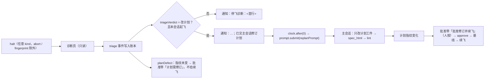

## Context

- **停飞后的现状**（main `821448f`，插件 0.12.0）：
  - halt 之后派只读诊断员（`orchestrator.tsx` `triage()`）；它结束时 `turn.complete`（agentId）hook 写 `triage` 事件、发通知、刷新批准带，然后返回（`orchestrator.tsx:1553` 起）。之后没有任何动作。
  - 诊断员的回答格式由 `prompts.ts:150` `TRIAGE_VERDICTS` 与 `agents/diagnostician.md` 规定：首行根因，第二行恰为「改计划」「修插件」「人工操作」之一，其后为草案。
  - `core.ts:384` `planDefect` 只认 G5「在改生产代码之前就已通过」；批准带（`register.tsx:261`）与续飞（`orchestrator.tsx:781`）都经它判定。
  - 起飞待命已有「交模型」路径：`$.clock.after(0, …)` 回调里 `$.prompt.submit`（`orchestrator.tsx` `submitFix`），因为 `command.run` 里调用会被引擎拒绝。
- **实测缺口**：afa `cparam-native-subhz-layout` attempt 1（2026-10-14）停飞后诊断结论「改计划」、附了草案，会话空闲到人回来；批准带给「续飞」，按下必再红。
- **约束**：铁律 7（计划批准只能是人按键）、铁律 9（零 token 判定）、铁律 10（控制面失效即停飞）；DRAFT-flight-resume-from-band 第 3 条（不新增模型可达的续飞入口）。

## Goals / Non-Goals

**Goals:**
- 诊断结论为「改计划」的停飞，不等人开口：主会话自动拿到草案改计划，人回来只需审 spec.html、按一次键。
- 计划未改时不给必红的「续飞」。

**Non-Goals:**
- 不自动批准、不自动续飞（铁律 7）。
- 「修插件」「人工操作」不交模型：前者受铁律 10 约束，后者本就要人。
- 不改诊断员的派发时机、权限与提示词格式。
- 门禁红在 owns 之外时不再重派执行体：本次不做（未被要求），记 Open Questions。
- 不加账本事件类型（判定器不用随之更新）。

## Decisions

### D1 · 结论读法：第二个非空行，严格匹配
- `core.ts` 新增 `triageVerdict(text): '改计划' | '修插件' | '人工操作' | undefined`：取第二个非空行，trim，去掉成对包住整行的 `**` 与「」，再与三者精确比较。
- 为什么取「非空行」：模型常在首行后空一行；为什么严格：「建议改计划」「改计划。」这类不按格式的回答宁可判未知（退回现状：只通知），不误交模型。
- 否决：关键字包含（「改计划」出现在任何位置）——草案正文里常有这三个字，会误判。

### D2 · 计划缺陷的第二条判据
- `planDefect` 先跑原 G5 判据，命中即返回（保持 #62 行为）；未命中时：本 attempt 有 halt，且本 attempt **最新一条** triage 的结论为「改计划」→ 返回其首行。
- 取最新一条：同一 attempt 理论上可能有多条（看门狗补派等），以最后结论为准。
- 不限 halt kind：诊断员只在非 abort / fingerprint 的停飞后派，有 triage 即说明停飞可诊断。
- 批准带与续飞拒绝无需改判定代码，自动生效；续飞拒绝文案在缺陷不来自 G5 时去掉「标为护栏」的提示。

### D3 · 交主会话：在诊断员结束的 hook 里排 clock.after(0)
- 位置：`turn.complete`（agentId）hook 的 diagnostician 分支，写完 triage、通知之后。该 hook 由外部事件触发、处在活的 hook 链里；`prompt.submit` 不派发 agent，不涉及派发凭证（DRAFT-flight-dispatch-live-frame 只约束派发）。
- 守卫：最新 takeoff 的 `by.session` 等于本会话（同 `orchestrator.tsx:533` 的写法），否则只通知。
- 至多一次：一条 triage 只在其写入时触发一次；不新增持久状态。
- 正文由 `prompts.ts` 新增的 `replanPrompt({ change, changeDir, hooksDir, attempt, triage })` 生成（与 `triagePrompt` 同处，同用 Flight 上的 `changeDir` / `hooksDir`）。
- 提交失败（引擎拒绝）：只写 log、通知里不写「已交主会话」——通知在提交前发出，因此改为：先排提交，提交回调里失败时补发一条「交主会话失败：<原因>」通知。
- 否决：插件直接改 slices.json（越过模型与人，且诊断草案可能不准）；把草案写进文件（D6 原则：诊断不落盘，避免未审内容进计划）。

### D4 · 边界写进修订请求，不新增机械拦截
- 主会话写入本就受 intent-gate 与「改计划须重新批准」约束：改了计划指纹必变，不经人按键起飞守卫不放行。
- 因此边界以文字给出（只改计划工件、不改生产代码、不发起飞命令、跑 spec_html 与 lint），不另加 hook。

## Risks / Trade-offs

- [模型按草案改错计划] → 人在 spec.html 审阅后才按「批准修订并续飞」；基线在按键后重跑，计划仍不对会再次停飞并再诊断。
- [人正在主会话里做别的事时被插入一轮] → 只在本会话起飞的飞行上触发，且这次飞行已停飞；与起飞待命「交模型」同一机制，人可随时中断。
- [诊断格式不合规导致不交接] → 退回现状（只通知 + 批准带），不比现在差。
- [诊断结论为「改计划」但计划其实无需改] → 批准带不给「续飞」；人可「搁置」或让主会话做无害改动后批准，也可直接 `/flight resume` 被拒后按需处理——比必红的续飞代价低。

## Migration Plan

- 插件 0.13.0；账本与判定器不变，旧账本照常读。已停飞、带「改计划」triage 的 change 升级后批准带即显示「计划需修订」（不会补交主会话：交接只在 triage 写入时触发）。

## Open Questions

- 门禁红且失败测试在本片 owns 之外时，是否直接 blocked、不再重派执行体（本次 afa 白跑约 5 分钟）——另立 change 再定。
- DRAFT-flight-resume-from-band 的 Consequences 写「看诊断、让主会话改工件」，本 change 由 `DRAFT-flight-triage-replan-handoff` 取代该句（只取代这一点）。
