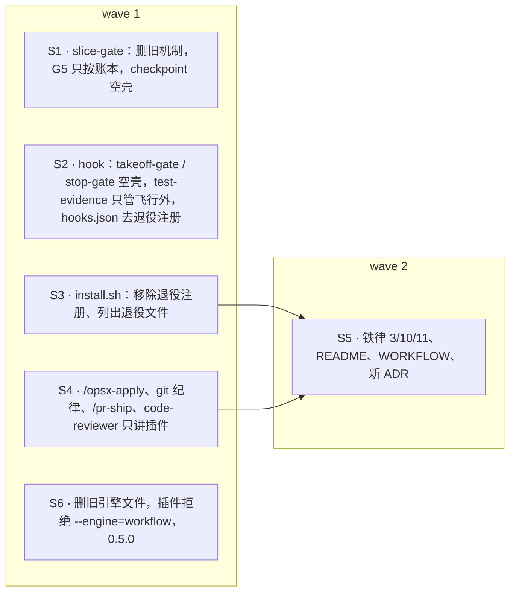

## Context

- **插件已是飞行唯一的执行者**：插件接管 `/opsx-apply`（`command.run`），派发 `flight:*` agent，自己跑判定器，并把一切写进账本 `refs/flight/<change>/ledger`。
- **旧 Workflow 引擎仍完整存在**，入口有两条：
  - `--engine=workflow`（`orchestrator.tsx:21` 的 `PASS_THROUGH` 原样交给模型）；
  - 命令文档里的 step 0–7（插件没拦下命令时模型会照做）。
- **只为旧引擎服务的机制**（2026-10-12 盘点，origin/main 36d91c3）：
  - slice-gate 的 checkpoint 快照、`--resume-checkpoint`、门禁结论 ref、`waves` 别名、G5 的 evidence.log 模式与 `hooks_missing`、`red_count`；
  - takeoff-gate 的 hook 模式（拦 Workflow / slice-executor / integrator 派发）；
  - `stop-gate.py`（让执行体自己跑门禁）；
  - `session-decompose.py`：`--expect-models` 依赖 Workflow 的 journal，其 `--session` 模式没有调用方。
- **插件仍在用的**：slice-gate 的 `start`、`record`、`--expect-branch`、`--base`、`gate --evidence ledger`；takeoff-gate 的 CLI 模式（`--change-dir`）。
- **已注册的 hook**：
  - 已安装项目和本仓库根的 `.claude/settings.json`，都注册了 `slice-gate.py checkpoint`、不带参数的 `takeoff-gate.py` 和 `stop-gate.py`；
  - 其中 `stop-gate.py` 是不带存在保护直接调用的；
  - `install.sh` 的 `merge_settings` 只追加、不删除。
- **evidence.log 的现状**：
  - 唯一的机器读者是 G5 的 log 模式，而插件一律走账本模式；
  - 飞行外（主会话修复）test-evidence 照写，供评审参考。

## Goals / Non-Goals

**Goals**
- 飞行只有一套实现：删除旧引擎及只为它服务的机制，文档只讲插件路径；插件缺席即停飞。
- 铁律与 ADR 跟实际做法一致：铁律 10 不再要求回退，铁律 3、11 不再指向旧引擎。
- 已安装项目升级、本仓库根 settings 不改的情况下，都不会因退役 hook 而出错。

**Non-Goals**
- `/flight status | abort | resume` 与飞行面板（3c 的后半，另立 change）。
- `--gate=per-task` 的 legacy 路径：仍保留，其 RED/GREEN 靠子 agent 自述，与铁律 3 有张力，记录在案，不在本 change 处理。
- `/opsx-bulk-apply` 里的 `--no-confirm` 与「step 6」说法：已过时，记录在案，另行处理。
- 本仓库根 `.claude/settings.json`：不改，原因是主检出有未提交的本地改动，改了会挡住快进。
- 兼容空壳的最终删除：留给阶段 4 的插件化分发。

## Decisions

### D1 · 删除旧引擎本体
删除以下文件：
- `template/.claude/workflows/opsx-apply.js`
- `template/.claude/agents/integrator.md`
- `template/.claude/agents/slice-executor.md`
- `template/.claude/hooks/session-decompose.py`

`tests/test_agents_workflow.py` 删除。其中三个用例仍有对象，迁到新文件 `tests/test_code_reviewer_agent.py`：
- `test_reviewer_no_rerun`、`test_reviewer_flags_symptom_fix`：仍测 code-reviewer；
- `test_executor_carries_subtractive_rules`：改测插件的 `agents/executor.md`。

### D2 · slice-gate 只留插件在用的部分（用户定）
**删除**：
- checkpoint 快照（`_ckpt_*`、`_checkpoint`、`_slice_owns`，gate 通过后删快照）；
- start 的 `--resume-checkpoint`（含从门禁结论 ref 找回后以 3 退出）；
- 门禁结论 ref（`_gate_ref` / `_gate_save` / `_gate_load`，以及 start、record 里的清除）；
- `waves` 别名；
- G5 的 log 模式（`evidence_state`、`hooks_missing`）；
- `red_count`。

**`--evidence` 参数**：只接受 `ledger`，并且是缺省值。插件照常传 `--evidence ledger`，不受影响。

**兼容入口**：`checkpoint` 子命令保留为兼容入口，什么都不做、退出 0，也不读 stdin 之外的任何东西。

**措辞**：头注释与提示里的「integrator」改为「控制面（flight 插件）」。

**测试**：`tests/test_slice_gate.py` 删去 checkpoint 段与门禁结论 ref 段；原来用缺省 log 模式调用 gate 的用例，改成账本模式并补测量事件，或者改成断言 G5 以外的门禁项。

### D3 · hook 的兼容空壳
- **`takeoff-gate.py`**：
  - 删除 hook 模式（`DISPATCH_TOOLS` / `TAKEOFF_AGENTS` / `find_change_dir` / `is_takeoff_dispatch` / `run_hook` / `emit_deny`）；
  - 不带参数运行时，读掉 stdin，什么都不输出，退出 0；
  - CLI 模式（`--change-dir`）不变。
- **`stop-gate.py`**：整文件换成兼容空壳，读掉 stdin，什么都不输出，退出 0。文件头注明「已退役：保留空壳，只为兼容仍注册它的 settings；新安装不再注册」。
- **模板 `template/.claude/hooks/hooks.json`**：
  - 去掉 PreToolUse 的 takeoff-gate、PostToolUse 与 PostToolUseFailure 的 checkpoint、Stop 与 SubagentStop 的 stop-gate；
  - test-evidence 的两条保留。

### D4 · test-evidence 只管飞行外（用户定）
- git toplevel 下有 `.openspec-slice` 标记时，一律不写，不论标记里的 evidence 模式是什么（飞行由控制面测量入账本）。
- 没有标记时照旧按分支或唯一候选定位 change 写入。
- 文件头注释改为「飞行外的测试留痕（主会话修复、per-task 路径）」。

### D5 · 安装器迁移
`install.sh` 的 `merge_settings` 合并之前，先从目标 settings 的各事件里移除命令串与下面任一条**完全相同**的 hook 项。这些是历代模板下发过的原样写法，执行体用 `git log -p -- template/.claude/hooks/hooks.json` 核对有没有别的写法，有就一并列入：
- `python3 "$CLAUDE_PROJECT_DIR/.claude/hooks/takeoff-gate.py"`
- `python3 "$CLAUDE_PROJECT_DIR/.claude/hooks/slice-gate.py" checkpoint`
- `python3 "$CLAUDE_PROJECT_DIR/.claude/hooks/stop-gate.py"`

规则：
- 用户自己写的命令（哪怕调用同一个脚本、写法不同）一律不动；
- 移除后某个事件为空，就删掉这个事件键；
- 有移除时打印「已移除 N 条退役 hook 注册」。

**退役文件**：目标里存在以下文件时，在收尾摘要里列出，并提示可以手动删除，**不替用户删**：
- `.claude/workflows/opsx-apply.js`
- `.claude/agents/integrator.md`
- `.claude/agents/slice-executor.md`
- `.claude/hooks/session-decompose.py`

**摘要措辞**：收尾摘要里关于 takeoff-gate 的一行改为「插件起飞时用 takeoff-gate 比对账本批准指纹」。`takeoff-gate` 与 `session-model.py` 字样仍须出现。

### D6 · 文档只讲插件路径
- **`/opsx-apply` 命令与 `openspec-apply-change` skill**（同改）：
  - **删除**：
    - `--engine=workflow`；
    - 「执行引擎」段里关于旧引擎的句子；
    - 路由表里的 slice-executor 与 integrator 行；
    - 旧引擎的 step 0–7（批准自检、选 change、git 纪律、lint、记录批准、启动工作流、收口分解、交给 pr-ship）；
    - session-decompose 与 `.flight`。
  - **保留**：插件接管后的行为说明，包括：
    - 起飞检查（批准指纹、工作区、lint / preflight、版本核对、跨会话与 `--takeover`）；
    - 派发与门禁；
    - 另起 worktree；
    - 落地交 `/pr-ship`；
    - 起飞授权提交。
  - **新增一段「模型看到本命令即停飞」**：插件接管时本命令不会到达模型；模型读到这里说明插件缺席、未加载或版本不符，必须停下报告，并给出：
    - 安装命令：`claude plugin marketplace add akarizo/intent-driven-claude-code --scope project` 与 `claude plugin install flight@intent-driven -s project`；
    - 重载：`/reload-plugins`。

    不得改用其他方式实现本 change。
  - **`--gate=per-task`**：照旧交给模型（legacy 路径），说明保留。
- **`openspec-git-discipline` skill**：飞行 carve-out 改写为插件的做法。
  - 切片 worktree 在 `.claude/worktrees/flight-<change>-<S>`，分支 `flight/<change>/<S>`；续飞另起时为 `<S>-a<attempt>`。
  - 由控制面合回 change 分支、写记录。
  - 不再出现 Workflow、Agent 回退与 integrator。
- **`/pr-ship` 与 `agents/code-reviewer.md`**：
  - 「Workflow 回退路径：evidence.log」改为「飞行外（主会话修复等）：evidence.log」；
  - code-reviewer 的描述不再说「用于飞行模式的每切片评审」（那是插件 `flight:reviewer` 的事），改为「`/pr-ship` 的 PR 评审与复核」；
  - 两处都保留 `evidence.log` 字样。

### D7 · 铁律、README、WORKFLOW 文档与 ADR
**仓库根 `CLAUDE.md` 的新条文**（照抄）：
- **3.** TDD 与留痕：生产代码前必有先失败的测试；测试由可信方运行并留痕（飞行中 = 控制面测量写入账本；飞行外 = hook 写 evidence.log），不接受自述。
- **10.** 失效即停飞、不回退第二实现：飞行控制面（flight 插件与判定器）缺席或失效 → 不起飞，在飞即停飞并如实记录；不回退到另一套飞行实现。与飞行无关的机制按各自约定降级（脚本渲染失败 → 保留占位），与飞行无关的护栏照常。
- **11.** 末句「收口 `--expect-models` 机械对账各角色实际模型」改为「收口从账本机械对账各角色实际模型（不符即阻断）」，其余不变。

**`template/CLAUDE.md.snippet`**：
- 第 3 条：括号里改为「飞行中控制面测量入账本，飞行外 hook 写 evidence.log」。
- 第 10 条：「失效即停飞：飞行控制面缺席或失效即不起飞或停飞，不回退到第二套实现；与飞行无关的机制按约定降级。」
- 第 11 条末句：「收口从账本对账并打印各角色实际模型」。
- 第 16 行与第 51 行关于 slice-executor、integrator、`args.models` 的说法，改为插件的 `flight:executor` / `flight:reviewer` / `flight:fixer`；机械动作由插件执行，零 token。

**README 与 `docs/WORKFLOW_zh.md`**：
- 删除「Workflow 前置条件」、Workflow / 回退的流程与说法、slice-executor / integrator、session-decompose、`--expect-models`；
- 改为插件的飞行流程（起飞 → 派发 → 测量 → 收口门禁 → 合回 → 评审 → 修复 → final → 落地交 `/pr-ship`）；
- 铁律列表同步 D7 的条文。

**新增 ADR `template/openspec/adr/DRAFT-flight-single-implementation.md`**：
- 标题：「DRAFT. 飞行只有一套实现：删除 Workflow 旧引擎，铁律 10 改为失效即停飞」
- Status：accepted；Date：2026-10-12
- Supersedes：
  - `DRAFT-flight-orchestrator-state-machine` 第 7 条（旧引擎删除前可用 `--engine=workflow` 显式选择）；
  - `DRAFT-flight-measure-protocol` 中「Workflow 回退路径仍用 evidence.log」一条；
  - 铁律 10 原文「回退必存在：新机制失效时回退路径语义一致（Workflow → Agent 派发；脚本渲染 → 保留占位）」的飞行部分。
- 关联：`DRAFT-flight-control-plane-in-mod` 第 4、5 条。
- 正文三节：
  - **Context**：现状与冲突；
  - **Decision**：
    1. 删除清单；
    2. 兼容空壳与安装器迁移；
    3. evidence.log 只作飞行外留痕、G5 只按账本；
    4. 铁律 3 / 10 / 11 新文；
    5. `--engine=workflow` 明确拒绝；
  - **Consequences**：
    - 更易：只维护一套实现；
    - 更难：插件缺席就不能飞（已是现状）；
    - 中性：兼容空壳留到阶段 4 删除。

### D8 · 插件
- `orchestrator.tsx`：`PASS_THROUGH` 只留 `--gate=per-task`。
- 参数含 `--engine=workflow` 时直接作答，不交给模型、不写任何事件。答复为：「flight：旧 Workflow 引擎已删除（DRAFT-flight-single-implementation），飞行只由 flight 插件执行；去掉 --engine=workflow 再发 /opsx-apply <change>」。
- 插件版本 0.5.0。

## 切片与 wave

S5 依赖 S3 与 S4：`tests/test_docs_iron_rules.py` 同时断言 apply 文档、`install.sh`、README 与 CLAUDE.md，要等前两片的文字落定再改。

**护栏**：`flight-retire-engine#per-task-passes-through` 是本 change 第一次用 `guards`。行为在 base 上已经成立，测试在规划时写完整、不带 xfail，用来守住删旧引擎时不误伤 legacy 透传。

## Risks / Trade-offs

- **下游没重跑安装器时**：旧注册仍在，只会调到兼容空壳，不出错也不起作用。重跑安装器后注册被移除。
- **兼容空壳是暂时的死代码**：阶段 4 改为插件分发、安装器不再拷 hook 时一并删除。
- **测试改动量大**：`test_slice_gate.py` 约 22 个用例要改成账本模式。用例的意图不变，只换判据来源。
- **插件缺席的下游无法再飞**：这已经是现状（起飞批准依赖插件），本 change 只是把文档和实现都对齐到这一点。
