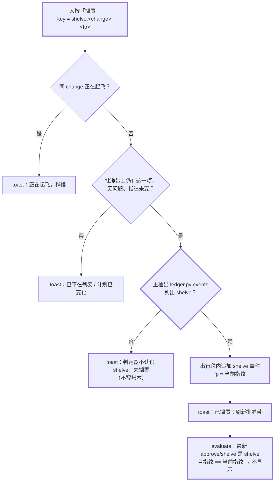
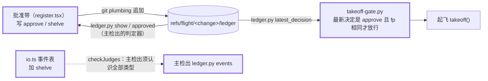

## Context

触发器命中：
- **跨模块**：判定器（`ledger.py`、`takeoff-gate.py`、`slice-gate.py`）、插件（`register.tsx`、`io.ts`、`land.ts`、`orchestrator.tsx`）、文档。
- **数据模型**：账本新增事件类型 `shelve`，批准判据随之改变（见 ADR）。
- **安全边界**：起飞批准的判据加上撤销规则。

动机见 proposal。人在 2026-10-14 选定：四项合成一个 change；「搁置」按钮、在账本记事件；与 `flight-dispatch-followups` 并行。

现状（读码核实，main @ `ed53487`，插件 0.10.2）：
- **批准带的显示规则**（`register.tsx` `evaluate`）：change 目录有 `spec.html`、`tasks.md` 含未勾选项，且指纹可算，就进入候选：
  - 最新 attempt 以非 abort 的 halt 结束 → 「续飞」或「批准修订并续飞」；
  - 账本批准指纹 ≠ 当前指纹 → 「批准起飞」；
  - 已批准且最新 approve 晚于最新 takeoff → 「起飞」；已批准且起飞过 → 不显示。
  - 没有任何「不打算飞」的出口：已批准、从未起飞的项永远显示「起飞」。
- **判定器来源不一致**：
  - 起飞（`orchestrator.tsx` `takeoff()`）用主检出的判定器（`judgesDir(main)`）；
  - 批准带用 change 所在 worktree 自己的 `.claude/hooks/`（`hooksDirOf(tree)`）跑 `plan_fp.py`、`ledger.py approved / show`、`slice-gate.py baseline`。
  - 陈旧 worktree 的 `ledger.py` 不认识新事件时，会把整条账本判损坏（exit 4），批准带显示「账本损坏，无法批准」。
- **事件表两份**：`ledger.py` 的 `EVENTS`（读取方）与 `io.ts` 的 `EVENTS`（写入方），起飞时 `checkJudges` 要求主检出的 `ledger.py events` 列出 `io.ts` 的全部类型。
- **批准判据**（`ledger.py` `latest_approval` → `takeoff-gate.py`）：账本最新一条 approve 的 fp == 当前计划指纹。
- **改名行**：`classifyDirty` 判工件的条件之一是 `p.startsWith(changeDir/)`；porcelain 的改名行去掉 XY 两列后是 `old -> new`，整串满足这个前缀。X 位（`R  `）、Y 位（` R`）都一样。
- **工件个数**：`takeoff()` 的拒绝信息「工件（N 个）」、起飞回复「已提交工件 N 个文件」；批准带说明行「按下会提交本 change 的 N 个工件并直接起飞」，`artifacts` 只存个数。
- **`run_test_gate` 的可度量条件**：退出码 1、junit 可解析、汇总行恰一行、汇总与 junit 的失败计数一致且非 0。
- **pytest-cov 在覆盖率未达标时的行为**（2026-10-14 下载 7.1.0 wheel，读 `pytest_cov/plugin.py` 核实）：
  - 在 `pytest_runtestloop` 收尾处打印 `ERROR: Coverage failure: total of … is less than fail-under=…`，并执行 `session.testsfailed += 1`；
  - 在 `pytest_terminal_summary` 打印 `FAIL Required test coverage of N% not reached. Total coverage: …`（达标时没有 `FAIL ` 前缀）；
  - 失败用例本身不变，所以汇总行与 junit 的计数仍然一致。
- **按钮**（引擎 2.1.295 类型文件 `ButtonProps` 核实）：同一处可以有多个 `Button`；`variant` 区分 `primary` 与 `secondary`，`dimColor` 画成次要按钮；`key` 就是 `ui.press` 的 `e.element`。

图（c4-diagrams：目的 = 评审批准带与判定器的改动；格式 = 普通 Mermaid flowchart；严格度 = 轻量，作为假设记录）。

批准带按「搁置」的动态视图（粗框为本 change 新增）：

批准判据的读写两侧（容器级，粗框为本 change 改动）：

图说明：
- **边界**：写账本的入口仍只有插件进程内的按键处理；判定器只读。
- **信任**：搁置与批准一样只由人按键触发，模型没有任何入口；搁置只会收回放行，不会放行任何东西（fail-closed 方向）。
- **假设**：同一会话内 `$.session.id()` 稳定；主检出的 `.claude/hooks/`（或 `template/.claude/hooks/`）与插件同版本（起飞时的 `checkJudges` 已强制这一点）。

## Goals / Non-Goals

**Goals**：
- 人能在批准带上把「不打算飞」的计划撤下，撤下后不能误起飞；
- 前 3 个遗留问题各有 scenario 测试；
- 正常路径（干净工作区、未搁置、无覆盖率门槛）的行为不变。

**Non-Goals**：
- **不提供「取消搁置」入口**：恢复 = 改动计划（指纹变化）。搁置的典型对象是陈旧计划，本来就要重写；要不改计划直接恢复，以后另立 change。
- **不统一 `plan_fp.py` 与 `slice-gate.py baseline` 的来源**：批准带仍用 change worktree 的判定器算指纹、跑基线。只有读账本改用主检出的。两边指纹算法不同的风险见 Risks。
- **不让起飞待命识别搁置**：搁置时若该 change 正在待命，下一次重试会被起飞守卫以「已搁置」拒绝，按现有「只能人处理」通知收场。
- **不识别 conftest 或其他插件自己改退出码**：只覆盖 pytest-cov，见 Risks。
- **不改 `DRAFT-test-gate-baseline-diff`**：它已 accepted，见 D5。
- **`commitArtifacts` 的 `-z` 解析不改**：改名行在起飞处已被拒绝，`commitArtifacts` 收不到改名条目。

## Decisions

### D1 · `shelve` 事件与批准判据（`ledger.py`、`takeoff-gate.py`、`io.ts`；ADR `DRAFT-approval-revocable-by-shelve`）
- **事件**：`{"ev": "shelve", "fp": <64 位十六进制>}` + 公共字段（`v` / `change` / `at` / `by.plugin`），`by` 里带 `surface` 与 `session`（同 approve）。`ledger.py` 与 `io.ts` 的 `EVENTS` 同时加这一项。
- **判据**：取账本里最后一条 `approve` 或 `shelve`，称为「最新决定」：
  - 是 approve，且其 fp == 当前计划指纹 → 批准成立；
  - 是 shelve → 不成立，`takeoff-gate.py` 以 3 退出，stderr 写「已搁置」、搁置时间与指纹前 8 位，并说明改动计划后批准带会重新显示「批准起飞」。文字不得含「未批准」「计划已变」：起飞待命按这两个词归为「等人按批准带」，搁置后批准带不显示该项，待命会空等到过期；避开后归为「只能人处理」，只通知；
  - 没有 → 「未批准」（同现状）。
- **接口**：`ledger.py` 新增 `latest_decision(change_dir) -> (event | None, tip)`；`latest_approval` 改为「最新决定是 approve 才返回它」，`approved` 子命令随之在搁置后不输出指纹。
- **搁置作废此前全部批准**：不比较指纹，最后一条决定说了算。
- **否决**：
  - 只在批准带隐藏、不进账本（换会话又出现；也挡不住手打 `/opsx-apply`）；
  - 另开 `refs/flight/<change>/shelved` 引用（审批记录分散在两处，飞行记录看不到）；
  - 复用 `halt kind abort`（halt 必须带 attempt，从未起飞的 change 没有 attempt）。

### D2 · 批准带读账本用主检出的判定器（`register.tsx`）
- **做法**：每次刷新先解析一次主检出的判定器目录（主 worktree 下有 `plan_fp.py` 的 `.claude/hooks` 或 `template/.claude/hooks`）。没有时，回退到该项 change worktree 的目录（同现状）。
  - 批准带对 `ledger.py` 的全部调用都用这个目录：`approved`、`show`（停飞判定、去重、搁置判定）、`events`（搁置前核对）。
  - `FlightItem` 新增 `ledgerDir` 字段。
  - `plan_fp.py` 与 `slice-gate.py baseline` 仍用 `hooksDir`，不变。
- **理由**：账本是共享的 git 引用，不属于任何 worktree。用与起飞同一份读取方，陈旧 worktree 才不会因为旧 `ledger.py` 不认识 `shelve`，把账本判成损坏。
- **否决**：改为全部判定器都取主检出（会改变「worktree 下没有 plan_fp.py → 无法批准」等现有行为与用例，超出本 change）。

### D3 · 批准带的「搁置」按钮与按键（`register.tsx`）
- **显示**：顶部那一项可以按（`problem === ''` 且不在进行中）时，主按钮之后再画一个 `Button`：`key = shelve:<change>:<fp>`、`label = 搁置`、`variant = secondary`、`dimColor`。随后一行 dim 说明：「搁置：这份计划不再显示、不能起飞；改动计划后重新出现」。
  - 有问题、进行中的项不画「搁置」（与现在不画主按钮一致）。
  - 四种模式都可搁置。
- **evaluate**：算出指纹、账本可读之后，在停飞判定之前：若「最新决定」是 shelve 且其 fp == 当前指纹 → 不显示。
- **isAlreadyApproved**：遇到 shelve 与 takeoff 一样清空 `last`。
- **按键**（`ui.press` 的 matcher 加 `shelve`；`PRESS_KEY` 加 `shelve`）：
  1. 同 change 在 `inFlight` → toast「正在起飞，稍候」；
  2. 批准带上找不到该 change、或有问题、或在进行中 → toast「已不在可批准列表」并刷新。不比较 `item.mode`，搁置不区分模式；
  3. 重算指纹 ≠ 按钮上的 fp → toast「计划已变化」并刷新；
  4. 用 `ledgerDir` 跑 `ledger.py events`：退出非 0 或未列出 `shelve` → toast「flight：判定器（<目录>）不认识 shelve，未搁置：先把主检出更新到与插件同一版本」，不写账本；
  5. 与 approve 共用 `serial` 串行段追加 shelve 事件（与 `appendApprove` 同一套 plumbing 与 CAS，抽成按事件类型参数化的一个函数）；写失败 → toast「账本写入失败（重试 3 次），未搁置」；
  6. 成功 → toast「flight：已搁置 <change>（指纹 <前 8 位>）：不再显示、不能起飞；改动计划后会重新出现」，刷新批准带。
- **否决**：在批准带上加确认步骤（两步按键）。搁置可以经改计划恢复，误按代价小；按键路径保持一步。

### D4 · 改名行与逐行列出工件（`land.ts`、`orchestrator.tsx`、`register.tsx`）
- **改名行**：`classifyDirty` 循环里先判断，路径含 ` -> ` 时放进 `others`，再走原有判断。起飞走「工件之外」的拒绝分支；这一步在 `commitRecords` 之前，不会部分提交。X 位与 Y 位改名去掉 XY 两列后形状相同，一并覆盖。
- **手打命令的拒绝信息**：在「（N 个）」之后换行逐行列出 `dirty.artifacts`，再接「确认无误后发 `/opsx-apply <change> 授权提交`…」。有工件之外改动时照旧只列工件之外的路径（#44 design D4）。
- **起飞回复**：「已提交工件 N 个文件」改为「已提交工件 N 个文件：」，后接逐行路径。
- **批准带**：`artifacts` 由「个数」改为「路径列表」；说明行「按下会提交本 change 的 N 个工件并直接起飞」不变，其下逐行 dim 列出路径，最多 5 行，超出时第 6 行写「…另 K 个」。「批准修订并续飞」也提交工件，同样列出。
- **路径口径**：porcelain 给出的、相对 worktree 根的路径，原样输出。
- **否决**：解析改名的源与目标再分别判断（改名本来就不该由插件代为提交，判为工件之外最简单，也是 fail-closed）。

### D5 · 覆盖率未达标不算可度量（`slice-gate.py`：`run_test_gate`）
- **位置**：在 `rc != 1` 判断之后、读 junit 之前。
- **判据**：去掉 ANSI 的输出里，任一行含 `Coverage failure: total of` 或 `FAIL Required test coverage of`。
- **命中时**：写 `res["why"] = "覆盖率未达标（pytest-cov fail-under）；门禁不判覆盖率时在 gate.test 加 --no-cov"`，`failed` 保持 None。
- **效果**：
  - final 走 `full_suite_verdict` 的「按退出码判」，判红，理由带「覆盖率」；
  - baseline 把它写进 reasons 并判红、停下报告。人按提示在 `gate.test` 加 `--no-cov`，或者把覆盖率修上去。
- **与 ADR 的关系**：`DRAFT-test-gate-baseline-diff`（accepted）规定的可度量条件，本意是「退出码 1 完全由失败用例解释」。pytest-cov 不增加失败用例就把退出码改成 1，不符合这个本意。本 change 只是加一条更严的实现检查，不改变决策方向，所以不另立 ADR、不 supersede。
- **否决**：注入 pytest 插件、自动排除预存红并要求 exit 0（该 ADR 已否决 `-p` 插件：被测仓库的包装脚本常覆写 `PYTHONPATH`）。

### D6 · 文档与版本
- `opsx-apply.md` 与 `openspec-apply-change/SKILL.md` 同改：
  - 「批准带（按下即起飞）」一节改写为：四个起飞按钮按下即起飞，另有「搁置」；
  - 加一行「搁置」：不再显示、不能起飞、改动计划后重新出现，判定器不认识时拒绝；
  - 「批准指纹」一行写明「已搁置」也不起飞。
- `plugin.json`：version 在执行时 worktree 当前值的基础上升一个补丁号，不写死；description 补「搁置」。`test_dispatch_origin_docs.py` 的 `== "0.10.2"` 放宽为「不低于 0.10.2」。

## Risks / Trade-offs

- [插件升级后，使用方的主检出判定器仍是旧版] → 起飞被 `checkJudges` 拒绝，提示判定器不认识 `shelve`（与以往新增事件相同）；搁置也拒绝、不写账本。迁移说明见下。
- [主检出没有判定器，回退到 change worktree 的旧 `ledger.py`] → 搁置前的 `events` 核对会发现它不认识 `shelve` 而拒绝，账本不会被写坏。
- [批准带的 `plan_fp.py` 仍取 change worktree 的，与起飞的主检出不同] → 两边算法不同时，批准带显示的指纹会与起飞时重算的不一致，起飞报「计划已变」。这是现状就有的问题，本 change 不扩大；记作后续。
- [误按「搁置」] → 只会收回放行；改动计划任一文件即可重新出现、重新批准。
- [pytest-cov 将来改了提示文字] → 识别失效，退回原行为（放行），这一项不是 fail-closed。缓解：两行标记任一命中即可；scenario 测试按 7.1.0 的原文构造，升级时对照。
- [基线已有预存红时，conftest 或其他插件自己把退出码改成 1，而失败用例不变] → 仍判可度量并放行。从退出码与计数上无法区分，只能识别具体工具的输出；本 change 只覆盖 pytest-cov。
- [与 `flight-dispatch-followups` 同改 `register.tsx`（按键入口）、`orchestrator.tsx`、类型与版本] → 后合入的一方预合并 main 时解冲突、重跑 baseline；计划文件不变则指纹不变。

## Migration Plan

- **本仓库**：合入后在主仓库根执行 `claude plugin update flight@intent-driven -s project`，再 `/reload-plugins`，确认插件版本为本 change 升出的版本；主检出的 `template/.claude/hooks/` 随同一次合入更新。
- **插件使用方**：升级插件的同时更新主检出的 `.claude/hooks/`（`install.sh --upgrade`），否则起飞被拒、搁置被拒。
- **门禁判红**：使用 pytest-cov fail-under、且覆盖率当前不达标的仓库，下一次 baseline 会判红，按提示在 `gate.test` 加 `--no-cov`。
- 不需要数据迁移：旧账本没有 `shelve`，判据结果不变。回滚即回退提交；回滚前已写入 `shelve` 的账本会被旧判定器判损坏，须先确认没有搁置过。

## Open Questions

- 无。`DRAFT-approval-bound-to-plan-fingerprint` 的判据由新 ADR `DRAFT-approval-revocable-by-shelve` supersede（见 ADR）。
