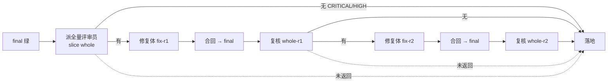

## Context

- **收尾现状**（0.7.0）：
  - 落地时 `landing.tsx` 用 `closeoutLists`（`core.ts`）从账本算出 `{blocked, blocking, deferred, fix}`，写进 `review-findings.json`，再跑 `slice-gate.py ship` 得出 land 的 verdict；然后交接 `/flight:pr-ship`。
  - `/flight:pr-ship` 由主会话派 `flight:code-reviewer` 审 PR，读回评审文字，自己判断 CRITICAL/HIGH 是否闭环，改写 `review-findings.json` 的 `blocking`，再跑 `ship`，最后自己执行 `gh pr ready`。
- **`slice-gate.py ship` 读的是文件**（`cmd_ship`）：
  - 用 `gate-report.md` 判各片与 final；
  - 用 `review-findings.json` 的 `blocking` 判评审；
  - 每次运行还往 `timeline.md` 记一行。
  - 这两个文件都在 change 目录里，主会话能改。
- **飞行内的修复只有一轮**：`core.ts` 的 `closing()` 只有在切片评审给出 CRITICAL/HIGH、且还没合回修复时，派一次修复体（slice `fix`），然后跑 final、落地。全量评审一直放在 pr-ship 里，由模型派。
- **评审员与工具**：
  - `flight:reviewer` 的工具含 `mcp__flight__submit_findings`；
  - `onFindings` 只认当前 attempt 里 role 为 reviewer 的 agent，校验后写 review 事件；
  - 模型可调用的工具恰为 `submit_findings` 与 `measure`（flight-entry-handoff 的不变量）。
- **起飞核对**：
  - 插件写入的事件类型全集是 `io.ts` 的 `EVENT_TYPES`，起飞时要求判定器 `ledger.py events` 认识它们；
  - `slice-gate.py features` 须列出 `REQUIRED_FEATURES`（`versions.ts`）；
  - 主检出没快进时，这两项核对拒飞。
- **gh 实测**（2026-10-13，本机 gh）：
  - `gh pr view <n> --json number,url,headRefName,headRefOid,isDraft` 返回这五个字段；
  - `gh pr ready --undo` 可以把 PR 转回 draft；
  - `gh pr comment <n> --body <text>` 可以贴评论。
  - 本机装有 glab，但 glab 的 JSON 字段本 change 没有核实。
- **#51 遗留**：
  - LOW：项目没有同名命令文件时插件会注册 `opsx-apply`，此时 `--gate=per-task` 走 `next(e)`，透传给一个没有正文的插件命令，结果未核实；
  - LOW：「来源规则」在 `opsx-apply.md` 与 `openspec-apply-change/SKILL.md` 里各写了两遍。

## Goals / Non-Goals

**Goals**
- 收尾的正当路径上，没有一步需要模型判断：
  - 评审由控制面派、结论进账本；
  - 闭环由账本裁决；
  - draft 与 ready 之间的切换由插件执行。
- 记录文件降为给人读的视图：裁决不读它们，模型改它们也影响不到裁决。
- 全量评审发现 CRITICAL/HIGH 时，在飞行内自动修复并复核，不问人。

**Non-Goals**
- **记录文件全部改由账本生成**：`slice-gate start` / `record`、`timeline record` 的删除，属于 change 2（D1）。本 change 只让 ship 不再读文件，并且不再写 timeline。
- **GitLab**：`ship` 工具只支持 GitHub（gh）；GitLab 项目的 PR 保持 draft，由人决定。
- **落地后的新提交**：解冲突、人工追加修改都在账本之外，ship 判为过期（draft）。是否转 ready 由人决定，本 change 不自动重跑 final 或复核。
- **故意绕过**：拿着 gh 凭据的模型总能用 `gh api` 等方式绕过插件。目标是正当路径不需要模型判断；故意绕过会留在转录里，不在本 change 的拦截范围内。

## Decisions

### D1 · 控制面派全量评审（用户定 C1-A）

- **时机**：`closing()` 里切片级修复（slice `fix`）与 final 都走完、final 绿之后，原来直接落地，现在先进入全量评审。
- **轮次按本 attempt 计**：
  - slice 依次为 `whole`（首轮）、`whole-r1`、`whole-r2`（复核），修复轮为 `fix-r1`、`fix-r2`；
  - 续飞的新 attempt 走到这里会重新评审，不沿用旧 attempt 的结论。
- **首轮（`whole`）的范围与提示词**：
  - 范围是 `git diff <base> <commit>`。`commit` 取本 attempt 最新 final 事件的 commit；`base` 在派发时由插件算出，等于 `git merge-base <commit> <主 worktree HEAD>`。
  - 算不出 base，或 base 等于 commit 时，记 blocked `review:whole`（infra，「算不出全量评审的起点」），随后落地，ship 判 draft。
  - 提示词由插件写，列出切片评审提过的全部 CRITICAL/HIGH，要求逐条核对：没闭环、或修得不对的，照原级别再提交。
- **复核（`whole-r<k>`）**：
  - 范围是 `git diff <上一轮评审的 commit> <本轮 final 的 commit>`；
  - 提示词列出上一轮的 CRITICAL/HIGH，要求逐条核对，同时报修复补丁新引入的问题；与本次修复无关的代码不报。
- **评审员**：仍是 `flight:reviewer`，经 `submit_findings` 提交，记成 review 事件，slice 为本轮 id。
  - 派发事件额外记 `commit`（这一轮审到哪个 commit）与 `base`。账本字段表允许额外字段。
  - `reviewer.md` 的正文改为「只审提示词给定的范围」，三种范围是切片合回 commit（对第一父取 diff）、全量、复核。仍保留「取 diff 失败」须报 HIGH。
- **未返回**：评审员结束了却没提交 → 沿用切片评审的规则，记 blocked `review:<id>`（infra），随后落地，ship 判 draft。

### D2 · 修复轮至多 2 轮（用户定 C2-A）
`closing()` 在 final 绿之后的完整判定（`k` 是本 attempt 已合回的修复轮数，`R` 是当前轮的评审 slice）：

1. 本 attempt 里有修复轮合回、且晚于最新的 final → 先跑 final。
2. `R` 还没有 review 事件：
   - 有 blocked `review:R` → 落地；
   - 没派过 → 派评审员（首轮或复核，见 D1）；
   - 已派、还没结束 → 等；
   - 已结束却没提交 → 记 blocked `review:R`。
3. `R` 的 review 没有 CRITICAL/HIGH，或 `k` 已达 2 → 落地。
4. 否则进入第 `k+1` 轮修复，修复轮 `F = fix-r<k+1>`：
   - `F` 已 blocked → 落地；
   - 没派过 → 派修复体，findings 为 `R` 的 CRITICAL/HIGH；
   - 收口门禁绿 → 合回；
   - 其余情况沿用现有修复体的判法：记 blocked 时，下一轮判定会落地。

修复体的派发、收口与合回，沿用 slice `fix` 的机制，只是 slice id 不同：
- 修复 worktree 与分支为 `flight-<change>-fix-r<k>` 与 `flight/<change>/fix-r<k>`，已存在时另起 `-a<attempt>`；
- 收口门禁是全量 final，记 gate 事件，slice 为 `fix-r<k>`；
- 合回提交为 `integrate: fix-r<k>`。

`final --reuse-fix` 的复用对象，从「最后一条 slice 为 fix 的 gate」放宽为 slice 为 `fix` 或 `fix-r<k>` 的 gate。

切片级修复（slice `fix`）只看切片评审的 findings，不包括全量评审与复核。否则全量评审的 HIGH 会被误派给旧的 `fix`。

### D3 · ship 只读账本（已定）
`slice-gate.py ship --change-dir <dir>` 改为只读账本、`slices.json` 与 git，判据如下（依次累积 reasons，任一条成立即判 draft）：

| 判据 | reason |
|---|---|
| 没有 `slices.json` | `没有 slices.json：不是飞行 change` |
| 账本读不出 | `账本读取失败：<原因>` |
| 账本没有 takeoff | `账本没有起飞记录` |
| 计划切片没有 ok 的 merge 事件（不限 attempt） | `切片 <S> 未合回` |
| 本 attempt 没有 final / 最新 final 红 / 最新 final 的 commit 既不是 HEAD，也不满足 `_final_fresh` | `final 未运行` / `final 红：<failed>` / `final 过期：记录 <c10>，HEAD <h10>` |
| 本 attempt 有 blocked `review:whole*`，且之后没有同轮的 review | `全量评审未返回：<slice>` |
| 本 attempt 合回了第 j 轮修复，但没有 `whole-r<j>` 的 review | `第 j 轮修复未经复核` |
| 最新一轮评审的 commit 既不是 HEAD，也不满足 `_final_fresh` | `全量评审过期：评审之后有代码提交` |
| blocking 非空 | `<n> 条 CRITICAL/HIGH 评审未闭环` |

- **blocking**：
  - 本 attempt 有全量评审时，取最新一轮 review 的 CRITICAL/HIGH；
  - 没有时（旧账本），取全部切片评审的 CRITICAL/HIGH；
  - 再加上路由对账：每条 ended 事件的实际模型，须包含该 attempt 起飞时的主模型（不区分大小写），否则生成一条 HIGH，`file` 为 `routing`，`line` 为 0，summary 含「路由不符」。逻辑与 `core.ts` 的 `routingFindings` 一致。
- **输出**：stdout 打印 JSON `{ready, commit, reasons, blocked, blocking, deferred, fix, review}`，退出码 0 为 ready、1 为 draft。各字段：
  - `blocked`：本 attempt 的 blocked 事件；
  - `deferred`：全部 review 的 MEDIUM/LOW；
  - `fix`：最后一条 slice 为 `fix` 或 `fix-r<k>` 的 merge 事件的 `{ok, commit}`，没有时为 null；
  - `review`：最新一轮全量评审的 `{slice, agent, commit}`，没有时为 null。
- **`--markdown`**：照旧打印 reasons 与 blocked 段落。
- **不再写 `timeline.md`**：ship 是纯判定。
- **能力声明**：`features` 增加一行 `ship-ledger`。

### D4 · 落地时按 ship 的输出写入给人读的记录（已定）
`land.ts` 的 `closeout` 改为：
1. 先跑 `slice-gate.py ship --change-dir`，解析 JSON；
2. 用它的 `{blocked, blocking, deferred, fix}` 写 `review-findings.json`；
3. 勾选 `tasks.md`，记 `apply-done`（note 中的数字取自 JSON）；
4. 提交记录；
5. verdict 取 JSON 的 `ready`。

ship 输出无法解析时，verdict 为 draft，reasons 写「ship 输出无法解析」，不写 `review-findings.json`。`closeoutLists` 随之不再使用，由 S5 删除；`core-reports-routing-mismatch` 改为直接测 `routingFindings`。

### D5 · ship 工具（用户定 C3-A）
`ship.ts` 是纯模块，经 `Ctx` / `Io` 访问外界。`shipPr(ctx, f, state, pr)` 依次执行，任一步失败即返回 `{deny: <原因>}`，并且不执行后续步骤：

1. 本 attempt 已有 land 事件，否则拒绝：「<change> 还没落地」。
2. `git remote get-url origin` 含 `github.com`，否则拒绝：「只支持 GitHub：PR 保持 draft，由人决定」。
3. `pr` 是纯数字，或是以 `/pull/<数字>` 结尾的 URL，否则拒绝。
4. `gh pr view <n> --json number,url,headRefName,headRefOid,isDraft`。`headRefName` 须等于 `f.branch`，`headRefOid` 须等于 change worktree 的 HEAD，否则拒绝，并写明期望值与实际值（例如「先推送」）。
5. `python3 <hooksDir>/slice-gate.py ship --change-dir <changeDir>`，cwd 为 change worktree，解析 JSON。
6. `gh pr comment <n> --body <shipComment(json)>`。
7. 裁决为 ready 且 PR 是 draft → `gh pr ready <n>`；裁决为 draft 且 PR 不是 draft → `gh pr ready <n> --undo`；其余情况不动。
8. 追加 ship 事件 `{attempt, pr: <url>, verdict, commit: <HEAD>}`。
9. 返回 `{result}`：一行写裁决、PR 状态的变化与评论已贴；draft 时附上 reasons。

`shipComment` 的格式（纯函数）：
- 标题：`## flight 裁决：ready` 或 `draft`；
- 一行说明：插件按账本裁决、commit 前 10 位；
- draft 时列出「未满足」的 reasons；
- 「全量评审」：哪一轮、哪个 agent、CRITICAL/HIGH 条数与逐条 `file:line — 级别 — 摘要 — 修法：…`；
- 「未自动修的 MEDIUM/LOW」逐条列出；
- 末行签名：`— flight 插件，<YYYY-MM-DD>`。

`io.ts` 的事件字段表增加 `ship: {attempt, pr, verdict, commit}`，与 `ledger.py` 一致。`EVENT_TYPES` 因此含 ship，起飞时要求判定器认识它。

### D6 · ship 工具的接线
- **注册**：session.start 时注册 `ship` 工具，失败忽略。
- **只认主会话**：`tool.call` 带 agentId 的调用一律拒绝，理由为「ship 只接受主会话调用」，飞行 agent 也包括在内。
- **处理流程**：校验输入 `{change, pr}` 都是非空字符串 → `locate` 找到 change → 读账本 → `shipPr`。

### D7 · 不变量随之更新
没有同名命令文件时，插件注册的斜杠命令恰为 `flight` 与 `opsx-apply`；模型可调用的工具恰为 `submit_findings`、`measure` 与 `ship`；任何工具或命令在任何输入下都不追加 approve 事件；`ship` 只追加 ship 事件。本要求取代 flight-entry-handoff 中「工具恰为 submit_findings 与 measure」的约束。

### D8 · `--gate=per-task` 在插件自己注册入口时给出指引（#51 LOW）
- **注册成功**：插件在 session.start 成功注册了 `opsx-apply`（即项目里没有同名命令文件）时，`--gate=per-task` 不再 `next(e)`，而是直接回复一段文字：含 legacy skill 的路径 `.claude/skills/legacy/openspec-subagent-apply-change/SKILL.md`，并写明「本项目没有 /opsx-apply 命令文件」。
- **注册被拒**（项目有命令文件）：照旧透传。

### D9 · 起飞核对判定器能力
`REQUIRED_FEATURES` 增加 `ship-ledger`。判定器认识 ship 事件这一项由 D5 带来（`EVENT_TYPES` 含 ship）。

### D10 · 文档（用户定 C4-A，以及 #51 LOW）
- **`/flight:pr-ship`**：
  - 飞行模式（有 `slices.json`）：一律以 `--draft` 建 PR，建完调 `ship` 工具，交出 change 名与 PR 号，然后打印结果并结束。不派评审员、不问人、不改 `review-findings.json`、不执行 `gh pr ready`。GitLab 项目 `ship` 会拒绝，PR 保持 draft。
  - 飞行外：维持现有第 8–10 步，PR 正文须写「非账本裁决」。
- **`/opsx-apply` 命令与 skill**（同改）：
  - 写明全量评审、修复至多 2 轮与复核，以及落地后由 `ship` 工具裁决；
  - 角色表增加「全量评审 / 复核」；
  - 「来源规则」各只保留一处完整表述。
- **README 与 `docs/WORKFLOW_zh.md`**：`/flight:pr-ship` 的描述改为上面的口径。

### D11 · 版本
插件 0.8.0。change 2 并入同一个 PR，不再改版本号。

## 切片与 wave

| wave | 切片 | 内容 | 依赖 |
|---|---|---|---|
| 1 | S1 | 判定器：ship 只读账本、ship 事件、ship-ledger 能力、`--reuse-fix` 认修复轮、PR 用时取账本 | - |
| 1 | S2 | 状态机：全量评审、修复轮、复核；面板加全量评审 | - |
| 1 | S3 | 落地执行：两种评审提示词、修复轮派发与合回、closeout 用 ship 输出、reviewer.md | - |
| 1 | S4 | `ship.ts` 纯模块与 ship 事件字段表 | - |
| 2 | S5 | 接线：注册 ship 工具、只认主会话、修复轮合回按 slice、per-task 指引、能力核对、不变量、删 closeoutLists、0.8.0 | S2 · S3 · S4 |
| 2 | S6 | 文档：pr-ship 飞行模式、apply 文档、来源规则、README、WORKFLOW | S1 |

wave 1 的四片之间靠 `slices/_interfaces.md` 的约定对接：
- Action 的形状（S2 产出，S3 消费）；
- ship JSON（S1 产出，S3、S4 消费）；
- `mergeFix` 的签名（S3 产出，S5 接线）。

## Risks / Trade-offs

- **飞行变长**：全量评审替代了原先 pr-ship 里的评审，评审员调用次数不变。有 CRITICAL/HIGH 时，每轮修复多一次修复体、全量 final 与复核，至多 2 轮。
- **落地后的提交判过期**：解冲突、人工追加修改都会让 ship 判 draft（final 或评审过期），转不转 ready 交人决定。这是有意的：账本之外的代码没有可信裁决。
- **GitLab 暂不支持**：PR 保持 draft，交人。
- **ship 工具由模型调用**：模型不调，PR 就停在 draft，这是安全的一侧；模型故意绕过（例如 `gh api`）会留在转录里。
- **叠成一个 PR**：本 change 与 change 2 都在 0.7.0 上飞，这个 PR 的收尾仍由主会话按 0.7.0 的 pr-ship 手动走（模型裁决），PR 正文须写明。新收尾要等合入、更新插件之后才第一次真用。
- **判定器与插件须同版本**：沿用起飞核对（D9）。合入后主检出不快进，起飞会被拒。
