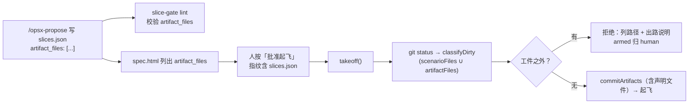

## Context

- 起飞时脏工作区处理（`flight-takeoff-commit` D2–D4）：`git status --porcelain` → `classifyDirty`（`plugins/flight/hooks/land.ts:42`）分成记录 / 工件 / 工件之外；工件之外非空即拒（`hooks/orchestrator.tsx:685`）；工件经「授权提交」或批准带按键由 `commitArtifacts` 提交。
- 工件来源只有三类：change 目录、同一 openspec 根下 `adr/DRAFT-*.md`、`scenarioFiles()`（`orchestrator.tsx:575`）从 `slices.json.scenario_tests` 取的测试文件。批准带计数（`register.tsx:176` `artifactCount`）走同一口径。
- 计划指纹白名单含 `slices.json`（`.claude/hooks/plan_fp.py:9`）：在 `slices.json` 里写的东西必经人批准（DRAFT-approval-bound-to-plan-fingerprint）。
- 起飞待命按拒绝文字分类（`hooks/armed.ts:44` `classifyRefusal`）：工件之外的拒绝现归 `human`（只通知、不重试）。改文案不能让它落进别的类。
- 跨模块（插件 TS · 判定器 Python · 渲染脚本 · schema 说明）且给 `slices.json` 契约加字段 → 命中设计触发器。



## Goals / Non-Goals

**Goals:**
- 本 change 的周边文件（测试辅助、ADR 索引、conftest 等）可在计划里显式声明，经人批准后随工件一并提交。
- 工件之外的拒绝信息说清「授权提交」管不到它们，并给出可照做的出路。

**Non-Goals:**
- 不放宽 fail-closed：未声明的文件仍拒飞，「授权提交」不扩大范围。
- 不自动推断（如解析测试 import）；不支持通配；不内建 afa 的 `adr/INDEX.md`。
- 不校验声明文件是否真有改动（人已定：Q3=不要求）；起飞时没脏就不提交，无害。
- 不拒绝与 change 目录或 scenario 测试文件重复的声明：重复无害，少一条判据少一处误报。

## Decisions

### D1 · 字段：`slices.json.artifact_files`
- 可选字符串数组，缺省视为 `[]`。路径相对 change worktree 根，与 `scenario_tests` 的路径同一基准（afa：`executor/tests/...`；本仓：`tests/...`）。
- 精确路径匹配（与 porcelain 第 3 列后的路径逐字比较）。
- 备选：`support_files`（人选定 `artifact_files`，与提示语「工件」直接对应）；顶层放而不放进各切片：声明的是「起飞前一次性提交的文件」，与切片 owns 正交。

### D2 · 插件分类（`land.ts` / `orchestrator.tsx` / `register.tsx`）
- `classifyDirty(paths, x)` 的 `x` 增加可选 `artifactFiles?: readonly string[]`；判定 artifacts 的条件追加 `x.artifactFiles?.includes(p)`。records 判定先于它，不变。
- `orchestrator.tsx` 在 `scenarioFiles` 旁新增并导出 `artifactFiles(io, path)`：读 `slices.json` 的 `artifact_files`，只保留字符串项；读不出 / 不是 JSON / 不是数组 → `[]`（之后的 lint 会报）。
- `takeoff()` 与 `register.tsx` 的 `artifactCount` 两处调用都传入它；两处口径保持一致。
- 备选：把声明文件并进 `scenarioFiles()` 的返回值 —— 拒绝：名字会说谎，测试也难区分来源。

### D3 · lint（`slice-gate.py` `lint_plan`）
- 键缺省 → 无错误。存在时：不是数组 → `artifact_files: 须是路径数组`；逐项：非字符串或空串、以 `/` 开头、任一段为 `..`、含 `*` `?` `[`、匹配 `(^|/)adr/\d{4}-[^/]*\.md$`（已编号 ADR）→ 各报一行，以 `artifact_files:` 开头并带原值。
- 放在纯函数 `lint_plan` 内（不需要 change 目录路径）。

### D4 · 拒绝文案（`orchestrator.tsx`）
```
flight：工作区不干净，不起飞（工件之外的未提交改动）：
<路径，每行一个>
「授权提交」只提交本 change 的工件，不覆盖上面这些文件。任选其一：
- 自行提交或撤销这些文件，再重发 /opsx-apply <change>
- 它们属于本 change（如 scenario 测试的辅助模块、ADR 索引）：逐个列进 slices.json 的 artifact_files，在批准带重新批准后起飞（按键会一并提交）
```
- 首行不变（`armed.ts` 依赖其前缀不是「工作区不干净，不起飞：\n」），出路段不含「未提交的只有本 change 的工件」，`classifyRefusal` 仍归 `human`。
- 仍不列工件路径（沿用 `flight-takeoff-commit` D4，免得人以为工件也要手动处理）。

### D5 · 审批面板（`spec_html.py`）
- `slices.json` 有非空 `artifact_files` 时，在飞行计划区「切片」表之后加 `<h3>起飞时一并提交的周边文件</h3>` 与逐行路径表；缺省或空数组不渲染该节。

### D6 · 文档与版本
- `opsx-apply` 命令 / skill 的「工作区与授权提交」写明 `artifact_files`；`opsx-propose` 命令 / skill 的一次成稿 tasks 阶段写明：为 scenario 测试新增或修改的辅助文件、ADR 索引等工件之外的本 change 文件须列进 `artifact_files`。schema tasks instruction 同步一句。README 飞行说明同步。
- 插件版本 0.10.4（排在 `flight-dispatch-followups` 的 0.10.3 之后）。

## Risks / Trade-offs

- [模型借 `artifact_files` 夹带生产代码] → 声明在指纹内、spec.html 单列一节给人看；起飞前只是提交，不绕过 G5/G9 等门禁。
- [改 `slices.json` 让已批准计划失效] → 预期行为：新增声明须重新批准；拒绝文案已写明。
- [与 `flight-dispatch-followups` 改同一批文件] → 合入前后都可起飞。先于它起飞（2026-10-14 实际如此）：S3 同时把基线里的 `tests/test_dispatch_origin_docs.py` 版本断言放宽为「不低于 0.10.2」，写法与该分支逐字相同以便日后自动合并；它合入后预合并 main 时，再把 `tests/test_dispatch_followups_docs.py` 的 `0.10.3` 断言改为 0.10.4，并人工解 `orchestrator.tsx` / `register.tsx` / `flight.test.tsx` / `plugin.json` 的冲突。
- [升版即破坏既有「版本 ==」断言] → S3 的 owns / verify 须覆盖基线里全部断言插件版本的测试文件（attempt 1 停飞根因：漏了 `test_dispatch_origin_docs.py`，修复方受写入范围限制写不进）。
- [非 ASCII 路径被 git 加引号] → 精确匹配失败、归工件之外（fail-closed，沿用 `flight-takeoff-commit` 的假设）。

## Migration Plan

- 纯增量；旧计划无该字段 → 行为不变。回滚 = 回退插件与 lint，已写的 `artifact_files` 被忽略、相关文件回到工件之外。

## Open Questions

（无：Q1–Q4 已于 2026-10-14 由人选定 A+B / `artifact_files` / 不要求确有改动 / 立 change。）
