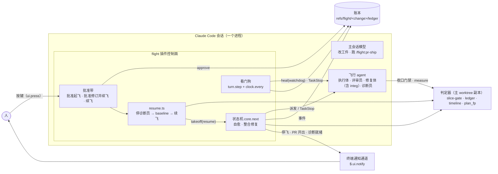
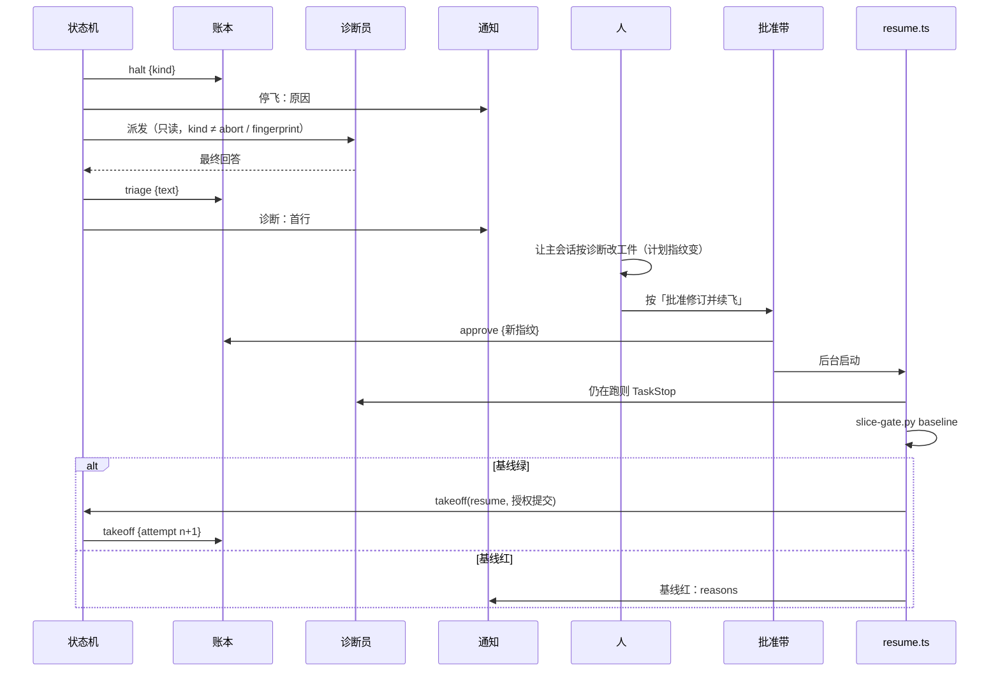
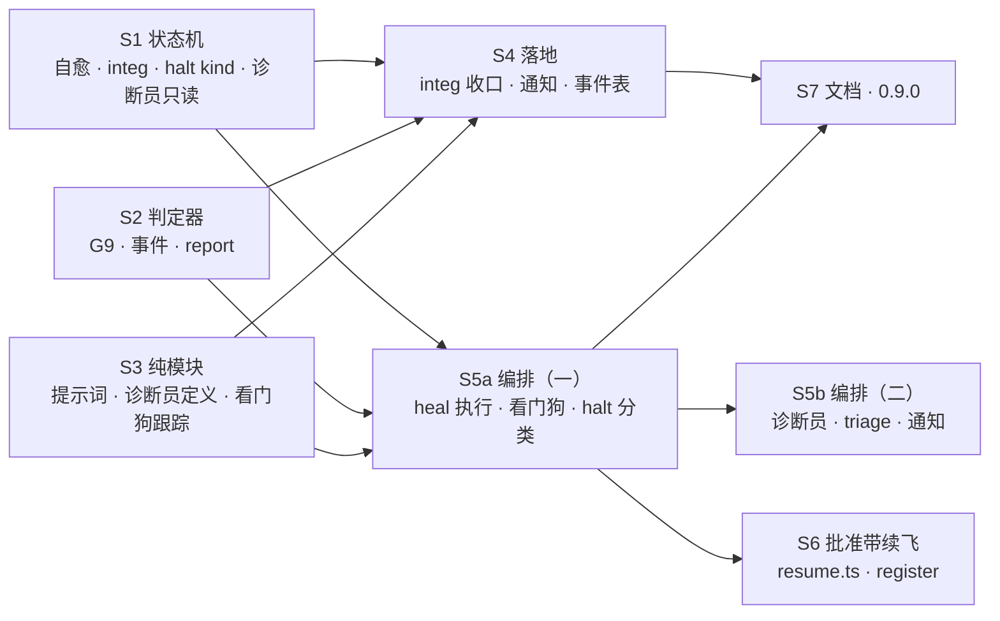

## Context

- **起点**：main `e5551f4`（#52 合入，插件 0.8.0）。飞行由 flight 插件里的状态机执行。
  - 状态是账本 `refs/flight/<change>/ledger` 的归约，`core.ts next()` 是纯函数（`DRAFT-flight-orchestrator-state-machine`）。
  - 停飞点（main 行号）：
    - `core.ts:202`：收尾时有切片 blocked → halt；
    - `:213`：final 红 → halt；
    - `:114`：计划指纹变了 → halt；
    - `orchestrator.tsx` driveNow 的 `terminal()`：动作异常、账本读失败、指纹算不出 → halt。
  - blocked 的来源：
    - `:155`：合回失败且不是冲突，直接 blocked，不重试；
    - `:170–175`：执行体门禁红用尽；
    - `:162`：解冲突失败；
    - `:193`、`:250`：评审未返回；
    - `fixerOutcome`：修复体没有收口门禁结论。
- **停飞之后**：
  - 控制面只有 `ctx.toast` 一行与飞行记录（`landing.tsx:230–235`），人离开终端就看不到。
  - 续飞要人发 `/flight resume`，或改计划 → 手动重跑基线 → 按「批准起飞」→ 回车 `/opsx-apply`。
- **实测**（本会话 2026-10-13，CLI 2.1.296）：
  1. 本机 2528 个 agent 转录：「工具结果 → 下一条回复」的最长间隔 p50 17 s、p99 248 s、p99.9 486 s、最大 581 s，没有一个超过 600 s。被人中断前空等超过 600 s 的有 10 次（794–1678 s），包括 ledger-guards S9 的 794 s。
  2. watchdog-spike（无头 `claude -p --plugin-dir`，haiku）：
     - `$.clock.every` 的回调在派发它的 hook 返回之后照常运行，回调里 `$.agent.list`、`$.fs.write`、`$.tool.call` 都可用；
     - `turn.step` 必须写成 async generator（`async function* … yield* next(e)`）；带 `{ agentId: /./ }` matcher 时，能看到插件 `$.agent.spawn` 派出的 agent 每次模型请求的开始与结束（spawn 在另一个 hook 里）；
     - 对已结束的 agent 调 `TaskStop`，`$.tool.call` 不抛错，返回 `{ isError: true, text: '<tool_use_error>Task … is not running (status: completed)…' }`。
  3. 记忆 abort-spike（2.1.296）：对运行中的 agent 调 `TaskStop` 能停下，随后 `turn.complete` 触发（reason aborted），`classic.SubagentStop` 不触发。
  4. API（类型定义）：
     - `$.ui.notify(text, { title })` 走 `preferredNotifChannel`（iterm2 / iterm2_with_bell / kitty / ghostty / terminal_bell），用户的 Notification hook 先跑；
     - 返回 `{ isSent: false, reason }` 时，reason 为 disabled / no-channel / no-surface / refused；
     - `turn.complete` 的 `next(e)` 解析为 `{ text }`，即 agent 的最终回答。
- **在用 ADR**：
  - `DRAFT-approval-bound-to-plan-fingerprint`：批准 = 人按按钮写 approve；判据不得来自被门禁方；
  - `DRAFT-flight-orchestrator-state-machine`；
  - `DRAFT-flight-single-implementation`：失效即停飞、不回退第二实现；
  - `DRAFT-flight-measure-protocol`；
  - `DRAFT-flight-envelope-tightening`。

## Goals / Non-Goals

**Goals**

- 不改计划就能解决的停飞，在飞行内自愈：合回失败重派、看门狗、整合修复体。全部有预算、全部记进账本，人事后看得见。
- 必须人来的停飞：立刻在终端通知，附只读诊断，人改完计划后按一次键就续飞。
- 不放宽铁律：
  - 计划变了仍要人按批准（铁律 7）；
  - 控制面异常仍停飞（铁律 10）；
  - 整合修复体照样经机械门禁与独立评审（铁律 4、5）。

**Non-Goals**

- 不自动改计划、不自动批准、不重试控制面异常。
- 不做手机推送与手机批准（用户 Q6 选只用终端通知）。
- 不做规划期预防 lint（owns 漏守卫测试、改状态机的片与旧用例同 wave）：用户未选，留 backlog。
- 不治「门禁在未提交工作区判绿」的根因：另有人跟进；A1 只是兜底。
- 本 change 自己的飞行跑在 0.8.0 上，享受不到自愈。

## C4 · 容器视图（轻量 C4 风格，普通 Mermaid）

- **边界**：
  - 一切写账本的动作都在插件进程内：approve 只由按键写，其余事件由状态机、看门狗写；
  - 判定器只读账本；
  - 模型不可调用任何写账本或续飞的入口。
- **新增**：看门狗、`resume.ts`、诊断员，以及批准带的两种新按钮。整合修复体复用修复体 agent 类型（fixer），只是 slice 名为 `integ`、门禁多一道 G9。
- **假设**：通知只到终端；人不在电脑前时，靠人自己在 Notification hook 里转发（用户选项 Q6-B）。

### 动态视图：停飞 → 续飞

## Decisions

### D1 · 合回失败（非冲突）重派一次（A1）

- **`afterMergeFailed`**：合回失败且 failed 里没有 `conflict:` 项、也没派过解冲突 agent 时：
  - `healVerdict(state, 'merge-retry', S)` 允许 → 返回 `heal`（merge-retry, S）；
  - 账本里已有该 heal（在这次 merge 之后）→ 返回全新派发 `dispatch executor S`（不带 continuation），由 `perform` 另起新 worktree（沿用 0.4.1 的「遇同名另起 `-a<n>`」）；
  - 预算不允许 → 照旧 `blocked infra`，原因追加「（自愈预算已用尽）」。
- **只看新派发之后的事**：
  - `sliceActions` 取本片合回事件时，只看最后一次执行体派发之后的；
  - `executorOutcome` 的「已派次数」只数最后一条 merge-retry heal 之后的派发；
  - 这样重派的执行体照常享有「续派一次」。
- **否决**：重试时复用原 worktree。S9 的现场就是原 worktree 的状态有问题，复用会原样失败。

### D2 · 看门狗（A2）

- **跟踪**：
  - 新模块 `watchdog.ts`（纯）：`StepTracker` 记每个 agent 当前在等的模型请求起点（`start(id, at)` / `end(id)` / `stale(now, limitMs)`）；
  - `WATCHDOG_MS = 600000`，取值依据见 Context 实测 1。
- **接线**（`orchestrator.tsx`）：
  - `on('turn.step', { agentId: /./ }, async function* …)`：请求开始时 `start`，`yield* next(e)` 结束后在 `finally` 里 `end`。只跟踪属于在飞 change 的 agent。
  - `session.start` 起一个 `$.clock.every(60000, …)`。每次 tick 取 `stale(now)`，对每个超时 agent（每个只处理一次）：
    1. 读它所属飞行的账本。
    2. **attempt 已 land / halt**（如停飞后的诊断员）：直接 TaskStop，不记 heal、不停飞。
    3. `healVerdict(state, 'watchdog', key)` 允许 → 先追加 `heal`（watchdog, key, agent）→ 再 TaskStop。
    4. 预算不允许 → 追加 `halt`（kind watchdog，原因含 agent 与等待时长）→ 停掉本 attempt 仍在跑的全部 agent（复用 abort 的 live / stop）。
    5. TaskStop 返回 `isError` 或抛错：追加 `diag`（where watchdog），不重复处理。
- **key 的写法**：
  - 执行体 = 切片 id；
  - 评审员 = `review:<slice>`（与 blocked 的写法一致，含 `review:whole` / `review:whole-r<k>` / `review:integ`）；
  - 修复体 = 其 slice（`fix` / `fix-r<k>` / `integ`）；
  - 解冲突 agent = `resolve:<slice>`；
  - 诊断员不记 heal。
- **停下之后**：`turn.complete`（aborted）照旧记 `ended` 并 drive（现有 hook）。
  - **执行体**：没有收口门禁 → 补跑门禁 → 红则续派一次（现有路径）。
  - **评审员**：结束但没有 review，且账本有指向它的 watchdog heal → 重派评审员一次（同 slice、同 mode、同范围）；第二个也没交 → 照旧 blocked。
  - **修复体**：没有收口门禁结论，且有指向它的 watchdog heal → 重派一次（同 slice、同 findings / failed）。
  - **解冲突 agent**：维持现状，blocked。
- **否决**：
  - 「看 transcript 文件 mtime」：路径不是公开契约；
  - 「工具调用间隔」：长 pytest 会被误判（工具在跑不该计时）。

### D3 · 自愈预算与 heal 事件（A3）

- **heal 事件**：`heal {attempt, kind: 'merge-retry' | 'watchdog' | 'integ', slice, reason, agent?}`。先记 heal，再做重派或停 agent。账本因此能说明每一次自愈为什么发生。
- **`healVerdict(state, kind, slice)`**（`core.ts`，纯）：
  - 本 attempt 的 heal 已有 `HEAL_BUDGET = 3` 条 → `{ ok: false, reason: '自愈预算已用尽（3/3）' }`；
  - 同 attempt 已有同 (kind, slice) → `{ ok: false, reason: '同一处已自愈过一次' }`；
  - 否则 `{ ok: true }`。
- **可见性**：`summarize` 增加一行「自愈 k/3：<kind> <slice> · …」（无 heal 时「自愈 0/3」）；`timeline.py report` 打印同样信息（铁律 8）。

### D4 · 整合修复体（A4）

**状态机**（`closing()`，final 红时）：

1. **条件**：本 attempt 最新 final 红、`commit` 非空（final 真跑了），并且本 attempt 没派过 `integ`。
   - `healVerdict(…, 'integ', 'integ')` 允许 → 返回 `heal`（integ）；
   - 已有该 heal → `dispatch fixer`，`slice: 'integ'`，`findings: []`，`failed: fin.failed`。
2. **integ 修复体结束**：
   - 收口门禁绿 → 派评审员，`slice: 'integ'`、`mode: 'integ'`，范围为派发时记下的 `base` 到门禁 commit；
   - 收口门禁红用尽（与其它修复体同规则）→ `blocked integ` → 停飞，kind integ。
3. **review(integ)**：有 CRITICAL/HIGH → 停飞，kind integ，原因「整合修复复核未通过」；否则 `merge integ via fix`。
4. **integ 合回之后**：最新 final 在合回之前 → 再跑 `final`。这次仍红 → 停飞，kind final（不派第二轮）。
5. **其它停飞条件**：
   - 不满足条件 1（commit 空、或预算不允许）→ 照旧停飞，kind final，原因追加预算原因；
   - final 红而有 blocked 切片的情况，前面 `stuck` 分支已先停飞（kind blocked）。

**review(integ) 不进切片修复**：`reviewFindings(sliceOnly)` 排除 slice `integ`（与 whole 同法），否则 integ 复核的 HIGH 会被当成切片评审结论去派 `fix`。

**G9 整合护栏**（`slice-gate.py final --integ-base <sha>`，只在 integ 收口时传）。对 `git diff <sha> HEAD` 判：

| 判据 | 判红条件 |
|---|---|
| 工件不可动 | 改动路径落在本 change 目录的 `proposal.md`、`design.md`、`tasks.md`、`slices.json`、`slices/`、`specs/` 下，或 `openspec/adr/` 下 |
| scenario 测试不可动 | `scenario_tests` 映射的 pytest 函数：用 ast 取 base 与 HEAD 两版的函数行区间，diff 的改动行落进任一区间（含删除该函数） |
| 测试只增不减 | 测试文件里（路径含 `tests/`、或文件名为 `test_*.py` / `*_test.py` / `*.test.ts(x)`）： • assert 行净减少：`assert ` / `expect(` 删除数 > 新增数 • 新增 xfail / skip 标记：`pytest.mark.xfail`、`pytest.mark.skip`、`pytest.skip(`、`.skip(`、`.todo(` • 测试函数净减少：`def test_`、`test('`、`it('` 删除数 > 新增数 |

失败项以 `G9 integ:` 开头并点名文件。owns 并集由包络在写入时管（修复体角色本来就限在 owns 并集，`envelope.ts`），G9 不重复判。

**派发与提示词**：
- `integFixerPrompt`：列出 final 失败清单与 G9 规则，要求「每处修复先有失败测试」（铁律 3：final 的红就是控制面测得的红），修不了的在最后一行写明。
- `integReviewPrompt`：给出 diff 范围，点名「重点核对是否以改弱测试换绿」。
- dispatch 事件另记 `base`（派发时 change 分支尖端），收口门禁据此传 `--integ-base`。

**否决**：
- 「合回后靠 #52 的全量评审兜」：全量评审的 HIGH 会进入自动修复轮，不会停下。用户要的是 integ 有问题就停。
- 「整合修复体可改任意文件」：等于绕过 owns 与计划批准（Q5-C）。

### D5 · halt 分类与终端通知（B1）

- **halt 动作与事件带 `kind`**：

  | kind | 来源 |
  |---|---|
  | `blocked` | 收尾时有切片 blocked |
  | `final` | final 红且不派 integ，或 integ 合回后再红 |
  | `integ` | 整合修复门禁红，或复核阻断 |
  | `fingerprint` | 计划指纹变了 |
  | `control` | driveNow 的 terminal：动作异常、账本读失败、指纹算不出 |
  | `watchdog` | 看门狗预算用尽 |
  | `abort` | `/flight abort` |

  `ledger.py` 与 `io.ts` 的 halt 字段表把 `kind` 列为可选（旧账本无此字段）。
- **`Ctx.notify?(text)`**：
  - 可选成员，`orchestrator.tsx` 的 `ctxOf` 用 `$.ui.notify(text, { title: 'flight' })` 实现；
  - 结果 `isSent: false` 或抛错时，只 `ctx.log` 一行，不影响飞行。
- **通知点**：

  | 事件 | 所在模块 | 内容 |
  |---|---|---|
  | 停飞（kind ≠ abort） | `landing.tsx` halt 分支 | change、原因首行 |
  | 诊断就绪 | `orchestrator.tsx` | triage 首行 |
  | PR 开出 | `ship.ts`，ship 事件写入后 | PR 号或链接、ready/draft、blocking 条数 |
  | 交接 `/flight:pr-ship` 失败 | `landing.tsx` | 原因与手动命令 |

- **否决**：land 时另发一条通知。PR 开出时那条已经覆盖；交接失败另有通知。

### D6 · 只读诊断员（B2）

- **角色**：
  - `Role` 增加 `diagnostician`，agent 定义 `agents/diagnostician.md`（`flight:diagnostician`）：tools 为 `Read, Grep, Glob, Bash`，effort high，maxTurns 30，不带 model。
  - 派发时显式指定主模型（铁律 11），并加入 `HIDDEN` 与 `agentType` 映射。
- **包络**：`envelope.ts` 对 diagnostician 与 reviewer 同规则，不可写任何文件，git 只读。
- **何时派**：driveNow 写下 halt 之后（含 terminal halt 与看门狗停飞），kind 不是 abort、fingerprint 时，在 change worktree 派一个。
  - 提示词 `triagePrompt` 给出停飞原因、kind、账本与判定器的只读查看命令。
  - 要求最终回答的格式：
    - 首行：一句话根因；
    - 第二行：该谁动（改计划 / 修插件 / 人工操作）；
    - 之后：计划修改草案（如有），写成 slices.json / spec 的改法。
- **记录**：
  - `turn.complete` 收到诊断员结束时，取 `next(e)` 的 `text`，截断到 4000 字，追加 `triage {attempt, agent, text}`；
  - 然后通知首行、刷新面板（摘要加一行「诊断：<首行>」）。
  - triage 只供展示，任何判定都不读它（`DRAFT-approval-bound-to-plan-fingerprint` 第 1 条）。
- **否决**：
  - 新增 `submit_diagnosis` 工具：多一个模型可调入口，还要动 `flight.test.tsx` 的工具不变量；最终回答已经够用。
  - 诊断员写草案文件：违反「停飞后不落盘、不改计划」。

### D7 · 一键续飞（B3）

- **批准带**（`register.tsx`）。对每个候选 change 额外读一次账本，判断最新 attempt 是否以 halt 结束：

  | 情形 | 显示 | 按下 |
  |---|---|---|
  | 从未起飞 / 已落地 | 「批准起飞」（不变） | 写 approve、预填 `/opsx-apply`，人回车 |
  | 已停飞且计划改过（当前指纹 ≠ 最近批准） | 「批准修订并续飞」+ 一行说明：按下会提交本 change 的工件、重跑基线、续飞只重派未合回的切片 | 写 approve → 后台 `resumeFlight(…, { replan: true })` |
  | 已停飞且计划未改 | 「续飞」 | 后台 `resumeFlight(…, { replan: false })`，不写 approve |

  按下前照旧核对指纹与绘制时一致；不一致就提示重新审阅（现有逻辑）。
- **`resume.ts` 的 `resumeFlight(deps, change, { replan })`**：依赖经参数注入，便于单测：`stopLive`、`baseline`、`takeoff`、`notify`、`toast`。步骤：
  1. 停掉本 change 仍在跑的诊断员（`stopLive`）。
  2. `replan` 时运行 `slice-gate.py baseline --change-dir <D>`（cwd 为 change worktree，超时 600 s）。
     - 退出非 0 → 通知「基线红，未续飞：<reasons 首行>」并返回，不起飞；
     - 计划未改时跳过基线（等同 `/flight resume`）。
  3. 调用依赖 `takeoff(['<change>', '授权提交'], { resume: true })`。本 change 里批准带把它接为**预填** `/opsx-apply <change> 授权提交`，人回车后：
     - 工作区只脏在本 change 工件时，由现有逻辑只提交工件；
     - 起飞检查照旧全跑：守卫、版本、跨会话、lint、preflight。
  4. 把 takeoff 依赖的回复首行通知出去（「已预填 …，回车续飞」）。
- **触发方式**：`ui.press` 处理里以 `$.clock.after(0, …)` 启动，不阻塞按键处理。实测 1 已证明 hook 返回后计时器回调仍可用 `$`。
- **修订（2026-10-13 attempt 2 后）**：原计划是按下即直接调用 `orchestrator.tsx` 的 `takeoff`，S6 两个执行体都做不到：
  - `register.tsx` import `takeoff` 并把 `$` 传进去，`claude plugin validate` 拒绝（「$ is followed only into a function declared in this same file」）；
  - 插件自己 `$.command.run('flight')` 的 origin 是 plugin，会被 `/flight` 的 `HOST_ORIGINS` 拒（D8）；
  - 可行的做法是让 `orchestrator.tsx` 在自己的 hook 里交出一个起飞闭包（闭包可以跨文件传）。但 `orchestrator.tsx` 归同 wave 的 S5b，新开一片只能排第 4 层，超过 lint 的深度上限 3；
  - 用户定：本 change 降级为预填，直接起飞并入后续 change「起飞待命」。那个 change 的「按批准起飞直接起飞」需要的正是同一个起飞闭包。
- **铁律 7**：
  - 写 approve 的仍只有按键；续飞命令由人回车发出；
  - 模型侧没有任何新入口：不注册新命令、新工具，`resumeFlight` 只被 `ui.press` 调用；
  - 这一条与 `DRAFT-flight-orchestrator-state-machine` 第 1 条「人照旧发 `/opsx-apply`」相悖，由新 ADR `DRAFT-flight-resume-from-band` 部分取代。自愈的边界另记 `DRAFT-flight-bounded-self-heal`。
- **否决**：
  - 用 `$.command.run('opsx-apply')` 从插件内发命令：来源为 plugin，会被自己的 `HOST_ORIGINS` 拒；为它开口子，等于给任意插件开了续飞入口。

### D8 · 判定器与核对

- **`ledger.py`**：
  - EVENTS 增加 `heal`（attempt、kind ∈ merge-retry / watchdog / integ、slice、reason）与 `triage`（attempt、agent、text）；
  - dispatch 的 role 增加 `diagnostician`；
  - halt 可选 `kind`，在 D5 的集合内。
- **`io.ts`**：EVENTS 同步，`EVENT_TYPES` 随之变化，`io.test.ts` 的类型清单同步。
- **`timeline.py`**：
  - `report` 增加「自愈：k 次（kind slice；…）」与「停飞诊断：<首行>」；
  - `render` 的 timeline.md 记 heal 与 triage 行。
- **`slice-gate.py`**：`FEATURES` 增加 `integ-guard`；`versions.ts` 的 `REQUIRED_FEATURES` 增加 `integ-guard`，起飞时判定器缺它就拒飞（#50 机制）。

### D9 · 文档与版本

- **`/opsx-apply` 命令与 `openspec-apply-change` skill 同改**（仓库纪律），README、WORKFLOW_zh 同步写清：
  - 自愈三种及预算 3；
  - 看门狗 10 分钟；
  - G9 护栏要点；
  - 停飞 kind 与终端通知；
  - 诊断员只读、只展示；
  - 批准带的「批准修订并续飞 / 续飞」与「首次起飞不变」。
- **插件 0.9.0**：`plugin.json` description 补上「停飞自愈、看门狗、一键续飞」。

### D10 · 切片编排（吸取 #52 两次教训）

- **改状态机的 S1 与靠 next() 推进的旧用例不同 wave**：
  - `core.test.ts` 的 `core-halts-on-final-red` 由 S1 改为「integ 已用过或不满足条件时停飞」；
  - `landing.test.tsx` 的 `final-red-halts` 由 S4 调整；
  - `orchestrator.test.tsx` 中 final 红的世界由 S5a 调整；「末条事件为 halt」的断言由 S5b 调整，因为 S5b 新增的诊断员派发会在 halt 之后追加 dispatch。
  - S4、S5a 都依赖 S1。
- **S4 ∥ S5a**：
  - S4 的 verify 不含 orchestrator 测试；
  - S5a 调整 final 红世界时，只断言状态机层面的结果（账本出现 heal integ 与 slice integ 的 fixer 派发），不断言 S4 才定的提示词与字段；
  - `ctx.notify` 是可选成员，landing 调 `ctx.notify?.(…)`，S5b 合回前后都不抛错。
- **S5 拆为 S5a / S5b**（2026-10-13 attempt 1 之后修订）：
  - attempt 1 的 S5 派了两个执行体，都用满 maxTurns 40 次模型请求被截断、没提交，S5 被判 blocked；
  - 原因是工作量超出一个执行体的轮次：6 个 scenario、四类接线、S1 带来的旧用例调整，再加上摸测试世界能力与被包络拒绝浪费的轮次；
  - 拆分：S5a 负责 heal、看门狗、halt 分类、export takeoff、integ-guard 与 final 红世界；S5b 负责诊断员、triage 与通知；
  - 两片都改 `orchestrator.tsx`，只能串行：S5b 依赖 S5a；
  - attempt 1 的半成品存为提交 `c563e41`，两片只读参考。
- **依赖**：S6 依赖 S5a（需要 export 的 `takeoff`），按 `_interfaces.md` 约定的写法找诊断员，与 S5b 并行。S7 文档依赖 S4、S5a，按 spec 写，与 S5b 并行。
- **深度**：3（S1/S2/S3 → S4/S5a → S5b/S6/S7）。

## Risks / Trade-offs

- **[看门狗误停正常的长思考]** → 阈值 10 分钟：历史回放误停为 0。误停一次的代价只是一次重派，且受预算约束；预算用尽即停飞通知人，不会无限循环。
- **[真实引擎里计时器周期被拒（"a refused period ends the interval"）]** → 每次 `turn.step` 开始时若计时器已结束就重新起一个（幂等）。实现片须覆盖。
- **[整合修复体以改弱测试换绿]** → 三道防线：
  1. G9 机械判（零 token）；
  2. 专审评审员有 HIGH 即停；
  3. final 绿后 #52 的全量评审再审一遍全部改动。

  启发式判不到的改弱（如改阈值），由第 2、3 道兜。
- **[自愈掩盖真实问题]** → heal 先记后做，面板、飞行记录、timeline 都打印；每个 attempt 最多 3 次。
- **[诊断员花 token]** → 只在停飞时派（低频），abort、fingerprint 不派；看门狗对已停飞 attempt 的 agent 直接停。
- **[一键续飞自动提交工件]** → 按钮旁写明；只提交本 change 工件（现有 `classifyDirty`），工件之外有脏改动照旧拒飞。
- **[基线跑 2–3 分钟期间人以为没反应]** → 起跑与结束各 toast 一次；面板显示「续飞准备中：基线运行」。
- **[`turn.step` 在 `claude plugin test` 世界里能否触发未知]** → S3 的跟踪逻辑放纯模块单测；S5a 的接线用例若测试世界发不了 `turn.step`，改为经注入点驱动 `StepTracker`，并在切片包里写明。attempt 1 已核实：测试一侧可以用 `$.turn.step({agentId, model})` 发出（model 必须非空），由测试世界自己应答，写法见 S5a 切片包。

## Migration Plan

1. 本 change 合入后，主检出快进到新 main，`claude plugin update flight@intent-driven`，并 `/reload-plugins`（0.9.0）。
2. 旧账本没有 heal、triage 与 halt.kind，读取照常（字段可选）。
3. 回滚：插件回装 0.8.0 即恢复「final 红即停飞」。判定器新增的 `--integ-base`、`integ-guard` 对 0.8.0 无影响。

## Open Questions

- 诊断员的最终回答在 `turn.complete` 里是否总能拿到全文（`next(e).text`）？若被截断或为空，triage 记「（无回答）」，飞行不受影响。实现片须实测一次。
- 远程（手机）批准与推送：用户本次不做（Q6-B）。将来要做时需新 ADR，因为 `DRAFT-approval-bound-to-plan-fingerprint` 默认按键来自有界面的终端会话。
